<!-- generated-by: bin/wiki-gen -->

# OpenLanes::CLI

_The command line. Every command is a thin shell over one library class: it parses flags, calls one object, and prints the result._

**Up:** [Developer Tooling](Developer-Tooling.md)

______________________________________________________________________

## What the namespace says about itself

> The command line. Every command is a thin shell over one library class:
> it parses flags, calls one object, and prints the result.
>
> Two conventions hold throughout:
>
> - The deliverable goes to STDOUT, progress and boxes go to STDERR, so
>   every command composes in a pipe.
> - A command does the work it is named for, and `-n` / `--dry-run`
>   previews it. Every change is reported as it is made: folder names and
>   pull request titles are joined on by branches, `pull-requests.md` and
>   merged history, and changing one silently is how a plan ends up filed
>   under work it did not do.

The doc comment on `OpenLanes::CLI` in [`lib/openlanes/cli.rb`](https://github.com/kigster/openlanes/blob/main/lib/openlanes/cli.rb).

## Class diagram

Generated by `openlanes uml self` (`just update-architecture`) into [`docs/architecture/openlanes-cli.md`](https://github.com/kigster/openlanes/blob/main/docs/architecture/openlanes-cli.md). Dotted arrows are `uses`; classes from other namespaces are shown where this one depends on them.

```mermaid
classDiagram
  class OpenLanes__Adapters__Probes["OpenLanes::Adapters::Probes"]
  class OpenLanes__Adapters__Report["OpenLanes::Adapters::Report"]
  class OpenLanes__Apps__Supervisor["OpenLanes::Apps::Supervisor"]
  class OpenLanes__Apps__Supervisor__StartFailed["OpenLanes::Apps::Supervisor::StartFailed"]
  class OpenLanes__CLI__API__Docs["API::Docs"]
  class OpenLanes__CLI__Abandon["Abandon"]
  class OpenLanes__CLI__Agents__Describe["Agents::Describe"]
  class OpenLanes__CLI__Agents__List["Agents::List"]
  class OpenLanes__CLI__Base["Base"]
  class OpenLanes__CLI__Coverage["Coverage"]
  class OpenLanes__CLI__Create["Create"]
  class OpenLanes__CLI__Discard["Discard"]
  class OpenLanes__CLI__Docs["Docs"]
  class OpenLanes__CLI__EngineCommand["EngineCommand"]
  class OpenLanes__CLI__Eval["Eval"]
  class OpenLanes__CLI__Events__Report["Events::Report"]
  class OpenLanes__CLI__Index["Index"]
  class OpenLanes__CLI__Init["Init"]
  class OpenLanes__CLI__Linear__Import["Linear::Import"]
  class OpenLanes__CLI__Linear__Projects["Linear::Projects"]
  class OpenLanes__CLI__Linear__Team["Linear::Team"]
  class OpenLanes__CLI__ListPlans["ListPlans"]
  class OpenLanes__CLI__Mail__Ack["Mail::Ack"]
  class OpenLanes__CLI__Mail__Locating["Mail::Locating"]
  <<module>> OpenLanes__CLI__Mail__Locating
  class OpenLanes__CLI__Mail__Read["Mail::Read"]
  class OpenLanes__CLI__Mail__Render["Mail::Render"]
  class OpenLanes__CLI__Mail__Send["Mail::Send"]
  class OpenLanes__CLI__Preview__Registry["Preview::Registry"]
  <<module>> OpenLanes__CLI__Preview__Registry
  class OpenLanes__CLI__Preview__Start["Preview::Start"]
  class OpenLanes__CLI__Preview__Status["Preview::Status"]
  class OpenLanes__CLI__Preview__Stop["Preview::Stop"]
  class OpenLanes__CLI__Programs["Programs"]
  class OpenLanes__CLI__RemovalCommand["RemovalCommand"]
  class OpenLanes__CLI__Resync__Dirs["Resync::Dirs"]
  class OpenLanes__CLI__Resync__Prs["Resync::Prs"]
  class OpenLanes__CLI__Review["Review"]
  class OpenLanes__CLI__Run["Run"]
  class OpenLanes__CLI__Setup["Setup"]
  class OpenLanes__CLI__Skills__Install["Skills::Install"]
  class OpenLanes__CLI__Start["Start"]
  class OpenLanes__CLI__State__Locating["State::Locating"]
  <<module>> OpenLanes__CLI__State__Locating
  class OpenLanes__CLI__State__Resume["State::Resume"]
  class OpenLanes__CLI__State__Show["State::Show"]
  class OpenLanes__CLI__State__Sign["State::Sign"]
  class OpenLanes__CLI__States["States"]
  class OpenLanes__CLI__Status["Status"]
  class OpenLanes__CLI__Stop["Stop"]
  class OpenLanes__CLI__Trash["Trash"]
  class OpenLanes__CLI__Uml["Uml"]
  class OpenLanes__CLI__Unblock["Unblock"]
  class OpenLanes__CLI__Version["Version"]
  class OpenLanes__CLI__Web["Web"]
  class OpenLanes__CLI__Worktree["Worktree"]
  class OpenLanes__CLI__WorktreePrune["WorktreePrune"]
  class OpenLanes__Config["OpenLanes::Config"]
  class OpenLanes__Coverage__Config["OpenLanes::Coverage::Config"]
  class OpenLanes__Coverage__Invalid["OpenLanes::Coverage::Invalid"]
  class OpenLanes__Engine__Dispatcher["OpenLanes::Engine::Dispatcher"]
  class OpenLanes__Engine__RunWorkflow["OpenLanes::Engine::RunWorkflow"]
  class OpenLanes__Error["OpenLanes::Error"]
  class OpenLanes__Evals__Invalid["OpenLanes::Evals::Invalid"]
  class OpenLanes__Evals__Live["OpenLanes::Evals::Live"]
  class OpenLanes__Evals__Run["OpenLanes::Evals::Run"]
  class OpenLanes__Lifecycle__ReasonInterview["OpenLanes::Lifecycle::ReasonInterview"]
  class OpenLanes__Lifecycle__UnblockWorkflow["OpenLanes::Lifecycle::UnblockWorkflow"]
  class OpenLanes__Linear__API["OpenLanes::Linear::API"]
  class OpenLanes__Linear__Import["OpenLanes::Linear::Import"]
  class OpenLanes__Linear__Survey["OpenLanes::Linear::Survey"]
  class OpenLanes__Live__Copilot__Operator["OpenLanes::Live::Copilot::Operator"]
  class OpenLanes__Live__Mail["OpenLanes::Live::Mail"]
  class OpenLanes__Live__Node["OpenLanes::Live::Node"]
  class OpenLanes__Live__Node__Invalid["OpenLanes::Live::Node::Invalid"]
  class OpenLanes__Live__Unavailable["OpenLanes::Live::Unavailable"]
  class OpenLanes__Log__Invalid["OpenLanes::Log::Invalid"]
  class OpenLanes__Log__Settings["OpenLanes::Log::Settings"]
  class OpenLanes__Plans__Feature["OpenLanes::Plans::Feature"]
  class OpenLanes__Plans__LastKnownState["OpenLanes::Plans::LastKnownState"]
  class OpenLanes__Plans__Mailbox["OpenLanes::Plans::Mailbox"]
  class OpenLanes__Plans__Ordinal["OpenLanes::Plans::Ordinal"]
  class OpenLanes__Plans__PlanState["OpenLanes::Plans::PlanState"]
  class OpenLanes__Plans__ReviewLabel["OpenLanes::Plans::ReviewLabel"]
  class OpenLanes__Plans__Spec["OpenLanes::Plans::Spec"]
  class OpenLanes__Presentation__ApiDocs["OpenLanes::Presentation::ApiDocs"]
  class OpenLanes__Presentation__EventsReport["OpenLanes::Presentation::EventsReport"]
  class OpenLanes__Setup__Architecture["OpenLanes::Setup::Architecture"]
  class OpenLanes__Setup__CiScaffold["OpenLanes::Setup::CiScaffold"]
  class OpenLanes__Setup__ProjectForm__Terminal["OpenLanes::Setup::ProjectForm::Terminal"]
  class OpenLanes__Setup__StackDocument["OpenLanes::Setup::StackDocument"]
  class OpenLanes__Supervision__Program["OpenLanes::Supervision::Program"]
  class OpenLanes__Supervision__Title["OpenLanes::Supervision::Title"]
  class OpenLanes__UI["OpenLanes::UI"]
  <<module>> OpenLanes__UI
  class OpenLanes__Uml__ClassDiagram["OpenLanes::Uml::ClassDiagram"]
  class OpenLanes__Vcs__Worktree["OpenLanes::Vcs::Worktree"]
  class OpenLanes__Web__AdminAuth["OpenLanes::Web::AdminAuth"]
  class OpenLanes__Web__AdminAuth__Invalid["OpenLanes::Web::AdminAuth::Invalid"]
  class OpenLanes__Web__Demo["OpenLanes::Web::Demo"]
  class OpenLanes__Web__Launcher["OpenLanes::Web::Launcher"]
  class OpenLanes__Web__Listen["OpenLanes::Web::Listen"]
  class OpenLanes__Web__Listen__Invalid["OpenLanes::Web::Listen::Invalid"]
  class OpenLanes__Web__Stores["OpenLanes::Web::Stores"]
  OpenLanes__CLI__API__Docs --|> OpenLanes__CLI__Base : inherits
  OpenLanes__CLI__API__Docs ..> OpenLanes__Presentation__ApiDocs : uses
  OpenLanes__CLI__API__Docs ..> OpenLanes__UI : uses
  OpenLanes__CLI__Abandon --|> OpenLanes__CLI__RemovalCommand : inherits
  OpenLanes__CLI__Agents__Describe ..> OpenLanes__Error : uses
  OpenLanes__CLI__Agents__Describe ..|> OpenLanes__UI : includes
  OpenLanes__CLI__Agents__List ..> OpenLanes__Adapters__Report : uses
  OpenLanes__CLI__Agents__List ..|> OpenLanes__UI : includes
  OpenLanes__CLI__Base ..> OpenLanes__Config : uses
  OpenLanes__CLI__Base ..> OpenLanes__Error : uses
  OpenLanes__CLI__Base ..|> OpenLanes__UI : includes
  OpenLanes__CLI__Base ..> OpenLanes__Web__AdminAuth : uses
  OpenLanes__CLI__Base ..> OpenLanes__Web__AdminAuth__Invalid : uses
  OpenLanes__CLI__Base ..> OpenLanes__Web__Listen : uses
  OpenLanes__CLI__Base ..> OpenLanes__Web__Listen__Invalid : uses
  OpenLanes__CLI__Coverage --|> OpenLanes__CLI__Base : inherits
  OpenLanes__CLI__Coverage ..> OpenLanes__Config : uses
  OpenLanes__CLI__Coverage ..> OpenLanes__Coverage__Config : uses
  OpenLanes__CLI__Coverage ..> OpenLanes__Coverage__Invalid : uses
  OpenLanes__CLI__Coverage ..> OpenLanes__Plans__Ordinal : uses
  OpenLanes__CLI__Create --|> OpenLanes__CLI__Base : inherits
  OpenLanes__CLI__Create ..> OpenLanes__Plans__Spec : uses
  OpenLanes__CLI__Discard --|> OpenLanes__CLI__RemovalCommand : inherits
  OpenLanes__CLI__Docs --|> OpenLanes__CLI__Base : inherits
  OpenLanes__CLI__EngineCommand --|> OpenLanes__CLI__Run : inherits
  OpenLanes__CLI__EngineCommand ..> OpenLanes__Engine__Dispatcher : uses
  OpenLanes__CLI__Eval --|> OpenLanes__CLI__Base : inherits
  OpenLanes__CLI__Eval ..> OpenLanes__Evals__Invalid : uses
  OpenLanes__CLI__Eval ..> OpenLanes__Evals__Live : uses
  OpenLanes__CLI__Eval ..> OpenLanes__Evals__Run : uses
  OpenLanes__CLI__Eval ..> OpenLanes__Plans__Spec : uses
  OpenLanes__CLI__Eval ..> OpenLanes__UI : uses
  OpenLanes__CLI__Events__Report --|> OpenLanes__CLI__Base : inherits
  OpenLanes__CLI__Events__Report ..> OpenLanes__Config : uses
  OpenLanes__CLI__Events__Report ..> OpenLanes__Presentation__EventsReport : uses
  OpenLanes__CLI__Index --|> OpenLanes__CLI__Base : inherits
  OpenLanes__CLI__Init --|> OpenLanes__CLI__Base : inherits
  OpenLanes__CLI__Init ..> OpenLanes__Config : uses
  OpenLanes__CLI__Init ..> OpenLanes__Error : uses
  OpenLanes__CLI__Init ..> OpenLanes__Plans__Spec : uses
  OpenLanes__CLI__Init ..> OpenLanes__Setup__Architecture : uses
  OpenLanes__CLI__Init ..> OpenLanes__Setup__CiScaffold : uses
  OpenLanes__CLI__Init ..> OpenLanes__Setup__ProjectForm__Terminal : uses
  OpenLanes__CLI__Init ..> OpenLanes__Setup__StackDocument : uses
  OpenLanes__CLI__Init ..> OpenLanes__UI : uses
  OpenLanes__CLI__Linear__Import --|> OpenLanes__CLI__Linear__Team : inherits
  OpenLanes__CLI__Linear__Import ..> OpenLanes__Error : uses
  OpenLanes__CLI__Linear__Import ..> OpenLanes__Linear__API : uses
  OpenLanes__CLI__Linear__Import ..> OpenLanes__Linear__Import : uses
  OpenLanes__CLI__Linear__Projects --|> OpenLanes__CLI__Linear__Team : inherits
  OpenLanes__CLI__Linear__Projects ..> OpenLanes__Error : uses
  OpenLanes__CLI__Linear__Team --|> OpenLanes__CLI__Base : inherits
  OpenLanes__CLI__Linear__Team ..> OpenLanes__Linear__API : uses
  OpenLanes__CLI__Linear__Team ..> OpenLanes__Linear__Survey : uses
  OpenLanes__CLI__Linear__Team ..> OpenLanes__UI : uses
  OpenLanes__CLI__ListPlans --|> OpenLanes__CLI__Base : inherits
  OpenLanes__CLI__Mail__Ack --|> OpenLanes__CLI__Base : inherits
  OpenLanes__CLI__Mail__Ack ..|> OpenLanes__CLI__Mail__Locating : includes
  OpenLanes__CLI__Mail__Ack ..> OpenLanes__Error : uses
  OpenLanes__CLI__Mail__Ack ..> OpenLanes__Plans__Mailbox : uses
  OpenLanes__CLI__Mail__Ack ..> OpenLanes__Plans__PlanState : uses
  OpenLanes__CLI__Mail__Ack ..> OpenLanes__UI : uses
  OpenLanes__CLI__Mail__Locating ..> OpenLanes__Plans__Ordinal : uses
  OpenLanes__CLI__Mail__Read --|> OpenLanes__CLI__Base : inherits
  OpenLanes__CLI__Mail__Read ..|> OpenLanes__CLI__Mail__Locating : includes
  OpenLanes__CLI__Mail__Read ..> OpenLanes__UI : uses
  OpenLanes__CLI__Mail__Render --|> OpenLanes__CLI__Base : inherits
  OpenLanes__CLI__Mail__Render ..|> OpenLanes__CLI__Mail__Locating : includes
  OpenLanes__CLI__Mail__Send --|> OpenLanes__CLI__Base : inherits
  OpenLanes__CLI__Mail__Send ..|> OpenLanes__CLI__Mail__Locating : includes
  OpenLanes__CLI__Mail__Send ..> OpenLanes__Config : uses
  OpenLanes__CLI__Mail__Send ..> OpenLanes__Error : uses
  OpenLanes__CLI__Mail__Send ..> OpenLanes__Live__Mail : uses
  OpenLanes__CLI__Mail__Send ..> OpenLanes__Live__Unavailable : uses
  OpenLanes__CLI__Mail__Send ..> OpenLanes__Plans__Feature : uses
  OpenLanes__CLI__Mail__Send ..> OpenLanes__Plans__PlanState : uses
  OpenLanes__CLI__Mail__Send ..> OpenLanes__UI : uses
  OpenLanes__CLI__Preview__Registry ..> OpenLanes__Plans__Ordinal : uses
  OpenLanes__CLI__Preview__Start ..> OpenLanes__Apps__Supervisor : uses
  OpenLanes__CLI__Preview__Start ..> OpenLanes__Apps__Supervisor__StartFailed : uses
  OpenLanes__CLI__Preview__Start --|> OpenLanes__CLI__Base : inherits
  OpenLanes__CLI__Preview__Start ..|> OpenLanes__CLI__Preview__Registry : includes
  OpenLanes__CLI__Preview__Start ..> OpenLanes__Config : uses
  OpenLanes__CLI__Preview__Start ..> OpenLanes__Error : uses
  OpenLanes__CLI__Preview__Start ..> OpenLanes__Live__Unavailable : uses
  OpenLanes__CLI__Preview__Start ..> OpenLanes__Plans__Ordinal : uses
  OpenLanes__CLI__Preview__Start ..> OpenLanes__UI : uses
  OpenLanes__CLI__Preview__Status --|> OpenLanes__CLI__Base : inherits
  OpenLanes__CLI__Preview__Status ..|> OpenLanes__CLI__Preview__Registry : includes
  OpenLanes__CLI__Preview__Status ..> OpenLanes__UI : uses
  OpenLanes__CLI__Preview__Stop --|> OpenLanes__CLI__Base : inherits
  OpenLanes__CLI__Preview__Stop ..|> OpenLanes__CLI__Preview__Registry : includes
  OpenLanes__CLI__Preview__Stop ..> OpenLanes__UI : uses
  OpenLanes__CLI__Programs ..> OpenLanes__CLI__EngineCommand : uses
  OpenLanes__CLI__Programs ..> OpenLanes__Supervision__Program : uses
  OpenLanes__CLI__Programs ..> OpenLanes__Web__Launcher : uses
  OpenLanes__CLI__RemovalCommand --|> OpenLanes__CLI__Base : inherits
  OpenLanes__CLI__Resync__Dirs --|> OpenLanes__CLI__Base : inherits
  OpenLanes__CLI__Resync__Prs --|> OpenLanes__CLI__Base : inherits
  OpenLanes__CLI__Review --|> OpenLanes__CLI__Base : inherits
  OpenLanes__CLI__Review ..> OpenLanes__Error : uses
  OpenLanes__CLI__Review ..> OpenLanes__Plans__ReviewLabel : uses
  OpenLanes__CLI__Run --|> OpenLanes__CLI__Base : inherits
  OpenLanes__CLI__Run ..> OpenLanes__Engine__RunWorkflow : uses
  OpenLanes__CLI__Setup --|> OpenLanes__CLI__Base : inherits
  OpenLanes__CLI__Skills__Install --|> OpenLanes__CLI__Base : inherits
  OpenLanes__CLI__Start --|> OpenLanes__CLI__EngineCommand : inherits
  OpenLanes__CLI__Start ..> OpenLanes__CLI__Programs : uses
  OpenLanes__CLI__Start ..> OpenLanes__Log__Invalid : uses
  OpenLanes__CLI__Start ..> OpenLanes__Log__Settings : uses
  OpenLanes__CLI__Start ..> OpenLanes__UI : uses
  OpenLanes__CLI__Start ..> OpenLanes__Web__AdminAuth : uses
  OpenLanes__CLI__Start ..> OpenLanes__Web__Launcher : uses
  OpenLanes__CLI__State__Locating ..> OpenLanes__Plans__Ordinal : uses
  OpenLanes__CLI__State__Locating ..> OpenLanes__Plans__PlanState : uses
  OpenLanes__CLI__State__Resume --|> OpenLanes__CLI__Base : inherits
  OpenLanes__CLI__State__Resume ..|> OpenLanes__CLI__State__Locating : includes
  OpenLanes__CLI__State__Resume ..> OpenLanes__Error : uses
  OpenLanes__CLI__State__Resume ..> OpenLanes__Plans__LastKnownState : uses
  OpenLanes__CLI__State__Resume ..> OpenLanes__Plans__PlanState : uses
  OpenLanes__CLI__State__Resume ..> OpenLanes__UI : uses
  OpenLanes__CLI__State__Show --|> OpenLanes__CLI__Base : inherits
  OpenLanes__CLI__State__Show ..|> OpenLanes__CLI__State__Locating : includes
  OpenLanes__CLI__State__Sign --|> OpenLanes__CLI__Base : inherits
  OpenLanes__CLI__State__Sign ..|> OpenLanes__CLI__State__Locating : includes
  OpenLanes__CLI__State__Sign ..> OpenLanes__Error : uses
  OpenLanes__CLI__State__Sign ..> OpenLanes__Plans__PlanState : uses
  OpenLanes__CLI__State__Sign ..> OpenLanes__UI : uses
  OpenLanes__CLI__Status --|> OpenLanes__CLI__Base : inherits
  OpenLanes__CLI__Status ..> OpenLanes__Supervision__Title : uses
  OpenLanes__CLI__Status ..> OpenLanes__UI : uses
  OpenLanes__CLI__Stop --|> OpenLanes__CLI__Base : inherits
  OpenLanes__CLI__Stop ..> OpenLanes__CLI__Status : uses
  OpenLanes__CLI__Stop ..> OpenLanes__UI : uses
  OpenLanes__CLI__Trash --|> OpenLanes__CLI__RemovalCommand : inherits
  OpenLanes__CLI__Trash ..> OpenLanes__Lifecycle__ReasonInterview : uses
  OpenLanes__CLI__Uml --|> OpenLanes__CLI__Base : inherits
  OpenLanes__CLI__Uml ..> OpenLanes__Uml__ClassDiagram : uses
  OpenLanes__CLI__Unblock --|> OpenLanes__CLI__Base : inherits
  OpenLanes__CLI__Unblock ..> OpenLanes__Lifecycle__UnblockWorkflow : uses
  OpenLanes__CLI__Web ..> OpenLanes__Adapters__Probes : uses
  OpenLanes__CLI__Web --|> OpenLanes__CLI__Base : inherits
  OpenLanes__CLI__Web ..> OpenLanes__Config : uses
  OpenLanes__CLI__Web ..> OpenLanes__Live__Copilot__Operator : uses
  OpenLanes__CLI__Web ..> OpenLanes__Live__Node : uses
  OpenLanes__CLI__Web ..> OpenLanes__Live__Node__Invalid : uses
  OpenLanes__CLI__Web ..> OpenLanes__Live__Unavailable : uses
  OpenLanes__CLI__Web ..> OpenLanes__Log__Invalid : uses
  OpenLanes__CLI__Web ..> OpenLanes__Log__Settings : uses
  OpenLanes__CLI__Web ..> OpenLanes__Web__Demo : uses
  OpenLanes__CLI__Web ..> OpenLanes__Web__Launcher : uses
  OpenLanes__CLI__Web ..> OpenLanes__Web__Stores : uses
  OpenLanes__CLI__Worktree --|> OpenLanes__CLI__Base : inherits
  OpenLanes__CLI__Worktree ..> OpenLanes__Plans__Ordinal : uses
  OpenLanes__CLI__WorktreePrune --|> OpenLanes__CLI__Base : inherits
  OpenLanes__CLI__WorktreePrune ..> OpenLanes__Error : uses
  OpenLanes__CLI__WorktreePrune ..> OpenLanes__UI : uses
  OpenLanes__CLI__WorktreePrune ..> OpenLanes__Vcs__Worktree : uses
```

Before the 4.0 refactor

Frozen in [`docs/architecture/before/openlanes-cli.md`](https://github.com/kigster/openlanes/blob/main/docs/architecture/before/openlanes-cli.md), generated once from main at a80651d.

```mermaid
classDiagram
  class OpenLanes__Apps__Supervisor["OpenLanes::Apps::Supervisor"]
  class OpenLanes__Apps__Supervisor__StartFailed["OpenLanes::Apps::Supervisor::StartFailed"]
  class OpenLanes__CLI__API__Docs["API::Docs"]
  class OpenLanes__CLI__Agents__Describe["Agents::Describe"]
  class OpenLanes__CLI__Agents__List["Agents::List"]
  class OpenLanes__CLI__App__Registry["App::Registry"]
  <<module>> OpenLanes__CLI__App__Registry
  class OpenLanes__CLI__App__Start["App::Start"]
  class OpenLanes__CLI__App__Status["App::Status"]
  class OpenLanes__CLI__App__Stop["App::Stop"]
  class OpenLanes__CLI__Base["Base"]
  class OpenLanes__CLI__Coverage["Coverage"]
  class OpenLanes__CLI__Create["Create"]
  class OpenLanes__CLI__Docs["Docs"]
  class OpenLanes__CLI__Eval["Eval"]
  class OpenLanes__CLI__Events__Report["Events::Report"]
  class OpenLanes__CLI__Index["Index"]
  class OpenLanes__CLI__Init["Init"]
  class OpenLanes__CLI__Linear__Import["Linear::Import"]
  class OpenLanes__CLI__Linear__Projects["Linear::Projects"]
  class OpenLanes__CLI__Linear__Team["Linear::Team"]
  class OpenLanes__CLI__Link["Link"]
  class OpenLanes__CLI__ListPlans["ListPlans"]
  class OpenLanes__CLI__Mail__Ack["Mail::Ack"]
  class OpenLanes__CLI__Mail__Locating["Mail::Locating"]
  <<module>> OpenLanes__CLI__Mail__Locating
  class OpenLanes__CLI__Mail__Read["Mail::Read"]
  class OpenLanes__CLI__Mail__Render["Mail::Render"]
  class OpenLanes__CLI__Mail__Send["Mail::Send"]
  class OpenLanes__CLI__Resync__Dirs["Resync::Dirs"]
  class OpenLanes__CLI__Resync__Prs["Resync::Prs"]
  class OpenLanes__CLI__Review["Review"]
  class OpenLanes__CLI__Run["Run"]
  class OpenLanes__CLI__Setup["Setup"]
  class OpenLanes__CLI__Skills__Install["Skills::Install"]
  class OpenLanes__CLI__Start["Start"]
  class OpenLanes__CLI__State__Locating["State::Locating"]
  <<module>> OpenLanes__CLI__State__Locating
  class OpenLanes__CLI__State__Resume["State::Resume"]
  class OpenLanes__CLI__State__Show["State::Show"]
  class OpenLanes__CLI__State__Sign["State::Sign"]
  class OpenLanes__CLI__States["States"]
  class OpenLanes__CLI__Unblock["Unblock"]
  class OpenLanes__CLI__Version["Version"]
  class OpenLanes__CLI__Web["Web"]
  class OpenLanes__CLI__Worktree["Worktree"]
  class OpenLanes__CLI__WorktreePrune["WorktreePrune"]
  class OpenLanes__Config["OpenLanes::Config"]
  class OpenLanes__Coverage__Config["OpenLanes::Coverage::Config"]
  class OpenLanes__Coverage__Invalid["OpenLanes::Coverage::Invalid"]
  class OpenLanes__Engine__Dispatcher["OpenLanes::Engine::Dispatcher"]
  class OpenLanes__Engine__RunWorkflow["OpenLanes::Engine::RunWorkflow"]
  class OpenLanes__Error["OpenLanes::Error"]
  class OpenLanes__Evals__Invalid["OpenLanes::Evals::Invalid"]
  class OpenLanes__Evals__Live["OpenLanes::Evals::Live"]
  class OpenLanes__Evals__Run["OpenLanes::Evals::Run"]
  class OpenLanes__Lifecycle__UnblockWorkflow["OpenLanes::Lifecycle::UnblockWorkflow"]
  class OpenLanes__Linear__API["OpenLanes::Linear::API"]
  class OpenLanes__Linear__Import["OpenLanes::Linear::Import"]
  class OpenLanes__Linear__Survey["OpenLanes::Linear::Survey"]
  class OpenLanes__Live__Copilot__Operator["OpenLanes::Live::Copilot::Operator"]
  class OpenLanes__Live__Mail["OpenLanes::Live::Mail"]
  class OpenLanes__Live__Node["OpenLanes::Live::Node"]
  class OpenLanes__Live__Node__Invalid["OpenLanes::Live::Node::Invalid"]
  class OpenLanes__Live__Unavailable["OpenLanes::Live::Unavailable"]
  class OpenLanes__Log__Invalid["OpenLanes::Log::Invalid"]
  class OpenLanes__Log__Settings["OpenLanes::Log::Settings"]
  class OpenLanes__Plans__Feature["OpenLanes::Plans::Feature"]
  class OpenLanes__Plans__LastKnownState["OpenLanes::Plans::LastKnownState"]
  class OpenLanes__Plans__Mailbox["OpenLanes::Plans::Mailbox"]
  class OpenLanes__Plans__Ordinal["OpenLanes::Plans::Ordinal"]
  class OpenLanes__Plans__PlanState["OpenLanes::Plans::PlanState"]
  class OpenLanes__Plans__ReviewLabel["OpenLanes::Plans::ReviewLabel"]
  class OpenLanes__Plans__Spec["OpenLanes::Plans::Spec"]
  class OpenLanes__Presentation__ApiDocs["OpenLanes::Presentation::ApiDocs"]
  class OpenLanes__Presentation__EventsReport["OpenLanes::Presentation::EventsReport"]
  class OpenLanes__Setup__CiScaffold["OpenLanes::Setup::CiScaffold"]
  class OpenLanes__Setup__Stack["OpenLanes::Setup::Stack"]
  class OpenLanes__Setup__StackDocument["OpenLanes::Setup::StackDocument"]
  class OpenLanes__UI["OpenLanes::UI"]
  <<module>> OpenLanes__UI
  class OpenLanes__Vcs__Worktree["OpenLanes::Vcs::Worktree"]
  class OpenLanes__Web__AdminAuth["OpenLanes::Web::AdminAuth"]
  class OpenLanes__Web__AdminAuth__Invalid["OpenLanes::Web::AdminAuth::Invalid"]
  class OpenLanes__Web__Demo["OpenLanes::Web::Demo"]
  class OpenLanes__Web__Launcher["OpenLanes::Web::Launcher"]
  class OpenLanes__Web__Listen["OpenLanes::Web::Listen"]
  class OpenLanes__Web__Listen__Invalid["OpenLanes::Web::Listen::Invalid"]
  class OpenLanes__Web__Stores["OpenLanes::Web::Stores"]
  OpenLanes__CLI__API__Docs --|> OpenLanes__CLI__Base : inherits
  OpenLanes__CLI__API__Docs ..> OpenLanes__Presentation__ApiDocs : uses
  OpenLanes__CLI__API__Docs ..> OpenLanes__UI : uses
  OpenLanes__CLI__Agents__Describe ..> OpenLanes__Error : uses
  OpenLanes__CLI__Agents__Describe ..|> OpenLanes__UI : includes
  OpenLanes__CLI__Agents__List ..|> OpenLanes__UI : includes
  OpenLanes__CLI__App__Registry ..> OpenLanes__Plans__Ordinal : uses
  OpenLanes__CLI__App__Start ..> OpenLanes__Apps__Supervisor : uses
  OpenLanes__CLI__App__Start ..> OpenLanes__Apps__Supervisor__StartFailed : uses
  OpenLanes__CLI__App__Start ..|> OpenLanes__CLI__App__Registry : includes
  OpenLanes__CLI__App__Start --|> OpenLanes__CLI__Base : inherits
  OpenLanes__CLI__App__Start ..> OpenLanes__Config : uses
  OpenLanes__CLI__App__Start ..> OpenLanes__Error : uses
  OpenLanes__CLI__App__Start ..> OpenLanes__Live__Unavailable : uses
  OpenLanes__CLI__App__Start ..> OpenLanes__Plans__Ordinal : uses
  OpenLanes__CLI__App__Start ..> OpenLanes__UI : uses
  OpenLanes__CLI__App__Status ..|> OpenLanes__CLI__App__Registry : includes
  OpenLanes__CLI__App__Status --|> OpenLanes__CLI__Base : inherits
  OpenLanes__CLI__App__Status ..> OpenLanes__UI : uses
  OpenLanes__CLI__App__Stop ..|> OpenLanes__CLI__App__Registry : includes
  OpenLanes__CLI__App__Stop --|> OpenLanes__CLI__Base : inherits
  OpenLanes__CLI__App__Stop ..> OpenLanes__UI : uses
  OpenLanes__CLI__Base ..> OpenLanes__Config : uses
  OpenLanes__CLI__Base ..> OpenLanes__Error : uses
  OpenLanes__CLI__Base ..|> OpenLanes__UI : includes
  OpenLanes__CLI__Base ..> OpenLanes__Web__AdminAuth : uses
  OpenLanes__CLI__Base ..> OpenLanes__Web__AdminAuth__Invalid : uses
  OpenLanes__CLI__Base ..> OpenLanes__Web__Listen : uses
  OpenLanes__CLI__Base ..> OpenLanes__Web__Listen__Invalid : uses
  OpenLanes__CLI__Coverage --|> OpenLanes__CLI__Base : inherits
  OpenLanes__CLI__Coverage ..> OpenLanes__Config : uses
  OpenLanes__CLI__Coverage ..> OpenLanes__Coverage__Config : uses
  OpenLanes__CLI__Coverage ..> OpenLanes__Coverage__Invalid : uses
  OpenLanes__CLI__Coverage ..> OpenLanes__Plans__Ordinal : uses
  OpenLanes__CLI__Create --|> OpenLanes__CLI__Base : inherits
  OpenLanes__CLI__Create ..> OpenLanes__Plans__Spec : uses
  OpenLanes__CLI__Docs --|> OpenLanes__CLI__Base : inherits
  OpenLanes__CLI__Eval --|> OpenLanes__CLI__Base : inherits
  OpenLanes__CLI__Eval ..> OpenLanes__Evals__Invalid : uses
  OpenLanes__CLI__Eval ..> OpenLanes__Evals__Live : uses
  OpenLanes__CLI__Eval ..> OpenLanes__Evals__Run : uses
  OpenLanes__CLI__Eval ..> OpenLanes__Plans__Spec : uses
  OpenLanes__CLI__Eval ..> OpenLanes__UI : uses
  OpenLanes__CLI__Events__Report --|> OpenLanes__CLI__Base : inherits
  OpenLanes__CLI__Events__Report ..> OpenLanes__Config : uses
  OpenLanes__CLI__Events__Report ..> OpenLanes__Presentation__EventsReport : uses
  OpenLanes__CLI__Index --|> OpenLanes__CLI__Base : inherits
  OpenLanes__CLI__Init --|> OpenLanes__CLI__Base : inherits
  OpenLanes__CLI__Init ..> OpenLanes__Config : uses
  OpenLanes__CLI__Init ..> OpenLanes__Error : uses
  OpenLanes__CLI__Init ..> OpenLanes__Plans__Spec : uses
  OpenLanes__CLI__Init ..> OpenLanes__Setup__CiScaffold : uses
  OpenLanes__CLI__Init ..> OpenLanes__Setup__Stack : uses
  OpenLanes__CLI__Init ..> OpenLanes__Setup__StackDocument : uses
  OpenLanes__CLI__Init ..> OpenLanes__UI : uses
  OpenLanes__CLI__Linear__Import --|> OpenLanes__CLI__Linear__Team : inherits
  OpenLanes__CLI__Linear__Import ..> OpenLanes__Error : uses
  OpenLanes__CLI__Linear__Import ..> OpenLanes__Linear__API : uses
  OpenLanes__CLI__Linear__Import ..> OpenLanes__Linear__Import : uses
  OpenLanes__CLI__Linear__Projects --|> OpenLanes__CLI__Linear__Team : inherits
  OpenLanes__CLI__Linear__Projects ..> OpenLanes__Error : uses
  OpenLanes__CLI__Linear__Team --|> OpenLanes__CLI__Base : inherits
  OpenLanes__CLI__Linear__Team ..> OpenLanes__Linear__API : uses
  OpenLanes__CLI__Linear__Team ..> OpenLanes__Linear__Survey : uses
  OpenLanes__CLI__Linear__Team ..> OpenLanes__UI : uses
  OpenLanes__CLI__Link --|> OpenLanes__CLI__Base : inherits
  OpenLanes__CLI__Link ..> OpenLanes__Error : uses
  OpenLanes__CLI__ListPlans --|> OpenLanes__CLI__Base : inherits
  OpenLanes__CLI__Mail__Ack --|> OpenLanes__CLI__Base : inherits
  OpenLanes__CLI__Mail__Ack ..|> OpenLanes__CLI__Mail__Locating : includes
  OpenLanes__CLI__Mail__Ack ..> OpenLanes__Error : uses
  OpenLanes__CLI__Mail__Ack ..> OpenLanes__Plans__Mailbox : uses
  OpenLanes__CLI__Mail__Ack ..> OpenLanes__Plans__PlanState : uses
  OpenLanes__CLI__Mail__Ack ..> OpenLanes__UI : uses
  OpenLanes__CLI__Mail__Locating ..> OpenLanes__Plans__Ordinal : uses
  OpenLanes__CLI__Mail__Read --|> OpenLanes__CLI__Base : inherits
  OpenLanes__CLI__Mail__Read ..|> OpenLanes__CLI__Mail__Locating : includes
  OpenLanes__CLI__Mail__Read ..> OpenLanes__UI : uses
  OpenLanes__CLI__Mail__Render --|> OpenLanes__CLI__Base : inherits
  OpenLanes__CLI__Mail__Render ..|> OpenLanes__CLI__Mail__Locating : includes
  OpenLanes__CLI__Mail__Send --|> OpenLanes__CLI__Base : inherits
  OpenLanes__CLI__Mail__Send ..|> OpenLanes__CLI__Mail__Locating : includes
  OpenLanes__CLI__Mail__Send ..> OpenLanes__Config : uses
  OpenLanes__CLI__Mail__Send ..> OpenLanes__Error : uses
  OpenLanes__CLI__Mail__Send ..> OpenLanes__Live__Mail : uses
  OpenLanes__CLI__Mail__Send ..> OpenLanes__Live__Unavailable : uses
  OpenLanes__CLI__Mail__Send ..> OpenLanes__Plans__Feature : uses
  OpenLanes__CLI__Mail__Send ..> OpenLanes__Plans__PlanState : uses
  OpenLanes__CLI__Mail__Send ..> OpenLanes__UI : uses
  OpenLanes__CLI__Resync__Dirs --|> OpenLanes__CLI__Base : inherits
  OpenLanes__CLI__Resync__Prs --|> OpenLanes__CLI__Base : inherits
  OpenLanes__CLI__Review --|> OpenLanes__CLI__Base : inherits
  OpenLanes__CLI__Review ..> OpenLanes__Error : uses
  OpenLanes__CLI__Review ..> OpenLanes__Plans__ReviewLabel : uses
  OpenLanes__CLI__Run --|> OpenLanes__CLI__Base : inherits
  OpenLanes__CLI__Run ..> OpenLanes__Engine__RunWorkflow : uses
  OpenLanes__CLI__Setup --|> OpenLanes__CLI__Base : inherits
  OpenLanes__CLI__Skills__Install --|> OpenLanes__CLI__Base : inherits
  OpenLanes__CLI__Start --|> OpenLanes__CLI__Run : inherits
  OpenLanes__CLI__Start ..> OpenLanes__Engine__Dispatcher : uses
  OpenLanes__CLI__State__Locating ..> OpenLanes__Plans__Ordinal : uses
  OpenLanes__CLI__State__Locating ..> OpenLanes__Plans__PlanState : uses
  OpenLanes__CLI__State__Resume --|> OpenLanes__CLI__Base : inherits
  OpenLanes__CLI__State__Resume ..|> OpenLanes__CLI__State__Locating : includes
  OpenLanes__CLI__State__Resume ..> OpenLanes__Error : uses
  OpenLanes__CLI__State__Resume ..> OpenLanes__Plans__LastKnownState : uses
  OpenLanes__CLI__State__Resume ..> OpenLanes__Plans__PlanState : uses
  OpenLanes__CLI__State__Resume ..> OpenLanes__UI : uses
  OpenLanes__CLI__State__Show --|> OpenLanes__CLI__Base : inherits
  OpenLanes__CLI__State__Show ..|> OpenLanes__CLI__State__Locating : includes
  OpenLanes__CLI__State__Sign --|> OpenLanes__CLI__Base : inherits
  OpenLanes__CLI__State__Sign ..|> OpenLanes__CLI__State__Locating : includes
  OpenLanes__CLI__State__Sign ..> OpenLanes__Error : uses
  OpenLanes__CLI__State__Sign ..> OpenLanes__Plans__PlanState : uses
  OpenLanes__CLI__State__Sign ..> OpenLanes__UI : uses
  OpenLanes__CLI__Unblock --|> OpenLanes__CLI__Base : inherits
  OpenLanes__CLI__Unblock ..> OpenLanes__Lifecycle__UnblockWorkflow : uses
  OpenLanes__CLI__Web --|> OpenLanes__CLI__Base : inherits
  OpenLanes__CLI__Web ..> OpenLanes__Config : uses
  OpenLanes__CLI__Web ..> OpenLanes__Live__Copilot__Operator : uses
  OpenLanes__CLI__Web ..> OpenLanes__Live__Node : uses
  OpenLanes__CLI__Web ..> OpenLanes__Live__Node__Invalid : uses
  OpenLanes__CLI__Web ..> OpenLanes__Live__Unavailable : uses
  OpenLanes__CLI__Web ..> OpenLanes__Log__Invalid : uses
  OpenLanes__CLI__Web ..> OpenLanes__Log__Settings : uses
  OpenLanes__CLI__Web ..> OpenLanes__Web__Demo : uses
  OpenLanes__CLI__Web ..> OpenLanes__Web__Launcher : uses
  OpenLanes__CLI__Web ..> OpenLanes__Web__Stores : uses
  OpenLanes__CLI__Worktree --|> OpenLanes__CLI__Base : inherits
  OpenLanes__CLI__Worktree ..> OpenLanes__Plans__Ordinal : uses
  OpenLanes__CLI__WorktreePrune --|> OpenLanes__CLI__Base : inherits
  OpenLanes__CLI__WorktreePrune ..> OpenLanes__Error : uses
  OpenLanes__CLI__WorktreePrune ..> OpenLanes__UI : uses
  OpenLanes__CLI__WorktreePrune ..> OpenLanes__Vcs__Worktree : uses
```

## Source files

- [`lib/openlanes/cli/agents/subcommands/describe.rb`](https://github.com/kigster/openlanes/blob/main/lib/openlanes/cli/agents/subcommands/describe.rb)
- [`lib/openlanes/cli/agents/subcommands/list.rb`](https://github.com/kigster/openlanes/blob/main/lib/openlanes/cli/agents/subcommands/list.rb)
- [`lib/openlanes/cli/api/api.rb`](https://github.com/kigster/openlanes/blob/main/lib/openlanes/cli/api/api.rb)
- [`lib/openlanes/cli/api/subcommands/docs.rb`](https://github.com/kigster/openlanes/blob/main/lib/openlanes/cli/api/subcommands/docs.rb)
- [`lib/openlanes/cli/base.rb`](https://github.com/kigster/openlanes/blob/main/lib/openlanes/cli/base.rb)
- [`lib/openlanes/cli/coverage/coverage.rb`](https://github.com/kigster/openlanes/blob/main/lib/openlanes/cli/coverage/coverage.rb)
- [`lib/openlanes/cli/create/create.rb`](https://github.com/kigster/openlanes/blob/main/lib/openlanes/cli/create/create.rb)
- [`lib/openlanes/cli/docs/docs.rb`](https://github.com/kigster/openlanes/blob/main/lib/openlanes/cli/docs/docs.rb)
- [`lib/openlanes/cli/engine/engine_command.rb`](https://github.com/kigster/openlanes/blob/main/lib/openlanes/cli/engine/engine_command.rb)
- [`lib/openlanes/cli/eval/eval.rb`](https://github.com/kigster/openlanes/blob/main/lib/openlanes/cli/eval/eval.rb)
- [`lib/openlanes/cli/events/events.rb`](https://github.com/kigster/openlanes/blob/main/lib/openlanes/cli/events/events.rb)
- [`lib/openlanes/cli/events/subcommands/report.rb`](https://github.com/kigster/openlanes/blob/main/lib/openlanes/cli/events/subcommands/report.rb)
- [`lib/openlanes/cli/index/index.rb`](https://github.com/kigster/openlanes/blob/main/lib/openlanes/cli/index/index.rb)
- [`lib/openlanes/cli/init/init.rb`](https://github.com/kigster/openlanes/blob/main/lib/openlanes/cli/init/init.rb)
- [`lib/openlanes/cli/linear/linear.rb`](https://github.com/kigster/openlanes/blob/main/lib/openlanes/cli/linear/linear.rb)
- [`lib/openlanes/cli/linear/subcommands/import.rb`](https://github.com/kigster/openlanes/blob/main/lib/openlanes/cli/linear/subcommands/import.rb)
- [`lib/openlanes/cli/linear/subcommands/projects.rb`](https://github.com/kigster/openlanes/blob/main/lib/openlanes/cli/linear/subcommands/projects.rb)
- [`lib/openlanes/cli/list_plans/abandon.rb`](https://github.com/kigster/openlanes/blob/main/lib/openlanes/cli/list_plans/abandon.rb)
- [`lib/openlanes/cli/list_plans/discard.rb`](https://github.com/kigster/openlanes/blob/main/lib/openlanes/cli/list_plans/discard.rb)
- [`lib/openlanes/cli/list_plans/list_plans.rb`](https://github.com/kigster/openlanes/blob/main/lib/openlanes/cli/list_plans/list_plans.rb)
- [`lib/openlanes/cli/list_plans/removal_command.rb`](https://github.com/kigster/openlanes/blob/main/lib/openlanes/cli/list_plans/removal_command.rb)
- [`lib/openlanes/cli/list_plans/trash.rb`](https://github.com/kigster/openlanes/blob/main/lib/openlanes/cli/list_plans/trash.rb)
- [`lib/openlanes/cli/mail/mail.rb`](https://github.com/kigster/openlanes/blob/main/lib/openlanes/cli/mail/mail.rb)
- [`lib/openlanes/cli/mail/subcommands/ack.rb`](https://github.com/kigster/openlanes/blob/main/lib/openlanes/cli/mail/subcommands/ack.rb)
- [`lib/openlanes/cli/mail/subcommands/read.rb`](https://github.com/kigster/openlanes/blob/main/lib/openlanes/cli/mail/subcommands/read.rb)
- [`lib/openlanes/cli/mail/subcommands/render.rb`](https://github.com/kigster/openlanes/blob/main/lib/openlanes/cli/mail/subcommands/render.rb)
- [`lib/openlanes/cli/mail/subcommands/send.rb`](https://github.com/kigster/openlanes/blob/main/lib/openlanes/cli/mail/subcommands/send.rb)
- [`lib/openlanes/cli/preview/preview.rb`](https://github.com/kigster/openlanes/blob/main/lib/openlanes/cli/preview/preview.rb)
- [`lib/openlanes/cli/preview/subcommands/start.rb`](https://github.com/kigster/openlanes/blob/main/lib/openlanes/cli/preview/subcommands/start.rb)
- [`lib/openlanes/cli/preview/subcommands/status.rb`](https://github.com/kigster/openlanes/blob/main/lib/openlanes/cli/preview/subcommands/status.rb)
- [`lib/openlanes/cli/preview/subcommands/stop.rb`](https://github.com/kigster/openlanes/blob/main/lib/openlanes/cli/preview/subcommands/stop.rb)
- [`lib/openlanes/cli/resync/subcommands/dirs.rb`](https://github.com/kigster/openlanes/blob/main/lib/openlanes/cli/resync/subcommands/dirs.rb)
- [`lib/openlanes/cli/resync/subcommands/prs.rb`](https://github.com/kigster/openlanes/blob/main/lib/openlanes/cli/resync/subcommands/prs.rb)
- [`lib/openlanes/cli/review/review.rb`](https://github.com/kigster/openlanes/blob/main/lib/openlanes/cli/review/review.rb)
- [`lib/openlanes/cli/run/run.rb`](https://github.com/kigster/openlanes/blob/main/lib/openlanes/cli/run/run.rb)
- [`lib/openlanes/cli/setup/setup.rb`](https://github.com/kigster/openlanes/blob/main/lib/openlanes/cli/setup/setup.rb)
- [`lib/openlanes/cli/skills/subcommands/install.rb`](https://github.com/kigster/openlanes/blob/main/lib/openlanes/cli/skills/subcommands/install.rb)
- [`lib/openlanes/cli/start/argv.rb`](https://github.com/kigster/openlanes/blob/main/lib/openlanes/cli/start/argv.rb)
- [`lib/openlanes/cli/start/programs.rb`](https://github.com/kigster/openlanes/blob/main/lib/openlanes/cli/start/programs.rb)
- [`lib/openlanes/cli/start/start.rb`](https://github.com/kigster/openlanes/blob/main/lib/openlanes/cli/start/start.rb)
- [`lib/openlanes/cli/state/state.rb`](https://github.com/kigster/openlanes/blob/main/lib/openlanes/cli/state/state.rb)
- [`lib/openlanes/cli/state/subcommands/resume.rb`](https://github.com/kigster/openlanes/blob/main/lib/openlanes/cli/state/subcommands/resume.rb)
- [`lib/openlanes/cli/state/subcommands/show.rb`](https://github.com/kigster/openlanes/blob/main/lib/openlanes/cli/state/subcommands/show.rb)
- [`lib/openlanes/cli/state/subcommands/sign.rb`](https://github.com/kigster/openlanes/blob/main/lib/openlanes/cli/state/subcommands/sign.rb)
- [`lib/openlanes/cli/states/states.rb`](https://github.com/kigster/openlanes/blob/main/lib/openlanes/cli/states/states.rb)
- [`lib/openlanes/cli/status/status.rb`](https://github.com/kigster/openlanes/blob/main/lib/openlanes/cli/status/status.rb)
- [`lib/openlanes/cli/stop/stop.rb`](https://github.com/kigster/openlanes/blob/main/lib/openlanes/cli/stop/stop.rb)
- [`lib/openlanes/cli/uml/uml.rb`](https://github.com/kigster/openlanes/blob/main/lib/openlanes/cli/uml/uml.rb)
- [`lib/openlanes/cli/unblock/unblock.rb`](https://github.com/kigster/openlanes/blob/main/lib/openlanes/cli/unblock/unblock.rb)
- [`lib/openlanes/cli/version/version.rb`](https://github.com/kigster/openlanes/blob/main/lib/openlanes/cli/version/version.rb)
- [`lib/openlanes/cli/web/web.rb`](https://github.com/kigster/openlanes/blob/main/lib/openlanes/cli/web/web.rb)
- [`lib/openlanes/cli/worktree/worktree.rb`](https://github.com/kigster/openlanes/blob/main/lib/openlanes/cli/worktree/worktree.rb)
- [`lib/openlanes/cli/worktree/worktree_prune.rb`](https://github.com/kigster/openlanes/blob/main/lib/openlanes/cli/worktree/worktree_prune.rb)

______________________________________________________________________

## Sources

Generated by [`bin/wiki-gen`](https://github.com/kigster/openlanes/blob/main/bin/wiki-gen) v2.0.0 at the commit of 2026-11-07, from:

- [`lib/openlanes/cli.rb`](https://github.com/kigster/openlanes/blob/main/lib/openlanes/cli.rb)
- [`docs/architecture/openlanes-cli.md`](https://github.com/kigster/openlanes/blob/main/docs/architecture/openlanes-cli.md)
- [`docs/architecture/before/openlanes-cli.md`](https://github.com/kigster/openlanes/blob/main/docs/architecture/before/openlanes-cli.md)
