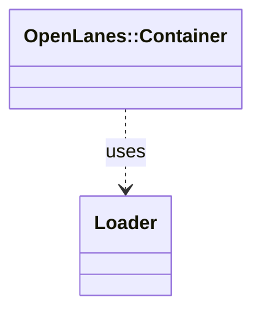

<!-- generated-by: bin/wiki-gen -->

# OpenLanes::Container

_The application's components, and the outside world they reach (A1)._

**Up:** [Engine and Runtime](Engine-and-Runtime.md)

______________________________________________________________________

## What the namespace says about itself

> The application's components, and the outside world they reach (A1).
>
> Two kinds of key:
>
> - **A dotted key is a class under `lib/openlanes/`**, keyed by its path:
>   `engine/upkeep/owed.rb` is `engine.upkeep.owed`. Collapsed directories
>   keep their place in the key (`support/clock.rb` is `support.clock`,
>   though the constant is `OpenLanes::Clock`), because the constant is
>   asked of {LOADER} rather than inflected from the key a second time.
> - **A bare key is a provider** from `lib/openlanes/providers/<key>.rb`:
>   `github`, `linear`, `redis`, `event_bus`, `logger`, `clock`, `process`.
>   Each hands out what the code builds by hand today, configured the same
>   way.
>
> Nothing is loaded ahead of use: a key is found, and its file loaded, the
> first time it is resolved. The suite finalizes the container with stubs
> enabled, so a spec swaps a component for the length of one example:
>
> @example
> OpenLanes::Container["github"] # a Vcs::GitHub
> OpenLanes::Container.stub("github", fake) { ... } # in a spec
> include OpenLanes::Deps["github", "clock"] # in a class

The doc comment on `OpenLanes::Container` in [`lib/openlanes/container.rb`](https://github.com/kigster/openlanes/blob/main/lib/openlanes/container.rb).

## Class diagram

Generated by `openlanes uml self` (`just update-architecture`) into [`docs/architecture/openlanes-container.md`](https://github.com/kigster/openlanes/blob/main/docs/architecture/openlanes-container.md). Dotted arrows are `uses`; classes from other namespaces are shown where this one depends on them.

______________________________________________________________________

## Sources

Generated by [`bin/wiki-gen`](https://github.com/kigster/openlanes/blob/main/bin/wiki-gen) v2.0.0 at the commit of 2026-11-07, from:

- [`lib/openlanes/container.rb`](https://github.com/kigster/openlanes/blob/main/lib/openlanes/container.rb)
- [`docs/architecture/openlanes-container.md`](https://github.com/kigster/openlanes/blob/main/docs/architecture/openlanes-container.md)
