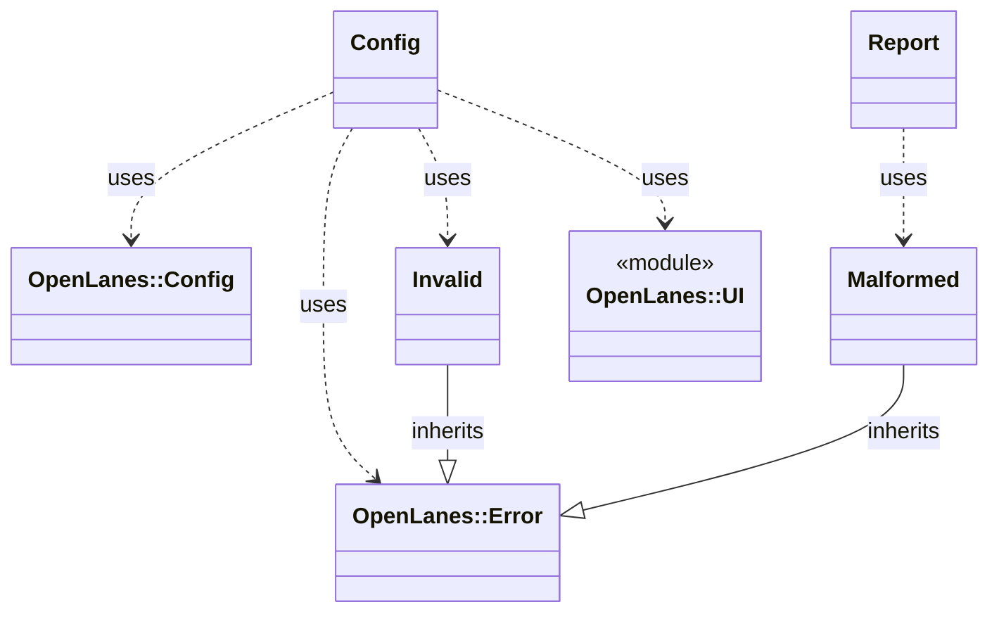

<!-- generated-by: bin/wiki-gen -->

# OpenLanes::Coverage

_A project's declared test coverage (decision M15), the `coverage:` section of its `.openlanes.yml`: which command runs the suite, where the line figure comes from, and the lowest one that may merge._

**Up:** [Developer Tooling](Developer-Tooling.md)

______________________________________________________________________

## What the namespace says about itself

> A project's declared test coverage (decision M15), the `coverage:`
> section of its `.openlanes.yml`: which command runs the suite, where the
> line figure comes from, and the lowest one that may merge.
>
> Pure, like {Plans}: it reads files and does arithmetic, and starts no
> process. Running either command belongs to {Engine::CoverageGate}, which
> is the only caller that turns a figure into a verdict.

The doc comment on `OpenLanes::Coverage` in [`lib/openlanes/coverage.rb`](https://github.com/kigster/openlanes/blob/main/lib/openlanes/coverage.rb).

## Class diagram

Generated by `openlanes uml self` (`just update-architecture`) into [`docs/architecture/openlanes-coverage.md`](https://github.com/kigster/openlanes/blob/main/docs/architecture/openlanes-coverage.md). Dotted arrows are `uses`; classes from other namespaces are shown where this one depends on them.

Before the 4.0 refactor

Frozen in [`docs/architecture/before/openlanes-coverage.md`](https://github.com/kigster/openlanes/blob/main/docs/architecture/before/openlanes-coverage.md), generated once from main at a80651d.

## Source files

- [`lib/openlanes/coverage/cobertura.rb`](https://github.com/kigster/openlanes/blob/main/lib/openlanes/coverage/cobertura.rb)
- [`lib/openlanes/coverage/config.rb`](https://github.com/kigster/openlanes/blob/main/lib/openlanes/coverage/config.rb)
- [`lib/openlanes/coverage/istanbul.rb`](https://github.com/kigster/openlanes/blob/main/lib/openlanes/coverage/istanbul.rb)
- [`lib/openlanes/coverage/lcov.rb`](https://github.com/kigster/openlanes/blob/main/lib/openlanes/coverage/lcov.rb)
- [`lib/openlanes/coverage/report.rb`](https://github.com/kigster/openlanes/blob/main/lib/openlanes/coverage/report.rb)
- [`lib/openlanes/coverage/simplecov.rb`](https://github.com/kigster/openlanes/blob/main/lib/openlanes/coverage/simplecov.rb)

______________________________________________________________________

## Sources

Generated by [`bin/wiki-gen`](https://github.com/kigster/openlanes/blob/main/bin/wiki-gen) v2.0.0 at the commit of 2026-11-07, from:

- [`lib/openlanes/coverage.rb`](https://github.com/kigster/openlanes/blob/main/lib/openlanes/coverage.rb)
- [`docs/architecture/openlanes-coverage.md`](https://github.com/kigster/openlanes/blob/main/docs/architecture/openlanes-coverage.md)
- [`docs/architecture/before/openlanes-coverage.md`](https://github.com/kigster/openlanes/blob/main/docs/architecture/before/openlanes-coverage.md)
