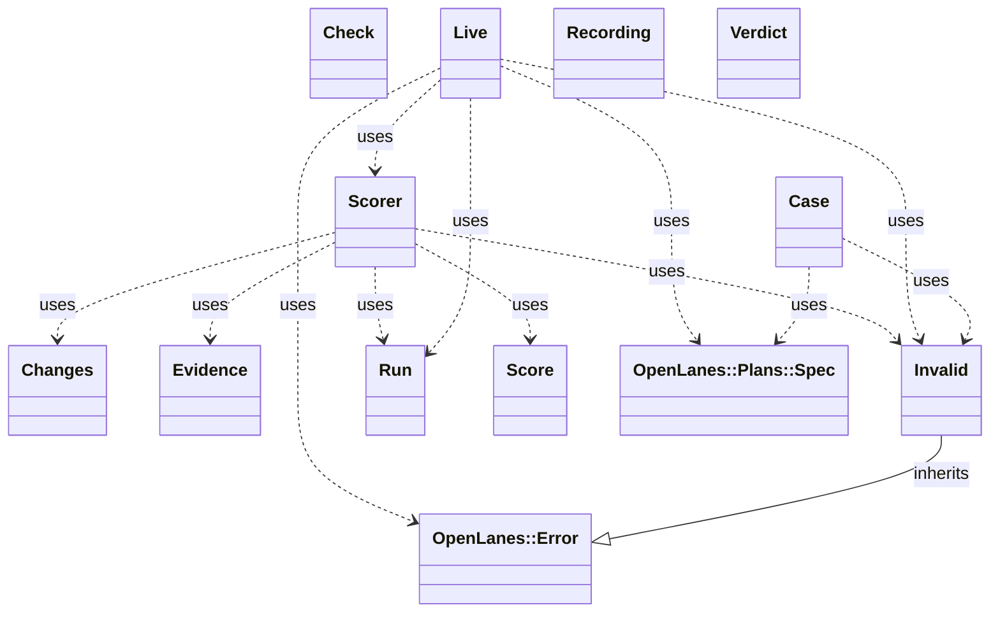

<!-- generated-by: bin/wiki-gen -->

# OpenLanes::Evals

_Per-agent evals: did the agent finish the task, and did it work at the depth it was asked for? A case (`evals/cases/<agent>/<id>.yml`) describes a fixture plan, the depth requested and the determinist…_

**Up:** [Developer Tooling](Developer-Tooling.md)

______________________________________________________________________

## What the namespace says about itself

> Per-agent evals: did the agent finish the task, and did it work at the
> depth it was asked for?
>
> A case (`evals/cases/<agent>/<id>.yml`) describes a fixture plan, the depth
> requested and the deterministic checks that hold an agent to both. Offline,
> the checks score recorded plan folders, a passing and a failing one per
> case, so the scorers are tested by the same corpus they score. Live, the
> agent runs in a throwaway repository under a token cap, and the folder it
> leaves behind is scored the same way.

The doc comment on `OpenLanes::Evals` in [`lib/openlanes/evals.rb`](https://github.com/kigster/openlanes/blob/main/lib/openlanes/evals.rb).

## Class diagram

Generated by `openlanes uml self` (`just update-architecture`) into [`docs/architecture/openlanes-evals.md`](https://github.com/kigster/openlanes/blob/main/docs/architecture/openlanes-evals.md). Dotted arrows are `uses`; classes from other namespaces are shown where this one depends on them.

Before the 4.0 refactor

Frozen in [`docs/architecture/before/openlanes-evals.md`](https://github.com/kigster/openlanes/blob/main/docs/architecture/before/openlanes-evals.md), generated once from main at a80651d.

## Source files

- [`lib/openlanes/evals/case.rb`](https://github.com/kigster/openlanes/blob/main/lib/openlanes/evals/case.rb)
- [`lib/openlanes/evals/changes.rb`](https://github.com/kigster/openlanes/blob/main/lib/openlanes/evals/changes.rb)
- [`lib/openlanes/evals/check.rb`](https://github.com/kigster/openlanes/blob/main/lib/openlanes/evals/check.rb)
- [`lib/openlanes/evals/evidence.rb`](https://github.com/kigster/openlanes/blob/main/lib/openlanes/evals/evidence.rb)
- [`lib/openlanes/evals/live.rb`](https://github.com/kigster/openlanes/blob/main/lib/openlanes/evals/live.rb)
- [`lib/openlanes/evals/recording.rb`](https://github.com/kigster/openlanes/blob/main/lib/openlanes/evals/recording.rb)
- [`lib/openlanes/evals/run.rb`](https://github.com/kigster/openlanes/blob/main/lib/openlanes/evals/run.rb)
- [`lib/openlanes/evals/score.rb`](https://github.com/kigster/openlanes/blob/main/lib/openlanes/evals/score.rb)
- [`lib/openlanes/evals/scorer.rb`](https://github.com/kigster/openlanes/blob/main/lib/openlanes/evals/scorer.rb)
- [`lib/openlanes/evals/verdict.rb`](https://github.com/kigster/openlanes/blob/main/lib/openlanes/evals/verdict.rb)

______________________________________________________________________

## Sources

Generated by [`bin/wiki-gen`](https://github.com/kigster/openlanes/blob/main/bin/wiki-gen) v2.0.0 at the commit of 2026-11-07, from:

- [`lib/openlanes/evals.rb`](https://github.com/kigster/openlanes/blob/main/lib/openlanes/evals.rb)
- [`docs/architecture/openlanes-evals.md`](https://github.com/kigster/openlanes/blob/main/docs/architecture/openlanes-evals.md)
- [`docs/architecture/before/openlanes-evals.md`](https://github.com/kigster/openlanes/blob/main/docs/architecture/before/openlanes-evals.md)
