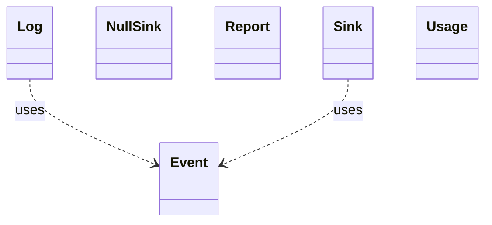

<!-- generated-by: bin/wiki-gen -->

# OpenLanes::Events

_The durable record of runs (plan 020.01): an opt-in, append-only JSONL log of run, agent, block/answer and PR events, kept outside the repo and outside Redis, and the aggregates read back from it._

**Up:** [Engine and Runtime](Engine-and-Runtime.md)

______________________________________________________________________

## What the namespace says about itself

> The durable record of runs (plan 020.01): an opt-in, append-only JSONL
> log of run, agent, block/answer and PR events, kept outside the repo and
> outside Redis, and the aggregates read back from it.
>
> Redis stays the live view. This is what is left after a run ends or
> Redis is flushed. It holds ids, timestamps, adapter, model and usage,
> and no prompt, transcript, answer or code (see {Event::PAYLOAD_KEYS}).

The doc comment on `OpenLanes::Events` in [`lib/openlanes/events.rb`](https://github.com/kigster/openlanes/blob/main/lib/openlanes/events.rb).

## Class diagram

Generated by `openlanes uml self` (`just update-architecture`) into [`docs/architecture/openlanes-events.md`](https://github.com/kigster/openlanes/blob/main/docs/architecture/openlanes-events.md). Dotted arrows are `uses`; classes from other namespaces are shown where this one depends on them.

Before the 4.0 refactor

Frozen in [`docs/architecture/before/openlanes-events.md`](https://github.com/kigster/openlanes/blob/main/docs/architecture/before/openlanes-events.md), generated once from main at a80651d.

## Source files

- [`lib/openlanes/events/event.rb`](https://github.com/kigster/openlanes/blob/main/lib/openlanes/events/event.rb)
- [`lib/openlanes/events/identity.rb`](https://github.com/kigster/openlanes/blob/main/lib/openlanes/events/identity.rb)
- [`lib/openlanes/events/location.rb`](https://github.com/kigster/openlanes/blob/main/lib/openlanes/events/location.rb)
- [`lib/openlanes/events/log.rb`](https://github.com/kigster/openlanes/blob/main/lib/openlanes/events/log.rb)
- [`lib/openlanes/events/null_sink.rb`](https://github.com/kigster/openlanes/blob/main/lib/openlanes/events/null_sink.rb)
- [`lib/openlanes/events/report.rb`](https://github.com/kigster/openlanes/blob/main/lib/openlanes/events/report.rb)
- [`lib/openlanes/events/sink.rb`](https://github.com/kigster/openlanes/blob/main/lib/openlanes/events/sink.rb)
- [`lib/openlanes/events/usage.rb`](https://github.com/kigster/openlanes/blob/main/lib/openlanes/events/usage.rb)

______________________________________________________________________

## Sources

Generated by [`bin/wiki-gen`](https://github.com/kigster/openlanes/blob/main/bin/wiki-gen) v2.0.0 at the commit of 2026-11-07, from:

- [`lib/openlanes/events.rb`](https://github.com/kigster/openlanes/blob/main/lib/openlanes/events.rb)
- [`docs/architecture/openlanes-events.md`](https://github.com/kigster/openlanes/blob/main/docs/architecture/openlanes-events.md)
- [`docs/architecture/before/openlanes-events.md`](https://github.com/kigster/openlanes/blob/main/docs/architecture/before/openlanes-events.md)
