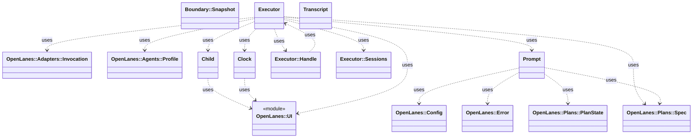

<!-- generated-by: bin/wiki-gen -->

# OpenLanes::Execution

_One agent invocation: the child process, its clock, the control file it polls, and the transcript it streams back._

**Up:** [Agents and Execution](Agents-and-Execution.md)

______________________________________________________________________

## What the namespace says about itself

> One agent invocation: the child process, its clock, the control file it
> polls, and the transcript it streams back. The autonomy boundary lives
> here, because this is the only place a coding agent is started.

The doc comment on `OpenLanes::Execution` in [`lib/openlanes/execution.rb`](https://github.com/kigster/openlanes/blob/main/lib/openlanes/execution.rb).

## Class diagram

Generated by `openlanes uml self` (`just update-architecture`) into [`docs/architecture/openlanes-execution.md`](https://github.com/kigster/openlanes/blob/main/docs/architecture/openlanes-execution.md). Dotted arrows are `uses`; classes from other namespaces are shown where this one depends on them.

```mermaid
classDiagram
  class OpenLanes__Adapters__Invocation["OpenLanes::Adapters::Invocation"]
  class OpenLanes__Agents__Dealing["OpenLanes::Agents::Dealing"]
  class OpenLanes__Agents__Profile["OpenLanes::Agents::Profile"]
  class OpenLanes__Agents__Registry["OpenLanes::Agents::Registry"]
  class OpenLanes__Config["OpenLanes::Config"]
  class OpenLanes__Error["OpenLanes::Error"]
  class OpenLanes__Execution__AgentProcess["AgentProcess"]
  class OpenLanes__Execution__AgentProcess__Registry["AgentProcess::Registry"]
  <<module>> OpenLanes__Execution__AgentProcess__Registry
  class OpenLanes__Execution__AgentSupervisor["AgentSupervisor"]
  class OpenLanes__Execution__Boundary__Snapshot["Boundary::Snapshot"]
  class OpenLanes__Execution__Child["Child"]
  class OpenLanes__Execution__Clock["Clock"]
  class OpenLanes__Execution__Executor["Executor"]
  class OpenLanes__Execution__Executor__Handle["Executor::Handle"]
  class OpenLanes__Execution__Executor__Sessions["Executor::Sessions"]
  class OpenLanes__Execution__Prompt["Prompt"]
  class OpenLanes__Execution__Rearm["Rearm"]
  class OpenLanes__Execution__Transcript["Transcript"]
  class OpenLanes__Plans__PlanState["OpenLanes::Plans::PlanState"]
  class OpenLanes__Plans__Spec["OpenLanes::Plans::Spec"]
  class OpenLanes__UI["OpenLanes::UI"]
  <<module>> OpenLanes__UI
  OpenLanes__Execution__AgentProcess ..|> OpenLanes__Execution__AgentProcess__Registry : includes
  OpenLanes__Execution__AgentProcess ..> OpenLanes__Execution__AgentSupervisor : uses
  OpenLanes__Execution__AgentProcess ..> OpenLanes__Execution__Child : uses
  OpenLanes__Execution__Child ..> OpenLanes__UI : uses
  OpenLanes__Execution__Executor ..> OpenLanes__Adapters__Invocation : uses
  OpenLanes__Execution__Executor ..> OpenLanes__Agents__Dealing : uses
  OpenLanes__Execution__Executor ..> OpenLanes__Agents__Profile : uses
  OpenLanes__Execution__Executor ..> OpenLanes__Execution__AgentProcess : uses
  OpenLanes__Execution__Executor ..> OpenLanes__Execution__Boundary__Snapshot : uses
  OpenLanes__Execution__Executor ..> OpenLanes__Execution__Clock : uses
  OpenLanes__Execution__Executor ..> OpenLanes__Execution__Executor__Handle : uses
  OpenLanes__Execution__Executor ..> OpenLanes__Execution__Executor__Sessions : uses
  OpenLanes__Execution__Executor ..> OpenLanes__Execution__Prompt : uses
  OpenLanes__Execution__Executor ..> OpenLanes__Execution__Rearm : uses
  OpenLanes__Execution__Executor ..> OpenLanes__Plans__Spec : uses
  OpenLanes__Execution__Executor ..> OpenLanes__UI : uses
  OpenLanes__Execution__Executor__Handle ..> OpenLanes__Execution__Executor : uses
  OpenLanes__Execution__Prompt ..> OpenLanes__Agents__Registry : uses
  OpenLanes__Execution__Prompt ..> OpenLanes__Config : uses
  OpenLanes__Execution__Prompt ..> OpenLanes__Error : uses
  OpenLanes__Execution__Prompt ..> OpenLanes__Plans__PlanState : uses
  OpenLanes__Execution__Prompt ..> OpenLanes__Plans__Spec : uses
```

Before the 4.0 refactor

Frozen in [`docs/architecture/before/openlanes-execution.md`](https://github.com/kigster/openlanes/blob/main/docs/architecture/before/openlanes-execution.md), generated once from main at a80651d.

## Source files

- [`lib/openlanes/execution/agent_process.rb`](https://github.com/kigster/openlanes/blob/main/lib/openlanes/execution/agent_process.rb)
- [`lib/openlanes/execution/agent_process/exit_status.rb`](https://github.com/kigster/openlanes/blob/main/lib/openlanes/execution/agent_process/exit_status.rb)
- [`lib/openlanes/execution/agent_process/files.rb`](https://github.com/kigster/openlanes/blob/main/lib/openlanes/execution/agent_process/files.rb)
- [`lib/openlanes/execution/agent_process/label.rb`](https://github.com/kigster/openlanes/blob/main/lib/openlanes/execution/agent_process/label.rb)
- [`lib/openlanes/execution/agent_process/registry.rb`](https://github.com/kigster/openlanes/blob/main/lib/openlanes/execution/agent_process/registry.rb)
- [`lib/openlanes/execution/agent_process/starter.rb`](https://github.com/kigster/openlanes/blob/main/lib/openlanes/execution/agent_process/starter.rb)
- [`lib/openlanes/execution/agent_supervisor.rb`](https://github.com/kigster/openlanes/blob/main/lib/openlanes/execution/agent_supervisor.rb)
- [`lib/openlanes/execution/agent_supervisor/records.rb`](https://github.com/kigster/openlanes/blob/main/lib/openlanes/execution/agent_supervisor/records.rb)
- [`lib/openlanes/execution/boundary.rb`](https://github.com/kigster/openlanes/blob/main/lib/openlanes/execution/boundary.rb)
- [`lib/openlanes/execution/checks.rb`](https://github.com/kigster/openlanes/blob/main/lib/openlanes/execution/checks.rb)
- [`lib/openlanes/execution/child.rb`](https://github.com/kigster/openlanes/blob/main/lib/openlanes/execution/child.rb)
- [`lib/openlanes/execution/clock.rb`](https://github.com/kigster/openlanes/blob/main/lib/openlanes/execution/clock.rb)
- [`lib/openlanes/execution/control.rb`](https://github.com/kigster/openlanes/blob/main/lib/openlanes/execution/control.rb)
- [`lib/openlanes/execution/executor.rb`](https://github.com/kigster/openlanes/blob/main/lib/openlanes/execution/executor.rb)
- [`lib/openlanes/execution/process_start.rb`](https://github.com/kigster/openlanes/blob/main/lib/openlanes/execution/process_start.rb)
- [`lib/openlanes/execution/prompt.rb`](https://github.com/kigster/openlanes/blob/main/lib/openlanes/execution/prompt.rb)
- [`lib/openlanes/execution/rearm.rb`](https://github.com/kigster/openlanes/blob/main/lib/openlanes/execution/rearm.rb)
- [`lib/openlanes/execution/shutdown_grace.rb`](https://github.com/kigster/openlanes/blob/main/lib/openlanes/execution/shutdown_grace.rb)
- [`lib/openlanes/execution/transcript.rb`](https://github.com/kigster/openlanes/blob/main/lib/openlanes/execution/transcript.rb)

______________________________________________________________________

## Sources

Generated by [`bin/wiki-gen`](https://github.com/kigster/openlanes/blob/main/bin/wiki-gen) v2.0.0 at the commit of 2026-11-07, from:

- [`lib/openlanes/execution.rb`](https://github.com/kigster/openlanes/blob/main/lib/openlanes/execution.rb)
- [`docs/architecture/openlanes-execution.md`](https://github.com/kigster/openlanes/blob/main/docs/architecture/openlanes-execution.md)
- [`docs/architecture/before/openlanes-execution.md`](https://github.com/kigster/openlanes/blob/main/docs/architecture/before/openlanes-execution.md)
