<!-- generated-by: bin/wiki-gen -->

# OpenLanes::Lifecycle

_Operations that change which plans exist or what they are called: minting a folder, drafting its brief, adopting an orphan pull request, reconciling names with contents, draining answered questions, a…_

**Up:** [Plan Model](Plan-Model.md)

______________________________________________________________________

## What the namespace says about itself

> Operations that change which plans exist or what they are called:
> minting a folder, drafting its brief, adopting an orphan pull request,
> reconciling names with contents, draining answered questions, and
> aging the ones nobody answers.

The doc comment on `OpenLanes::Lifecycle` in [`lib/openlanes/lifecycle.rb`](https://github.com/kigster/openlanes/blob/main/lib/openlanes/lifecycle.rb).

## Class diagram

Generated by `openlanes uml self` (`just update-architecture`) into [`docs/architecture/openlanes-lifecycle.md`](https://github.com/kigster/openlanes/blob/main/docs/architecture/openlanes-lifecycle.md). Dotted arrows are `uses`; classes from other namespaces are shown where this one depends on them.

```mermaid
classDiagram
  class OpenLanes__Error["OpenLanes::Error"]
  class OpenLanes__Events__NullSink["OpenLanes::Events::NullSink"]
  class OpenLanes__Lifecycle__Adoption["Adoption"]
  class OpenLanes__Lifecycle__Aging["Aging"]
  class OpenLanes__Lifecycle__Allocator["Allocator"]
  class OpenLanes__Lifecycle__Allocator__Refused["Allocator::Refused"]
  class OpenLanes__Lifecycle__Brief["Brief"]
  class OpenLanes__Lifecycle__CreateWorkflow["CreateWorkflow"]
  class OpenLanes__Lifecycle__Creator["Creator"]
  class OpenLanes__Lifecycle__ReasonInterview["ReasonInterview"]
  class OpenLanes__Lifecycle__Removal["Removal"]
  class OpenLanes__Lifecycle__Resync__Dirs["Resync::Dirs"]
  class OpenLanes__Lifecycle__Resync__Prs["Resync::Prs"]
  class OpenLanes__Lifecycle__Rewiring["Rewiring"]
  class OpenLanes__Lifecycle__UnblockWorkflow["UnblockWorkflow"]
  class OpenLanes__Lifecycle__Unblocker["Unblocker"]
  class OpenLanes__Plans__Dependencies["OpenLanes::Plans::Dependencies"]
  class OpenLanes__Plans__Feature["OpenLanes::Plans::Feature"]
  class OpenLanes__Plans__Journal__Entry["OpenLanes::Plans::Journal::Entry"]
  class OpenLanes__Plans__Lock["OpenLanes::Plans::Lock"]
  class OpenLanes__Plans__Ordinal["OpenLanes::Plans::Ordinal"]
  class OpenLanes__Plans__PlanState["OpenLanes::Plans::PlanState"]
  class OpenLanes__Plans__PullRequests["OpenLanes::Plans::PullRequests"]
  class OpenLanes__Plans__Spec["OpenLanes::Plans::Spec"]
  class OpenLanes__Plans__StateMachine["OpenLanes::Plans::StateMachine"]
  class OpenLanes__Plans__StateMachine__Refused["OpenLanes::Plans::StateMachine::Refused"]
  class OpenLanes__Plans__Tree["OpenLanes::Plans::Tree"]
  class OpenLanes__Refusal["OpenLanes::Refusal"]
  class OpenLanes__UI["OpenLanes::UI"]
  <<module>> OpenLanes__UI
  class OpenLanes__Vcs__GitHub["OpenLanes::Vcs::GitHub"]
  OpenLanes__Lifecycle__Adoption ..> OpenLanes__Error : uses
  OpenLanes__Lifecycle__Adoption ..> OpenLanes__Lifecycle__Allocator : uses
  OpenLanes__Lifecycle__Adoption ..> OpenLanes__Lifecycle__Creator : uses
  OpenLanes__Lifecycle__Adoption ..> OpenLanes__Plans__Ordinal : uses
  OpenLanes__Lifecycle__Adoption ..> OpenLanes__Plans__PullRequests : uses
  OpenLanes__Lifecycle__Adoption ..> OpenLanes__Plans__Tree : uses
  OpenLanes__Lifecycle__Adoption ..> OpenLanes__UI : uses
  OpenLanes__Lifecycle__Adoption ..> OpenLanes__Vcs__GitHub : uses
  OpenLanes__Lifecycle__Aging ..> OpenLanes__Plans__Dependencies : uses
  OpenLanes__Lifecycle__Aging ..> OpenLanes__Plans__PlanState : uses
  OpenLanes__Lifecycle__Aging ..> OpenLanes__Plans__StateMachine__Refused : uses
  OpenLanes__Lifecycle__Aging ..> OpenLanes__UI : uses
  OpenLanes__Lifecycle__Allocator ..> OpenLanes__Error : uses
  OpenLanes__Lifecycle__Allocator ..> OpenLanes__Lifecycle__Allocator__Refused : uses
  OpenLanes__Lifecycle__Allocator ..> OpenLanes__Plans__Tree : uses
  OpenLanes__Lifecycle__Allocator__Refused --|> OpenLanes__Error : inherits
  OpenLanes__Lifecycle__Brief ..> OpenLanes__Lifecycle__Allocator : uses
  OpenLanes__Lifecycle__CreateWorkflow ..> OpenLanes__Error : uses
  OpenLanes__Lifecycle__CreateWorkflow ..> OpenLanes__Lifecycle__Brief : uses
  OpenLanes__Lifecycle__CreateWorkflow ..> OpenLanes__Plans__Feature : uses
  OpenLanes__Lifecycle__CreateWorkflow ..> OpenLanes__Refusal : uses
  OpenLanes__Lifecycle__CreateWorkflow ..|> OpenLanes__UI : includes
  OpenLanes__Lifecycle__CreateWorkflow ..> OpenLanes__Vcs__GitHub : uses
  OpenLanes__Lifecycle__Creator ..> OpenLanes__Error : uses
  OpenLanes__Lifecycle__Creator ..> OpenLanes__Lifecycle__Allocator : uses
  OpenLanes__Lifecycle__Creator ..> OpenLanes__Plans__Ordinal : uses
  OpenLanes__Lifecycle__Creator ..> OpenLanes__Plans__PlanState : uses
  OpenLanes__Lifecycle__Creator ..> OpenLanes__Plans__PullRequests : uses
  OpenLanes__Lifecycle__Removal ..> OpenLanes__Lifecycle__Resync__Dirs : uses
  OpenLanes__Lifecycle__Removal ..> OpenLanes__Lifecycle__Rewiring : uses
  OpenLanes__Lifecycle__Removal ..> OpenLanes__Plans__Lock : uses
  OpenLanes__Lifecycle__Removal ..> OpenLanes__Plans__StateMachine : uses
  OpenLanes__Lifecycle__Resync__Dirs ..> OpenLanes__Error : uses
  OpenLanes__Lifecycle__Resync__Dirs ..> OpenLanes__Lifecycle__Rewiring : uses
  OpenLanes__Lifecycle__Resync__Dirs ..> OpenLanes__Plans__Lock : uses
  OpenLanes__Lifecycle__Resync__Dirs ..> OpenLanes__Plans__Ordinal : uses
  OpenLanes__Lifecycle__Resync__Dirs ..> OpenLanes__Plans__PlanState : uses
  OpenLanes__Lifecycle__Resync__Dirs ..> OpenLanes__Plans__Spec : uses
  OpenLanes__Lifecycle__Resync__Dirs ..> OpenLanes__Plans__Tree : uses
  OpenLanes__Lifecycle__Resync__Dirs ..> OpenLanes__UI : uses
  OpenLanes__Lifecycle__Resync__Prs ..> OpenLanes__Lifecycle__Adoption : uses
  OpenLanes__Lifecycle__Resync__Prs ..> OpenLanes__Plans__Ordinal : uses
  OpenLanes__Lifecycle__Resync__Prs ..> OpenLanes__Plans__Tree : uses
  OpenLanes__Lifecycle__Resync__Prs ..> OpenLanes__UI : uses
  OpenLanes__Lifecycle__Resync__Prs ..> OpenLanes__Vcs__GitHub : uses
  OpenLanes__Lifecycle__Rewiring ..> OpenLanes__Plans__Dependencies : uses
  OpenLanes__Lifecycle__Rewiring ..> OpenLanes__Plans__Spec : uses
  OpenLanes__Lifecycle__Rewiring ..> OpenLanes__UI : uses
  OpenLanes__Lifecycle__UnblockWorkflow ..> OpenLanes__Lifecycle__Unblocker : uses
  OpenLanes__Lifecycle__UnblockWorkflow ..> OpenLanes__Refusal : uses
  OpenLanes__Lifecycle__UnblockWorkflow ..|> OpenLanes__UI : includes
  OpenLanes__Lifecycle__Unblocker ..> OpenLanes__Error : uses
  OpenLanes__Lifecycle__Unblocker ..> OpenLanes__Events__NullSink : uses
  OpenLanes__Lifecycle__Unblocker ..> OpenLanes__Lifecycle__Resync__Dirs : uses
  OpenLanes__Lifecycle__Unblocker ..> OpenLanes__Plans__Journal__Entry : uses
  OpenLanes__Lifecycle__Unblocker ..> OpenLanes__Plans__PlanState : uses
  OpenLanes__Lifecycle__Unblocker ..> OpenLanes__UI : uses
```

Before the 4.0 refactor

Frozen in [`docs/architecture/before/openlanes-lifecycle.md`](https://github.com/kigster/openlanes/blob/main/docs/architecture/before/openlanes-lifecycle.md), generated once from main at a80651d.

```mermaid
classDiagram
  class OpenLanes__Error["OpenLanes::Error"]
  class OpenLanes__Events__NullSink["OpenLanes::Events::NullSink"]
  class OpenLanes__Lifecycle__Adoption["Adoption"]
  class OpenLanes__Lifecycle__Aging["Aging"]
  class OpenLanes__Lifecycle__Allocator["Allocator"]
  class OpenLanes__Lifecycle__Allocator__Refused["Allocator::Refused"]
  class OpenLanes__Lifecycle__Brief["Brief"]
  class OpenLanes__Lifecycle__CreateWorkflow["CreateWorkflow"]
  class OpenLanes__Lifecycle__Creator["Creator"]
  class OpenLanes__Lifecycle__Linker["Linker"]
  class OpenLanes__Lifecycle__Resync__Dirs["Resync::Dirs"]
  class OpenLanes__Lifecycle__Resync__Prs["Resync::Prs"]
  class OpenLanes__Lifecycle__UnblockWorkflow["UnblockWorkflow"]
  class OpenLanes__Lifecycle__Unblocker["Unblocker"]
  class OpenLanes__Plans__Dependencies["OpenLanes::Plans::Dependencies"]
  class OpenLanes__Plans__Feature["OpenLanes::Plans::Feature"]
  class OpenLanes__Plans__Journal__Entry["OpenLanes::Plans::Journal::Entry"]
  class OpenLanes__Plans__Lock["OpenLanes::Plans::Lock"]
  class OpenLanes__Plans__Ordinal["OpenLanes::Plans::Ordinal"]
  class OpenLanes__Plans__PlanState["OpenLanes::Plans::PlanState"]
  class OpenLanes__Plans__PullRequests["OpenLanes::Plans::PullRequests"]
  class OpenLanes__Plans__Spec["OpenLanes::Plans::Spec"]
  class OpenLanes__Plans__StateMachine__Refused["OpenLanes::Plans::StateMachine::Refused"]
  class OpenLanes__Plans__Tree["OpenLanes::Plans::Tree"]
  class OpenLanes__Refusal["OpenLanes::Refusal"]
  class OpenLanes__UI["OpenLanes::UI"]
  <<module>> OpenLanes__UI
  class OpenLanes__Vcs__GitHub["OpenLanes::Vcs::GitHub"]
  OpenLanes__Lifecycle__Adoption ..> OpenLanes__Error : uses
  OpenLanes__Lifecycle__Adoption ..> OpenLanes__Lifecycle__Allocator : uses
  OpenLanes__Lifecycle__Adoption ..> OpenLanes__Lifecycle__Creator : uses
  OpenLanes__Lifecycle__Adoption ..> OpenLanes__Plans__Ordinal : uses
  OpenLanes__Lifecycle__Adoption ..> OpenLanes__Plans__PullRequests : uses
  OpenLanes__Lifecycle__Adoption ..> OpenLanes__Plans__Tree : uses
  OpenLanes__Lifecycle__Adoption ..> OpenLanes__UI : uses
  OpenLanes__Lifecycle__Adoption ..> OpenLanes__Vcs__GitHub : uses
  OpenLanes__Lifecycle__Aging ..> OpenLanes__Plans__Dependencies : uses
  OpenLanes__Lifecycle__Aging ..> OpenLanes__Plans__PlanState : uses
  OpenLanes__Lifecycle__Aging ..> OpenLanes__Plans__StateMachine__Refused : uses
  OpenLanes__Lifecycle__Aging ..> OpenLanes__UI : uses
  OpenLanes__Lifecycle__Allocator ..> OpenLanes__Error : uses
  OpenLanes__Lifecycle__Allocator ..> OpenLanes__Lifecycle__Allocator__Refused : uses
  OpenLanes__Lifecycle__Allocator ..> OpenLanes__Plans__Tree : uses
  OpenLanes__Lifecycle__Allocator__Refused --|> OpenLanes__Error : inherits
  OpenLanes__Lifecycle__Brief ..> OpenLanes__Lifecycle__Allocator : uses
  OpenLanes__Lifecycle__CreateWorkflow ..> OpenLanes__Error : uses
  OpenLanes__Lifecycle__CreateWorkflow ..> OpenLanes__Lifecycle__Brief : uses
  OpenLanes__Lifecycle__CreateWorkflow ..> OpenLanes__Plans__Feature : uses
  OpenLanes__Lifecycle__CreateWorkflow ..> OpenLanes__Refusal : uses
  OpenLanes__Lifecycle__CreateWorkflow ..|> OpenLanes__UI : includes
  OpenLanes__Lifecycle__CreateWorkflow ..> OpenLanes__Vcs__GitHub : uses
  OpenLanes__Lifecycle__Creator ..> OpenLanes__Error : uses
  OpenLanes__Lifecycle__Creator ..> OpenLanes__Lifecycle__Allocator : uses
  OpenLanes__Lifecycle__Creator ..> OpenLanes__Plans__Ordinal : uses
  OpenLanes__Lifecycle__Creator ..> OpenLanes__Plans__PlanState : uses
  OpenLanes__Lifecycle__Creator ..> OpenLanes__Plans__PullRequests : uses
  OpenLanes__Lifecycle__Linker ..> OpenLanes__Error : uses
  OpenLanes__Lifecycle__Linker ..> OpenLanes__Plans__Dependencies : uses
  OpenLanes__Lifecycle__Linker ..> OpenLanes__Plans__Ordinal : uses
  OpenLanes__Lifecycle__Linker ..> OpenLanes__Plans__Spec : uses
  OpenLanes__Lifecycle__Resync__Dirs ..> OpenLanes__Error : uses
  OpenLanes__Lifecycle__Resync__Dirs ..> OpenLanes__Plans__Lock : uses
  OpenLanes__Lifecycle__Resync__Dirs ..> OpenLanes__Plans__PlanState : uses
  OpenLanes__Lifecycle__Resync__Dirs ..> OpenLanes__Plans__Spec : uses
  OpenLanes__Lifecycle__Resync__Dirs ..> OpenLanes__Plans__Tree : uses
  OpenLanes__Lifecycle__Resync__Dirs ..> OpenLanes__UI : uses
  OpenLanes__Lifecycle__Resync__Prs ..> OpenLanes__Lifecycle__Adoption : uses
  OpenLanes__Lifecycle__Resync__Prs ..> OpenLanes__Plans__Ordinal : uses
  OpenLanes__Lifecycle__Resync__Prs ..> OpenLanes__Plans__Tree : uses
  OpenLanes__Lifecycle__Resync__Prs ..> OpenLanes__UI : uses
  OpenLanes__Lifecycle__Resync__Prs ..> OpenLanes__Vcs__GitHub : uses
  OpenLanes__Lifecycle__UnblockWorkflow ..> OpenLanes__Lifecycle__Unblocker : uses
  OpenLanes__Lifecycle__UnblockWorkflow ..> OpenLanes__Refusal : uses
  OpenLanes__Lifecycle__UnblockWorkflow ..|> OpenLanes__UI : includes
  OpenLanes__Lifecycle__Unblocker ..> OpenLanes__Error : uses
  OpenLanes__Lifecycle__Unblocker ..> OpenLanes__Events__NullSink : uses
  OpenLanes__Lifecycle__Unblocker ..> OpenLanes__Lifecycle__Resync__Dirs : uses
  OpenLanes__Lifecycle__Unblocker ..> OpenLanes__Plans__Journal__Entry : uses
  OpenLanes__Lifecycle__Unblocker ..> OpenLanes__Plans__PlanState : uses
  OpenLanes__Lifecycle__Unblocker ..> OpenLanes__UI : uses
```

## Source files

- [`lib/openlanes/lifecycle/adoption.rb`](https://github.com/kigster/openlanes/blob/main/lib/openlanes/lifecycle/adoption.rb)
- [`lib/openlanes/lifecycle/aging.rb`](https://github.com/kigster/openlanes/blob/main/lib/openlanes/lifecycle/aging.rb)
- [`lib/openlanes/lifecycle/aging_note.rb`](https://github.com/kigster/openlanes/blob/main/lib/openlanes/lifecycle/aging_note.rb)
- [`lib/openlanes/lifecycle/allocator.rb`](https://github.com/kigster/openlanes/blob/main/lib/openlanes/lifecycle/allocator.rb)
- [`lib/openlanes/lifecycle/brief.rb`](https://github.com/kigster/openlanes/blob/main/lib/openlanes/lifecycle/brief.rb)
- [`lib/openlanes/lifecycle/completion.rb`](https://github.com/kigster/openlanes/blob/main/lib/openlanes/lifecycle/completion.rb)
- [`lib/openlanes/lifecycle/create_workflow.rb`](https://github.com/kigster/openlanes/blob/main/lib/openlanes/lifecycle/create_workflow.rb)
- [`lib/openlanes/lifecycle/creator.rb`](https://github.com/kigster/openlanes/blob/main/lib/openlanes/lifecycle/creator.rb)
- [`lib/openlanes/lifecycle/lanes.rb`](https://github.com/kigster/openlanes/blob/main/lib/openlanes/lifecycle/lanes.rb)
- [`lib/openlanes/lifecycle/reason_interview.rb`](https://github.com/kigster/openlanes/blob/main/lib/openlanes/lifecycle/reason_interview.rb)
- [`lib/openlanes/lifecycle/removal.rb`](https://github.com/kigster/openlanes/blob/main/lib/openlanes/lifecycle/removal.rb)
- [`lib/openlanes/lifecycle/resync.rb`](https://github.com/kigster/openlanes/blob/main/lib/openlanes/lifecycle/resync.rb)
- [`lib/openlanes/lifecycle/rewiring.rb`](https://github.com/kigster/openlanes/blob/main/lib/openlanes/lifecycle/rewiring.rb)
- [`lib/openlanes/lifecycle/unblock_workflow.rb`](https://github.com/kigster/openlanes/blob/main/lib/openlanes/lifecycle/unblock_workflow.rb)
- [`lib/openlanes/lifecycle/unblocker.rb`](https://github.com/kigster/openlanes/blob/main/lib/openlanes/lifecycle/unblocker.rb)

______________________________________________________________________

## Sources

Generated by [`bin/wiki-gen`](https://github.com/kigster/openlanes/blob/main/bin/wiki-gen) v2.0.0 at the commit of 2026-11-07, from:

- [`lib/openlanes/lifecycle.rb`](https://github.com/kigster/openlanes/blob/main/lib/openlanes/lifecycle.rb)
- [`docs/architecture/openlanes-lifecycle.md`](https://github.com/kigster/openlanes/blob/main/docs/architecture/openlanes-lifecycle.md)
- [`docs/architecture/before/openlanes-lifecycle.md`](https://github.com/kigster/openlanes/blob/main/docs/architecture/before/openlanes-lifecycle.md)
