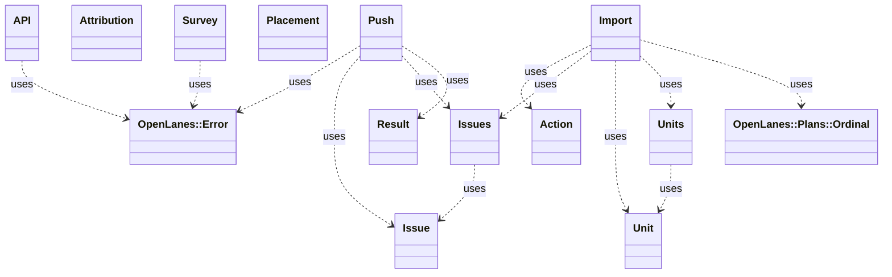

<!-- generated-by: bin/wiki-gen -->

# OpenLanes::Linear

_`.plans` as Linear projects and issues. The folders already are a tracker: a number, a state, a set of pull requests and a document saying why._

**Up:** [Integrations](Integrations.md)

______________________________________________________________________

## What the namespace says about itself

> `.plans` as Linear projects and issues.
>
> The folders already are a tracker: a number, a state, a set of pull
> requests and a document saying why. What they are not is visible to anyone
> who does not have the repository checked out, which is most of the people
> who want to know how a piece of work is going. This exports to Linear so
> that audience can see it, and it exports *one way* — the folder is the
> truth, Linear is the window.
>
> Four pieces, in the order a run uses them:
>
> {Units} reads `plan.md` and finds the work units inside a plan
> {Import} decides, from disk alone, what would be created or updated
> {Push} applies that through {API} and records what it did
> {Issues} is the record, `linear.md`, that makes the next run idempotent
>
> {Import} touches nothing but the filesystem, which is what makes the dry
> run trustworthy: it is not a description of what a push would do, it is
> the object the push consumes.

The doc comment on `OpenLanes::Linear` in [`lib/openlanes/linear.rb`](https://github.com/kigster/openlanes/blob/main/lib/openlanes/linear.rb).

## Class diagram

Generated by `openlanes uml self` (`just update-architecture`) into [`docs/architecture/openlanes-linear.md`](https://github.com/kigster/openlanes/blob/main/docs/architecture/openlanes-linear.md). Dotted arrows are `uses`; classes from other namespaces are shown where this one depends on them.

Before the 4.0 refactor

Frozen in [`docs/architecture/before/openlanes-linear.md`](https://github.com/kigster/openlanes/blob/main/docs/architecture/before/openlanes-linear.md), generated once from main at a80651d.

## Source files

- [`lib/openlanes/linear/api.rb`](https://github.com/kigster/openlanes/blob/main/lib/openlanes/linear/api.rb)
- [`lib/openlanes/linear/attribution.rb`](https://github.com/kigster/openlanes/blob/main/lib/openlanes/linear/attribution.rb)
- [`lib/openlanes/linear/fuzzy.rb`](https://github.com/kigster/openlanes/blob/main/lib/openlanes/linear/fuzzy.rb)
- [`lib/openlanes/linear/import.rb`](https://github.com/kigster/openlanes/blob/main/lib/openlanes/linear/import.rb)
- [`lib/openlanes/linear/issue.rb`](https://github.com/kigster/openlanes/blob/main/lib/openlanes/linear/issue.rb)
- [`lib/openlanes/linear/mapping.rb`](https://github.com/kigster/openlanes/blob/main/lib/openlanes/linear/mapping.rb)
- [`lib/openlanes/linear/push.rb`](https://github.com/kigster/openlanes/blob/main/lib/openlanes/linear/push.rb)
- [`lib/openlanes/linear/survey.rb`](https://github.com/kigster/openlanes/blob/main/lib/openlanes/linear/survey.rb)
- [`lib/openlanes/linear/unit.rb`](https://github.com/kigster/openlanes/blob/main/lib/openlanes/linear/unit.rb)

______________________________________________________________________

## Sources

Generated by [`bin/wiki-gen`](https://github.com/kigster/openlanes/blob/main/bin/wiki-gen) v2.0.0 at the commit of 2026-11-07, from:

- [`lib/openlanes/linear.rb`](https://github.com/kigster/openlanes/blob/main/lib/openlanes/linear.rb)
- [`docs/architecture/openlanes-linear.md`](https://github.com/kigster/openlanes/blob/main/docs/architecture/openlanes-linear.md)
- [`docs/architecture/before/openlanes-linear.md`](https://github.com/kigster/openlanes/blob/main/docs/architecture/before/openlanes-linear.md)
