<!-- generated-by: bin/wiki-gen -->

# OpenLanes::Live

_The live run in Redis (plan 004): the engine publishes its board there and reads the page's commands from there, and machines sharing one Redis see each other's boards and never take each other's plan…_

**Up:** [Engine and Runtime](Engine-and-Runtime.md)

______________________________________________________________________

## What the namespace says about itself

> The live run in Redis (plan 004): the engine publishes its board there
> and reads the page's commands from there, and machines sharing one Redis
> see each other's boards and never take each other's plans (W6, W13, W26).
>
> The engine builds a {Session}. The API server reads boards with {.board},
> queues commands with {.enqueue} and follows answers with {.replies}, all
> over the same {Keys}, so neither side spells a key.

The doc comment on `OpenLanes::Live` in [`lib/openlanes/live.rb`](https://github.com/kigster/openlanes/blob/main/lib/openlanes/live.rb).

## Class diagram

Generated by `openlanes uml self` (`just update-architecture`) into [`docs/architecture/openlanes-live.md`](https://github.com/kigster/openlanes/blob/main/docs/architecture/openlanes-live.md). Dotted arrows are `uses`; classes from other namespaces are shown where this one depends on them.

```mermaid
classDiagram
  class OpenLanes__Adapters__Availability["OpenLanes::Adapters::Availability"]
  class OpenLanes__Adapters__Invocation["OpenLanes::Adapters::Invocation"]
  class OpenLanes__Adapters__Probes["OpenLanes::Adapters::Probes"]
  class OpenLanes__Agents__Profile["OpenLanes::Agents::Profile"]
  class OpenLanes__Config["OpenLanes::Config"]
  class OpenLanes__Engine__Board["OpenLanes::Engine::Board"]
  class OpenLanes__Engine__Extensions["OpenLanes::Engine::Extensions"]
  class OpenLanes__Error["OpenLanes::Error"]
  class OpenLanes__Execution__Child["OpenLanes::Execution::Child"]
  class OpenLanes__Execution__Executor["OpenLanes::Execution::Executor"]
  class OpenLanes__Lifecycle__Aging["OpenLanes::Lifecycle::Aging"]
  class OpenLanes__Lifecycle__Creator["OpenLanes::Lifecycle::Creator"]
  class OpenLanes__Lifecycle__Unblocker["OpenLanes::Lifecycle::Unblocker"]
  class OpenLanes__Live__Chat["Chat"]
  class OpenLanes__Live__Chat__Invalid["Chat::Invalid"]
  class OpenLanes__Live__Chat__Settled["Chat::Settled"]
  class OpenLanes__Live__ChoiceConverter["ChoiceConverter"]
  class OpenLanes__Live__ChoiceConverter__Invalid["ChoiceConverter::Invalid"]
  class OpenLanes__Live__ChoiceJudge["ChoiceJudge"]
  class OpenLanes__Live__Claims["Claims"]
  class OpenLanes__Live__Command["Command"]
  class OpenLanes__Live__Command__Invalid["Command::Invalid"]
  class OpenLanes__Live__Commands["Commands"]
  class OpenLanes__Live__Commands__Refusal["Commands::Refusal"]
  class OpenLanes__Live__Copilot["Copilot"]
  class OpenLanes__Live__Copilot__Brief["Copilot::Brief"]
  class OpenLanes__Live__Copilot__Invalid["Copilot::Invalid"]
  class OpenLanes__Live__Copilot__Operator["Copilot::Operator"]
  class OpenLanes__Live__Copilot__Slash__Help["Copilot::Slash::Help"]
  class OpenLanes__Live__Copilot__Turn["Copilot::Turn"]
  class OpenLanes__Live__Copilot__Unanswered["Copilot::Unanswered"]
  class OpenLanes__Live__EventBus__Base["EventBus::Base"]
  class OpenLanes__Live__EventBus__MemoryBus["EventBus::MemoryBus"]
  class OpenLanes__Live__EventBus__RedisBus["EventBus::RedisBus"]
  class OpenLanes__Live__EventBus__Transaction["EventBus::Transaction"]
  class OpenLanes__Live__GroupMissing["GroupMissing"]
  class OpenLanes__Live__Holder["Holder"]
  class OpenLanes__Live__Interviewer["Interviewer"]
  class OpenLanes__Live__Keys["Keys"]
  class OpenLanes__Live__Mail["Mail"]
  class OpenLanes__Live__MemoryStore["MemoryStore"]
  class OpenLanes__Live__MemorySubscriber["MemorySubscriber"]
  class OpenLanes__Live__Meter["Meter"]
  class OpenLanes__Live__Node["Node"]
  class OpenLanes__Live__Node__Invalid["Node::Invalid"]
  class OpenLanes__Live__Outage["Outage"]
  class OpenLanes__Live__OutageReport["OutageReport"]
  class OpenLanes__Live__Publisher["Publisher"]
  class OpenLanes__Live__Reply["Reply"]
  class OpenLanes__Live__RunRecord["RunRecord"]
  class OpenLanes__Live__RunState["RunState"]
  class OpenLanes__Live__Session["Session"]
  class OpenLanes__Live__Snapshot["Snapshot"]
  class OpenLanes__Live__Stations__Station["Stations::Station"]
  class OpenLanes__Live__Store["Store"]
  class OpenLanes__Live__Store__Transaction["Store::Transaction"]
  class OpenLanes__Live__Subscriber["Subscriber"]
  class OpenLanes__Live__Unavailable["Unavailable"]
  class OpenLanes__Plans__Choices["OpenLanes::Plans::Choices"]
  class OpenLanes__Plans__Feature["OpenLanes::Plans::Feature"]
  class OpenLanes__Plans__Lock["OpenLanes::Plans::Lock"]
  class OpenLanes__Plans__Mailbox["OpenLanes::Plans::Mailbox"]
  class OpenLanes__Plans__Ordinal["OpenLanes::Plans::Ordinal"]
  class OpenLanes__Plans__PlanState["OpenLanes::Plans::PlanState"]
  class OpenLanes__Plans__Spec["OpenLanes::Plans::Spec"]
  class OpenLanes__Plans__Verdict["OpenLanes::Plans::Verdict"]
  class OpenLanes__UI["OpenLanes::UI"]
  <<module>> OpenLanes__UI
  OpenLanes__Live__Chat ..> OpenLanes__Error : uses
  OpenLanes__Live__Chat ..> OpenLanes__Live__Chat__Invalid : uses
  OpenLanes__Live__Chat ..> OpenLanes__Live__Chat__Settled : uses
  OpenLanes__Live__Chat ..> OpenLanes__Live__Command : uses
  OpenLanes__Live__Chat ..> OpenLanes__Live__Unavailable : uses
  OpenLanes__Live__Chat ..> OpenLanes__UI : uses
  OpenLanes__Live__Chat__Invalid --|> OpenLanes__Error : inherits
  OpenLanes__Live__Chat__Settled --|> OpenLanes__Error : inherits
  OpenLanes__Live__ChoiceConverter ..> OpenLanes__Config : uses
  OpenLanes__Live__ChoiceConverter ..> OpenLanes__Error : uses
  OpenLanes__Live__ChoiceConverter ..> OpenLanes__Live__ChoiceConverter__Invalid : uses
  OpenLanes__Live__ChoiceConverter ..> OpenLanes__Plans__Choices : uses
  OpenLanes__Live__ChoiceConverter__Invalid --|> OpenLanes__Error : inherits
  OpenLanes__Live__ChoiceJudge ..> OpenLanes__UI : uses
  OpenLanes__Live__Claims ..> OpenLanes__Live__Keys : uses
  OpenLanes__Live__Command ..> OpenLanes__Error : uses
  OpenLanes__Live__Command ..> OpenLanes__Live__Command__Invalid : uses
  OpenLanes__Live__Command ..> OpenLanes__Plans__Ordinal : uses
  OpenLanes__Live__Command__Invalid --|> OpenLanes__Error : inherits
  OpenLanes__Live__Commands ..> OpenLanes__Config : uses
  OpenLanes__Live__Commands ..> OpenLanes__Error : uses
  OpenLanes__Live__Commands ..> OpenLanes__Lifecycle__Creator : uses
  OpenLanes__Live__Commands ..> OpenLanes__Lifecycle__Unblocker : uses
  OpenLanes__Live__Commands ..> OpenLanes__Live__Command : uses
  OpenLanes__Live__Commands ..> OpenLanes__Live__Command__Invalid : uses
  OpenLanes__Live__Commands ..> OpenLanes__Live__Commands__Refusal : uses
  OpenLanes__Live__Commands ..> OpenLanes__Live__Copilot : uses
  OpenLanes__Live__Commands ..> OpenLanes__Live__GroupMissing : uses
  OpenLanes__Live__Commands ..> OpenLanes__Live__Keys : uses
  OpenLanes__Live__Commands ..> OpenLanes__Live__Reply : uses
  OpenLanes__Live__Commands ..> OpenLanes__Live__RunState : uses
  OpenLanes__Live__Commands ..> OpenLanes__Live__Snapshot : uses
  OpenLanes__Live__Commands ..> OpenLanes__Live__Unavailable : uses
  OpenLanes__Live__Commands ..> OpenLanes__Plans__Feature : uses
  OpenLanes__Live__Commands ..> OpenLanes__Plans__Mailbox : uses
  OpenLanes__Live__Commands ..> OpenLanes__Plans__Ordinal : uses
  OpenLanes__Live__Commands ..> OpenLanes__Plans__PlanState : uses
  OpenLanes__Live__Commands ..> OpenLanes__Plans__Spec : uses
  OpenLanes__Live__Commands ..> OpenLanes__UI : uses
  OpenLanes__Live__Copilot ..> OpenLanes__Error : uses
  OpenLanes__Live__Copilot ..> OpenLanes__Live__Command : uses
  OpenLanes__Live__Copilot ..> OpenLanes__Live__Copilot__Invalid : uses
  OpenLanes__Live__Copilot ..> OpenLanes__Live__Copilot__Slash__Help : uses
  OpenLanes__Live__Copilot ..> OpenLanes__Live__Copilot__Unanswered : uses
  OpenLanes__Live__Copilot ..> OpenLanes__Live__Keys : uses
  OpenLanes__Live__Copilot__Invalid --|> OpenLanes__Error : inherits
  OpenLanes__Live__Copilot__Operator ..> OpenLanes__Adapters__Invocation : uses
  OpenLanes__Live__Copilot__Operator ..> OpenLanes__Agents__Profile : uses
  OpenLanes__Live__Copilot__Operator ..> OpenLanes__Error : uses
  OpenLanes__Live__Copilot__Operator ..> OpenLanes__Execution__Child : uses
  OpenLanes__Live__Copilot__Operator ..> OpenLanes__Execution__Executor : uses
  OpenLanes__Live__Copilot__Operator ..> OpenLanes__Live__Copilot : uses
  OpenLanes__Live__Copilot__Operator ..> OpenLanes__Live__Copilot__Brief : uses
  OpenLanes__Live__Copilot__Turn ..> OpenLanes__Live__Command : uses
  OpenLanes__Live__Copilot__Turn ..> OpenLanes__Live__Command__Invalid : uses
  OpenLanes__Live__Copilot__Turn ..> OpenLanes__Live__Copilot__Invalid : uses
  OpenLanes__Live__Copilot__Unanswered --|> OpenLanes__Error : inherits
  OpenLanes__Live__EventBus__Base ..> OpenLanes__Live__EventBus__Transaction : uses
  OpenLanes__Live__EventBus__MemoryBus --|> OpenLanes__Live__EventBus__Base : inherits
  OpenLanes__Live__EventBus__MemoryBus ..> OpenLanes__Live__MemoryStore : uses
  OpenLanes__Live__EventBus__RedisBus --|> OpenLanes__Live__EventBus__Base : inherits
  OpenLanes__Live__EventBus__Transaction ..> OpenLanes__Live__Store : uses
  OpenLanes__Live__GroupMissing --|> OpenLanes__Error : inherits
  OpenLanes__Live__Interviewer ..> OpenLanes__Config : uses
  OpenLanes__Live__Interviewer ..> OpenLanes__Live__ChoiceConverter : uses
  OpenLanes__Live__Interviewer ..> OpenLanes__Live__ChoiceConverter__Invalid : uses
  OpenLanes__Live__Interviewer ..> OpenLanes__Plans__Choices : uses
  OpenLanes__Live__Mail ..> OpenLanes__Live__Keys : uses
  OpenLanes__Live__MemoryStore ..> OpenLanes__Live__GroupMissing : uses
  OpenLanes__Live__MemoryStore ..> OpenLanes__Live__MemorySubscriber : uses
  OpenLanes__Live__MemoryStore ..> OpenLanes__Live__Store : uses
  OpenLanes__Live__MemoryStore ..> OpenLanes__Live__Store__Transaction : uses
  OpenLanes__Live__Node ..> OpenLanes__Live__Node__Invalid : uses
  OpenLanes__Live__Outage ..> OpenLanes__Live__Unavailable : uses
  OpenLanes__Live__Outage ..> OpenLanes__UI : uses
  OpenLanes__Live__OutageReport ..> OpenLanes__Live__Unavailable : uses
  OpenLanes__Live__Publisher ..> OpenLanes__Live__Keys : uses
  OpenLanes__Live__Publisher ..> OpenLanes__Live__Meter : uses
  OpenLanes__Live__Publisher ..> OpenLanes__Live__RunState : uses
  OpenLanes__Live__Publisher ..> OpenLanes__Live__Snapshot : uses
  OpenLanes__Live__Publisher ..> OpenLanes__Live__Unavailable : uses
  OpenLanes__Live__Publisher ..> OpenLanes__UI : uses
  OpenLanes__Live__RunRecord ..> OpenLanes__Error : uses
  OpenLanes__Live__RunRecord ..> OpenLanes__Live__Unavailable : uses
  OpenLanes__Live__RunRecord ..> OpenLanes__UI : uses
  OpenLanes__Live__Session ..> OpenLanes__Adapters__Probes : uses
  OpenLanes__Live__Session ..> OpenLanes__Config : uses
  OpenLanes__Live__Session ..> OpenLanes__Live__Claims : uses
  OpenLanes__Live__Session ..> OpenLanes__Live__Commands : uses
  OpenLanes__Live__Session ..> OpenLanes__Live__Keys : uses
  OpenLanes__Live__Session ..> OpenLanes__Live__Mail : uses
  OpenLanes__Live__Session ..> OpenLanes__Live__Node : uses
  OpenLanes__Live__Session ..> OpenLanes__Live__Outage : uses
  OpenLanes__Live__Session ..> OpenLanes__Live__OutageReport : uses
  OpenLanes__Live__Session ..> OpenLanes__Live__Publisher : uses
  OpenLanes__Live__Session ..> OpenLanes__Live__RunRecord : uses
  OpenLanes__Live__Session ..> OpenLanes__Live__RunState : uses
  OpenLanes__Live__Session ..> OpenLanes__Live__Unavailable : uses
  OpenLanes__Live__Session ..> OpenLanes__UI : uses
  OpenLanes__Live__Snapshot ..> OpenLanes__Adapters__Availability : uses
  OpenLanes__Live__Snapshot ..> OpenLanes__Config : uses
  OpenLanes__Live__Snapshot ..> OpenLanes__Engine__Board : uses
  OpenLanes__Live__Snapshot ..> OpenLanes__Engine__Extensions : uses
  OpenLanes__Live__Snapshot ..> OpenLanes__Error : uses
  OpenLanes__Live__Snapshot ..> OpenLanes__Lifecycle__Aging : uses
  OpenLanes__Live__Snapshot ..> OpenLanes__Lifecycle__Unblocker : uses
  OpenLanes__Live__Snapshot ..> OpenLanes__Live__Meter : uses
  OpenLanes__Live__Snapshot ..> OpenLanes__Live__RunState : uses
  OpenLanes__Live__Snapshot ..> OpenLanes__Plans__Choices : uses
  OpenLanes__Live__Snapshot ..> OpenLanes__Plans__Lock : uses
  OpenLanes__Live__Snapshot ..> OpenLanes__Plans__PlanState : uses
  OpenLanes__Live__Snapshot ..> OpenLanes__Plans__Spec : uses
  OpenLanes__Live__Snapshot ..> OpenLanes__Plans__Verdict : uses
  OpenLanes__Live__Store ..> OpenLanes__Live__GroupMissing : uses
  OpenLanes__Live__Store ..> OpenLanes__Live__Store__Transaction : uses
  OpenLanes__Live__Store ..> OpenLanes__Live__Subscriber : uses
  OpenLanes__Live__Store ..> OpenLanes__Live__Unavailable : uses
  OpenLanes__Live__Subscriber ..> OpenLanes__Live__Store : uses
  OpenLanes__Live__Subscriber ..> OpenLanes__Live__Unavailable : uses
  OpenLanes__Live__Unavailable --|> OpenLanes__Error : inherits
```

Before the 4.0 refactor

Frozen in [`docs/architecture/before/openlanes-live.md`](https://github.com/kigster/openlanes/blob/main/docs/architecture/before/openlanes-live.md), generated once from main at a80651d.

```mermaid
classDiagram
  class OpenLanes__Adapters__Invocation["OpenLanes::Adapters::Invocation"]
  class OpenLanes__Agents__Profile["OpenLanes::Agents::Profile"]
  class OpenLanes__Config["OpenLanes::Config"]
  class OpenLanes__Engine__Board["OpenLanes::Engine::Board"]
  class OpenLanes__Engine__Extensions["OpenLanes::Engine::Extensions"]
  class OpenLanes__Error["OpenLanes::Error"]
  class OpenLanes__Execution__Child["OpenLanes::Execution::Child"]
  class OpenLanes__Execution__Executor["OpenLanes::Execution::Executor"]
  class OpenLanes__Lifecycle__Aging["OpenLanes::Lifecycle::Aging"]
  class OpenLanes__Lifecycle__Creator["OpenLanes::Lifecycle::Creator"]
  class OpenLanes__Lifecycle__Unblocker["OpenLanes::Lifecycle::Unblocker"]
  class OpenLanes__Live__Chat["Chat"]
  class OpenLanes__Live__Chat__Invalid["Chat::Invalid"]
  class OpenLanes__Live__Chat__Settled["Chat::Settled"]
  class OpenLanes__Live__ChoiceConverter["ChoiceConverter"]
  class OpenLanes__Live__ChoiceConverter__Invalid["ChoiceConverter::Invalid"]
  class OpenLanes__Live__ChoiceJudge["ChoiceJudge"]
  class OpenLanes__Live__Claims["Claims"]
  class OpenLanes__Live__Command["Command"]
  class OpenLanes__Live__Command__Invalid["Command::Invalid"]
  class OpenLanes__Live__Commands["Commands"]
  class OpenLanes__Live__Commands__Refusal["Commands::Refusal"]
  class OpenLanes__Live__Copilot["Copilot"]
  class OpenLanes__Live__Copilot__Brief["Copilot::Brief"]
  class OpenLanes__Live__Copilot__Invalid["Copilot::Invalid"]
  class OpenLanes__Live__Copilot__Operator["Copilot::Operator"]
  class OpenLanes__Live__Copilot__Slash__Help["Copilot::Slash::Help"]
  class OpenLanes__Live__Copilot__Turn["Copilot::Turn"]
  class OpenLanes__Live__Copilot__Unanswered["Copilot::Unanswered"]
  class OpenLanes__Live__EventBus__Base["EventBus::Base"]
  class OpenLanes__Live__EventBus__MemoryBus["EventBus::MemoryBus"]
  class OpenLanes__Live__EventBus__RedisBus["EventBus::RedisBus"]
  class OpenLanes__Live__EventBus__Transaction["EventBus::Transaction"]
  class OpenLanes__Live__GroupMissing["GroupMissing"]
  class OpenLanes__Live__Interviewer["Interviewer"]
  class OpenLanes__Live__Keys["Keys"]
  class OpenLanes__Live__Mail["Mail"]
  class OpenLanes__Live__MemoryStore["MemoryStore"]
  class OpenLanes__Live__MemorySubscriber["MemorySubscriber"]
  class OpenLanes__Live__Meter["Meter"]
  class OpenLanes__Live__Node["Node"]
  class OpenLanes__Live__Node__Invalid["Node::Invalid"]
  class OpenLanes__Live__Outage["Outage"]
  class OpenLanes__Live__OutageReport["OutageReport"]
  class OpenLanes__Live__Publisher["Publisher"]
  class OpenLanes__Live__Reply["Reply"]
  class OpenLanes__Live__RunRecord["RunRecord"]
  class OpenLanes__Live__RunState["RunState"]
  class OpenLanes__Live__Session["Session"]
  class OpenLanes__Live__Snapshot["Snapshot"]
  class OpenLanes__Live__Stations__Station["Stations::Station"]
  class OpenLanes__Live__Store["Store"]
  class OpenLanes__Live__Store__Transaction["Store::Transaction"]
  class OpenLanes__Live__Subscriber["Subscriber"]
  class OpenLanes__Live__Unavailable["Unavailable"]
  class OpenLanes__Plans__Choices["OpenLanes::Plans::Choices"]
  class OpenLanes__Plans__Feature["OpenLanes::Plans::Feature"]
  class OpenLanes__Plans__Lock["OpenLanes::Plans::Lock"]
  class OpenLanes__Plans__Mailbox["OpenLanes::Plans::Mailbox"]
  class OpenLanes__Plans__Ordinal["OpenLanes::Plans::Ordinal"]
  class OpenLanes__Plans__PlanState["OpenLanes::Plans::PlanState"]
  class OpenLanes__Plans__Spec["OpenLanes::Plans::Spec"]
  class OpenLanes__UI["OpenLanes::UI"]
  <<module>> OpenLanes__UI
  OpenLanes__Live__Chat ..> OpenLanes__Error : uses
  OpenLanes__Live__Chat ..> OpenLanes__Live__Chat__Invalid : uses
  OpenLanes__Live__Chat ..> OpenLanes__Live__Chat__Settled : uses
  OpenLanes__Live__Chat ..> OpenLanes__Live__Command : uses
  OpenLanes__Live__Chat ..> OpenLanes__Live__Unavailable : uses
  OpenLanes__Live__Chat ..> OpenLanes__UI : uses
  OpenLanes__Live__Chat__Invalid --|> OpenLanes__Error : inherits
  OpenLanes__Live__Chat__Settled --|> OpenLanes__Error : inherits
  OpenLanes__Live__ChoiceConverter ..> OpenLanes__Config : uses
  OpenLanes__Live__ChoiceConverter ..> OpenLanes__Error : uses
  OpenLanes__Live__ChoiceConverter ..> OpenLanes__Live__ChoiceConverter__Invalid : uses
  OpenLanes__Live__ChoiceConverter ..> OpenLanes__Plans__Choices : uses
  OpenLanes__Live__ChoiceConverter__Invalid --|> OpenLanes__Error : inherits
  OpenLanes__Live__ChoiceJudge ..> OpenLanes__UI : uses
  OpenLanes__Live__Claims ..> OpenLanes__Live__Keys : uses
  OpenLanes__Live__Command ..> OpenLanes__Error : uses
  OpenLanes__Live__Command ..> OpenLanes__Live__Command__Invalid : uses
  OpenLanes__Live__Command ..> OpenLanes__Plans__Ordinal : uses
  OpenLanes__Live__Command__Invalid --|> OpenLanes__Error : inherits
  OpenLanes__Live__Commands ..> OpenLanes__Config : uses
  OpenLanes__Live__Commands ..> OpenLanes__Error : uses
  OpenLanes__Live__Commands ..> OpenLanes__Lifecycle__Creator : uses
  OpenLanes__Live__Commands ..> OpenLanes__Lifecycle__Unblocker : uses
  OpenLanes__Live__Commands ..> OpenLanes__Live__Command : uses
  OpenLanes__Live__Commands ..> OpenLanes__Live__Command__Invalid : uses
  OpenLanes__Live__Commands ..> OpenLanes__Live__Commands__Refusal : uses
  OpenLanes__Live__Commands ..> OpenLanes__Live__Copilot : uses
  OpenLanes__Live__Commands ..> OpenLanes__Live__GroupMissing : uses
  OpenLanes__Live__Commands ..> OpenLanes__Live__Keys : uses
  OpenLanes__Live__Commands ..> OpenLanes__Live__Reply : uses
  OpenLanes__Live__Commands ..> OpenLanes__Live__RunState : uses
  OpenLanes__Live__Commands ..> OpenLanes__Live__Snapshot : uses
  OpenLanes__Live__Commands ..> OpenLanes__Live__Unavailable : uses
  OpenLanes__Live__Commands ..> OpenLanes__Plans__Feature : uses
  OpenLanes__Live__Commands ..> OpenLanes__Plans__Mailbox : uses
  OpenLanes__Live__Commands ..> OpenLanes__Plans__Ordinal : uses
  OpenLanes__Live__Commands ..> OpenLanes__Plans__PlanState : uses
  OpenLanes__Live__Commands ..> OpenLanes__UI : uses
  OpenLanes__Live__Copilot ..> OpenLanes__Error : uses
  OpenLanes__Live__Copilot ..> OpenLanes__Live__Command : uses
  OpenLanes__Live__Copilot ..> OpenLanes__Live__Copilot__Invalid : uses
  OpenLanes__Live__Copilot ..> OpenLanes__Live__Copilot__Slash__Help : uses
  OpenLanes__Live__Copilot ..> OpenLanes__Live__Copilot__Unanswered : uses
  OpenLanes__Live__Copilot ..> OpenLanes__Live__Keys : uses
  OpenLanes__Live__Copilot__Invalid --|> OpenLanes__Error : inherits
  OpenLanes__Live__Copilot__Operator ..> OpenLanes__Adapters__Invocation : uses
  OpenLanes__Live__Copilot__Operator ..> OpenLanes__Agents__Profile : uses
  OpenLanes__Live__Copilot__Operator ..> OpenLanes__Error : uses
  OpenLanes__Live__Copilot__Operator ..> OpenLanes__Execution__Child : uses
  OpenLanes__Live__Copilot__Operator ..> OpenLanes__Execution__Executor : uses
  OpenLanes__Live__Copilot__Operator ..> OpenLanes__Live__Copilot : uses
  OpenLanes__Live__Copilot__Operator ..> OpenLanes__Live__Copilot__Brief : uses
  OpenLanes__Live__Copilot__Turn ..> OpenLanes__Live__Command : uses
  OpenLanes__Live__Copilot__Turn ..> OpenLanes__Live__Command__Invalid : uses
  OpenLanes__Live__Copilot__Turn ..> OpenLanes__Live__Copilot__Invalid : uses
  OpenLanes__Live__Copilot__Unanswered --|> OpenLanes__Error : inherits
  OpenLanes__Live__EventBus__Base ..> OpenLanes__Live__EventBus__Transaction : uses
  OpenLanes__Live__EventBus__MemoryBus --|> OpenLanes__Live__EventBus__Base : inherits
  OpenLanes__Live__EventBus__MemoryBus ..> OpenLanes__Live__MemoryStore : uses
  OpenLanes__Live__EventBus__RedisBus --|> OpenLanes__Live__EventBus__Base : inherits
  OpenLanes__Live__EventBus__Transaction ..> OpenLanes__Live__Store : uses
  OpenLanes__Live__GroupMissing --|> OpenLanes__Error : inherits
  OpenLanes__Live__Interviewer ..> OpenLanes__Config : uses
  OpenLanes__Live__Interviewer ..> OpenLanes__Live__ChoiceConverter : uses
  OpenLanes__Live__Interviewer ..> OpenLanes__Live__ChoiceConverter__Invalid : uses
  OpenLanes__Live__Interviewer ..> OpenLanes__Plans__Choices : uses
  OpenLanes__Live__Mail ..> OpenLanes__Live__Keys : uses
  OpenLanes__Live__MemoryStore ..> OpenLanes__Live__GroupMissing : uses
  OpenLanes__Live__MemoryStore ..> OpenLanes__Live__MemorySubscriber : uses
  OpenLanes__Live__MemoryStore ..> OpenLanes__Live__Store : uses
  OpenLanes__Live__MemoryStore ..> OpenLanes__Live__Store__Transaction : uses
  OpenLanes__Live__Node ..> OpenLanes__Live__Node__Invalid : uses
  OpenLanes__Live__Outage ..> OpenLanes__Live__Unavailable : uses
  OpenLanes__Live__Outage ..> OpenLanes__UI : uses
  OpenLanes__Live__OutageReport ..> OpenLanes__Live__Unavailable : uses
  OpenLanes__Live__Publisher ..> OpenLanes__Live__Keys : uses
  OpenLanes__Live__Publisher ..> OpenLanes__Live__Meter : uses
  OpenLanes__Live__Publisher ..> OpenLanes__Live__RunState : uses
  OpenLanes__Live__Publisher ..> OpenLanes__Live__Snapshot : uses
  OpenLanes__Live__Publisher ..> OpenLanes__Live__Unavailable : uses
  OpenLanes__Live__Publisher ..> OpenLanes__UI : uses
  OpenLanes__Live__RunRecord ..> OpenLanes__Error : uses
  OpenLanes__Live__RunRecord ..> OpenLanes__Live__Unavailable : uses
  OpenLanes__Live__RunRecord ..> OpenLanes__UI : uses
  OpenLanes__Live__Session ..> OpenLanes__Config : uses
  OpenLanes__Live__Session ..> OpenLanes__Live__Claims : uses
  OpenLanes__Live__Session ..> OpenLanes__Live__Commands : uses
  OpenLanes__Live__Session ..> OpenLanes__Live__Keys : uses
  OpenLanes__Live__Session ..> OpenLanes__Live__Mail : uses
  OpenLanes__Live__Session ..> OpenLanes__Live__Node : uses
  OpenLanes__Live__Session ..> OpenLanes__Live__Outage : uses
  OpenLanes__Live__Session ..> OpenLanes__Live__OutageReport : uses
  OpenLanes__Live__Session ..> OpenLanes__Live__Publisher : uses
  OpenLanes__Live__Session ..> OpenLanes__Live__RunRecord : uses
  OpenLanes__Live__Session ..> OpenLanes__Live__RunState : uses
  OpenLanes__Live__Session ..> OpenLanes__Live__Unavailable : uses
  OpenLanes__Live__Session ..> OpenLanes__UI : uses
  OpenLanes__Live__Snapshot ..> OpenLanes__Config : uses
  OpenLanes__Live__Snapshot ..> OpenLanes__Engine__Board : uses
  OpenLanes__Live__Snapshot ..> OpenLanes__Engine__Extensions : uses
  OpenLanes__Live__Snapshot ..> OpenLanes__Error : uses
  OpenLanes__Live__Snapshot ..> OpenLanes__Lifecycle__Aging : uses
  OpenLanes__Live__Snapshot ..> OpenLanes__Lifecycle__Unblocker : uses
  OpenLanes__Live__Snapshot ..> OpenLanes__Live__Meter : uses
  OpenLanes__Live__Snapshot ..> OpenLanes__Live__RunState : uses
  OpenLanes__Live__Snapshot ..> OpenLanes__Plans__Choices : uses
  OpenLanes__Live__Snapshot ..> OpenLanes__Plans__Lock : uses
  OpenLanes__Live__Snapshot ..> OpenLanes__Plans__PlanState : uses
  OpenLanes__Live__Snapshot ..> OpenLanes__Plans__Spec : uses
  OpenLanes__Live__Store ..> OpenLanes__Live__GroupMissing : uses
  OpenLanes__Live__Store ..> OpenLanes__Live__Store__Transaction : uses
  OpenLanes__Live__Store ..> OpenLanes__Live__Subscriber : uses
  OpenLanes__Live__Store ..> OpenLanes__Live__Unavailable : uses
  OpenLanes__Live__Subscriber ..> OpenLanes__Live__Store : uses
  OpenLanes__Live__Subscriber ..> OpenLanes__Live__Unavailable : uses
  OpenLanes__Live__Unavailable --|> OpenLanes__Error : inherits
```

## Source files

- [`lib/openlanes/live/chat.rb`](https://github.com/kigster/openlanes/blob/main/lib/openlanes/live/chat.rb)
- [`lib/openlanes/live/choice_converter.rb`](https://github.com/kigster/openlanes/blob/main/lib/openlanes/live/choice_converter.rb)
- [`lib/openlanes/live/choice_judge.rb`](https://github.com/kigster/openlanes/blob/main/lib/openlanes/live/choice_judge.rb)
- [`lib/openlanes/live/claims.rb`](https://github.com/kigster/openlanes/blob/main/lib/openlanes/live/claims.rb)
- [`lib/openlanes/live/command.rb`](https://github.com/kigster/openlanes/blob/main/lib/openlanes/live/command.rb)
- [`lib/openlanes/live/commands.rb`](https://github.com/kigster/openlanes/blob/main/lib/openlanes/live/commands.rb)
- [`lib/openlanes/live/copilot.rb`](https://github.com/kigster/openlanes/blob/main/lib/openlanes/live/copilot.rb)
- [`lib/openlanes/live/copilot/brief.rb`](https://github.com/kigster/openlanes/blob/main/lib/openlanes/live/copilot/brief.rb)
- [`lib/openlanes/live/copilot/cards.rb`](https://github.com/kigster/openlanes/blob/main/lib/openlanes/live/copilot/cards.rb)
- [`lib/openlanes/live/copilot/operator.rb`](https://github.com/kigster/openlanes/blob/main/lib/openlanes/live/copilot/operator.rb)
- [`lib/openlanes/live/copilot/slash.rb`](https://github.com/kigster/openlanes/blob/main/lib/openlanes/live/copilot/slash.rb)
- [`lib/openlanes/live/event_bus.rb`](https://github.com/kigster/openlanes/blob/main/lib/openlanes/live/event_bus.rb)
- [`lib/openlanes/live/event_bus/base.rb`](https://github.com/kigster/openlanes/blob/main/lib/openlanes/live/event_bus/base.rb)
- [`lib/openlanes/live/event_bus/memory_bus.rb`](https://github.com/kigster/openlanes/blob/main/lib/openlanes/live/event_bus/memory_bus.rb)
- [`lib/openlanes/live/event_bus/redis_bus.rb`](https://github.com/kigster/openlanes/blob/main/lib/openlanes/live/event_bus/redis_bus.rb)
- [`lib/openlanes/live/event_bus/transaction.rb`](https://github.com/kigster/openlanes/blob/main/lib/openlanes/live/event_bus/transaction.rb)
- [`lib/openlanes/live/holder.rb`](https://github.com/kigster/openlanes/blob/main/lib/openlanes/live/holder.rb)
- [`lib/openlanes/live/interviewer.rb`](https://github.com/kigster/openlanes/blob/main/lib/openlanes/live/interviewer.rb)
- [`lib/openlanes/live/keys.rb`](https://github.com/kigster/openlanes/blob/main/lib/openlanes/live/keys.rb)
- [`lib/openlanes/live/mail.rb`](https://github.com/kigster/openlanes/blob/main/lib/openlanes/live/mail.rb)
- [`lib/openlanes/live/memory_store.rb`](https://github.com/kigster/openlanes/blob/main/lib/openlanes/live/memory_store.rb)
- [`lib/openlanes/live/memory_subscriber.rb`](https://github.com/kigster/openlanes/blob/main/lib/openlanes/live/memory_subscriber.rb)
- [`lib/openlanes/live/meter.rb`](https://github.com/kigster/openlanes/blob/main/lib/openlanes/live/meter.rb)
- [`lib/openlanes/live/news.rb`](https://github.com/kigster/openlanes/blob/main/lib/openlanes/live/news.rb)
- [`lib/openlanes/live/node.rb`](https://github.com/kigster/openlanes/blob/main/lib/openlanes/live/node.rb)
- [`lib/openlanes/live/outage.rb`](https://github.com/kigster/openlanes/blob/main/lib/openlanes/live/outage.rb)
- [`lib/openlanes/live/outage_report.rb`](https://github.com/kigster/openlanes/blob/main/lib/openlanes/live/outage_report.rb)
- [`lib/openlanes/live/phases.rb`](https://github.com/kigster/openlanes/blob/main/lib/openlanes/live/phases.rb)
- [`lib/openlanes/live/publisher.rb`](https://github.com/kigster/openlanes/blob/main/lib/openlanes/live/publisher.rb)
- [`lib/openlanes/live/repo.rb`](https://github.com/kigster/openlanes/blob/main/lib/openlanes/live/repo.rb)
- [`lib/openlanes/live/run_record.rb`](https://github.com/kigster/openlanes/blob/main/lib/openlanes/live/run_record.rb)
- [`lib/openlanes/live/run_state.rb`](https://github.com/kigster/openlanes/blob/main/lib/openlanes/live/run_state.rb)
- [`lib/openlanes/live/session.rb`](https://github.com/kigster/openlanes/blob/main/lib/openlanes/live/session.rb)
- [`lib/openlanes/live/snapshot.rb`](https://github.com/kigster/openlanes/blob/main/lib/openlanes/live/snapshot.rb)
- [`lib/openlanes/live/stations.rb`](https://github.com/kigster/openlanes/blob/main/lib/openlanes/live/stations.rb)
- [`lib/openlanes/live/store.rb`](https://github.com/kigster/openlanes/blob/main/lib/openlanes/live/store.rb)
- [`lib/openlanes/live/subscriber.rb`](https://github.com/kigster/openlanes/blob/main/lib/openlanes/live/subscriber.rb)

______________________________________________________________________

## Sources

Generated by [`bin/wiki-gen`](https://github.com/kigster/openlanes/blob/main/bin/wiki-gen) v2.0.0 at the commit of 2026-11-07, from:

- [`lib/openlanes/live.rb`](https://github.com/kigster/openlanes/blob/main/lib/openlanes/live.rb)
- [`docs/architecture/openlanes-live.md`](https://github.com/kigster/openlanes/blob/main/docs/architecture/openlanes-live.md)
- [`docs/architecture/before/openlanes-live.md`](https://github.com/kigster/openlanes/blob/main/docs/architecture/before/openlanes-live.md)
