<!-- generated-by: bin/wiki-gen -->

# OpenLanes::Plans

_The plan model: what a `.plans` folder is, which state it claims, and which transitions it may take._

**Up:** [Plan Model](Plan-Model.md)

______________________________________________________________________

## What the namespace says about itself

> The plan model: what a `.plans` folder is, which state it claims, and
> which transitions it may take. Nothing in here spawns a process or talks
> to a network; it reads and renames folders, and that is all.
>
> The module methods below are the front door. Callers outside this
> namespace go through them rather than constructing the classes, so the
> classes can be split or renamed without touching the CLI.

The doc comment on `OpenLanes::Plans` in [`lib/openlanes/plans.rb`](https://github.com/kigster/openlanes/blob/main/lib/openlanes/plans.rb).

## Class diagram

Generated by `openlanes uml self` (`just update-architecture`) into [`docs/architecture/openlanes-plans.md`](https://github.com/kigster/openlanes/blob/main/docs/architecture/openlanes-plans.md). Dotted arrows are `uses`; classes from other namespaces are shown where this one depends on them.

```mermaid
classDiagram
  class OpenLanes__Error["OpenLanes::Error"]
  class OpenLanes__Plans__Choices["Choices"]
  class OpenLanes__Plans__Dependencies["Dependencies"]
  class OpenLanes__Plans__Feature["Feature"]
  class OpenLanes__Plans__Index["Index"]
  class OpenLanes__Plans__Journal__Entry["Journal::Entry"]
  class OpenLanes__Plans__Journal__Rejection["Journal::Rejection"]
  class OpenLanes__Plans__Journal__Round["Journal::Round"]
  class OpenLanes__Plans__LastKnownState["LastKnownState"]
  class OpenLanes__Plans__Ledger__Entry["Ledger::Entry"]
  class OpenLanes__Plans__Ledger__Handoff["Ledger::Handoff"]
  class OpenLanes__Plans__Ledger__Problem["Ledger::Problem"]
  class OpenLanes__Plans__Ledger__Reading["Ledger::Reading"]
  class OpenLanes__Plans__Lock["Lock"]
  class OpenLanes__Plans__Lock__Held["Lock::Held"]
  class OpenLanes__Plans__Mailbox["Mailbox"]
  class OpenLanes__Plans__Ordinal["Ordinal"]
  class OpenLanes__Plans__PlanState["PlanState"]
  class OpenLanes__Plans__PullRequest["PullRequest"]
  class OpenLanes__Plans__PullRequestMachine["PullRequestMachine"]
  class OpenLanes__Plans__PullRequestMachine__Refused["PullRequestMachine::Refused"]
  class OpenLanes__Plans__PullRequests["PullRequests"]
  class OpenLanes__Plans__ReviewLabel["ReviewLabel"]
  class OpenLanes__Plans__Spec["Spec"]
  class OpenLanes__Plans__StateMachine["StateMachine"]
  class OpenLanes__Plans__StateMachine__Refused["StateMachine::Refused"]
  class OpenLanes__Plans__Status["Status"]
  class OpenLanes__Plans__Subject["Subject"]
  class OpenLanes__Plans__Tree["Tree"]
  class OpenLanes__Plans__Verdict["Verdict"]
  class OpenLanes__UI["OpenLanes::UI"]
  <<module>> OpenLanes__UI
  OpenLanes__Plans__Dependencies ..> OpenLanes__Plans__Ordinal : uses
  OpenLanes__Plans__Dependencies ..> OpenLanes__Plans__Spec : uses
  OpenLanes__Plans__Dependencies ..> OpenLanes__Plans__StateMachine : uses
  OpenLanes__Plans__Lock ..> OpenLanes__Error : uses
  OpenLanes__Plans__Lock__Held --|> OpenLanes__Error : inherits
  OpenLanes__Plans__Mailbox ..> OpenLanes__Error : uses
  OpenLanes__Plans__Mailbox ..> OpenLanes__Plans__PlanState : uses
  OpenLanes__Plans__Ordinal ..> OpenLanes__Error : uses
  OpenLanes__Plans__PlanState ..> OpenLanes__Error : uses
  OpenLanes__Plans__PlanState ..> OpenLanes__Plans__Feature : uses
  OpenLanes__Plans__PlanState ..> OpenLanes__Plans__Journal__Entry : uses
  OpenLanes__Plans__PlanState ..> OpenLanes__Plans__Journal__Rejection : uses
  OpenLanes__Plans__PlanState ..> OpenLanes__Plans__Journal__Round : uses
  OpenLanes__Plans__PlanState ..> OpenLanes__Plans__LastKnownState : uses
  OpenLanes__Plans__PlanState ..> OpenLanes__Plans__Ledger__Entry : uses
  OpenLanes__Plans__PlanState ..> OpenLanes__Plans__Ledger__Handoff : uses
  OpenLanes__Plans__PlanState ..> OpenLanes__Plans__Ledger__Reading : uses
  OpenLanes__Plans__PullRequestMachine ..> OpenLanes__Error : uses
  OpenLanes__Plans__PullRequestMachine ..> OpenLanes__Plans__PullRequestMachine__Refused : uses
  OpenLanes__Plans__PullRequestMachine ..> OpenLanes__Plans__ReviewLabel : uses
  OpenLanes__Plans__PullRequestMachine__Refused --|> OpenLanes__Error : inherits
  OpenLanes__Plans__PullRequests ..> OpenLanes__Plans__PullRequest : uses
  OpenLanes__Plans__ReviewLabel ..> OpenLanes__Error : uses
  OpenLanes__Plans__Spec ..> OpenLanes__Plans__Ordinal : uses
  OpenLanes__Plans__StateMachine ..> OpenLanes__Error : uses
  OpenLanes__Plans__StateMachine ..> OpenLanes__Plans__StateMachine__Refused : uses
  OpenLanes__Plans__StateMachine__Refused --|> OpenLanes__Error : inherits
  OpenLanes__Plans__Subject ..> OpenLanes__Error : uses
  OpenLanes__Plans__Subject ..> OpenLanes__Plans__Feature : uses
  OpenLanes__Plans__Subject ..> OpenLanes__Plans__PlanState : uses
  OpenLanes__Plans__Subject ..> OpenLanes__Plans__PullRequests : uses
  OpenLanes__Plans__Subject ..> OpenLanes__Plans__StateMachine : uses
  OpenLanes__Plans__Subject ..> OpenLanes__UI : uses
  OpenLanes__Plans__Tree ..> OpenLanes__Plans__Dependencies : uses
  OpenLanes__Plans__Tree ..> OpenLanes__Plans__Feature : uses
  OpenLanes__Plans__Tree ..> OpenLanes__Plans__Ordinal : uses
  OpenLanes__Plans__Tree ..> OpenLanes__Plans__Subject : uses
  OpenLanes__Plans__Verdict ..> OpenLanes__Plans__ReviewLabel : uses
```

Before the 4.0 refactor

Frozen in [`docs/architecture/before/openlanes-plans.md`](https://github.com/kigster/openlanes/blob/main/docs/architecture/before/openlanes-plans.md), generated once from main at a80651d.

```mermaid
classDiagram
  class OpenLanes__Error["OpenLanes::Error"]
  class OpenLanes__Plans__Choices["Choices"]
  class OpenLanes__Plans__Dependencies["Dependencies"]
  class OpenLanes__Plans__Feature["Feature"]
  class OpenLanes__Plans__Index["Index"]
  class OpenLanes__Plans__Journal__Entry["Journal::Entry"]
  class OpenLanes__Plans__Journal__Rejection["Journal::Rejection"]
  class OpenLanes__Plans__Journal__Round["Journal::Round"]
  class OpenLanes__Plans__LastKnownState["LastKnownState"]
  class OpenLanes__Plans__Ledger__Entry["Ledger::Entry"]
  class OpenLanes__Plans__Ledger__Handoff["Ledger::Handoff"]
  class OpenLanes__Plans__Ledger__Problem["Ledger::Problem"]
  class OpenLanes__Plans__Ledger__Reading["Ledger::Reading"]
  class OpenLanes__Plans__Lock["Lock"]
  class OpenLanes__Plans__Lock__Held["Lock::Held"]
  class OpenLanes__Plans__Mailbox["Mailbox"]
  class OpenLanes__Plans__Ordinal["Ordinal"]
  class OpenLanes__Plans__PlanState["PlanState"]
  class OpenLanes__Plans__PullRequest["PullRequest"]
  class OpenLanes__Plans__PullRequestMachine["PullRequestMachine"]
  class OpenLanes__Plans__PullRequestMachine__Refused["PullRequestMachine::Refused"]
  class OpenLanes__Plans__PullRequests["PullRequests"]
  class OpenLanes__Plans__ReviewLabel["ReviewLabel"]
  class OpenLanes__Plans__Spec["Spec"]
  class OpenLanes__Plans__StateMachine["StateMachine"]
  class OpenLanes__Plans__StateMachine__Refused["StateMachine::Refused"]
  class OpenLanes__Plans__Status["Status"]
  class OpenLanes__Plans__Subject["Subject"]
  class OpenLanes__Plans__Tree["Tree"]
  class OpenLanes__Plans__Verdict["Verdict"]
  class OpenLanes__UI["OpenLanes::UI"]
  <<module>> OpenLanes__UI
  OpenLanes__Plans__Dependencies ..> OpenLanes__Plans__Ordinal : uses
  OpenLanes__Plans__Dependencies ..> OpenLanes__Plans__Spec : uses
  OpenLanes__Plans__Dependencies ..> OpenLanes__Plans__StateMachine : uses
  OpenLanes__Plans__Lock ..> OpenLanes__Error : uses
  OpenLanes__Plans__Lock__Held --|> OpenLanes__Error : inherits
  OpenLanes__Plans__Mailbox ..> OpenLanes__Error : uses
  OpenLanes__Plans__Mailbox ..> OpenLanes__Plans__PlanState : uses
  OpenLanes__Plans__Ordinal ..> OpenLanes__Error : uses
  OpenLanes__Plans__PlanState ..> OpenLanes__Error : uses
  OpenLanes__Plans__PlanState ..> OpenLanes__Plans__Feature : uses
  OpenLanes__Plans__PlanState ..> OpenLanes__Plans__Journal__Entry : uses
  OpenLanes__Plans__PlanState ..> OpenLanes__Plans__Journal__Rejection : uses
  OpenLanes__Plans__PlanState ..> OpenLanes__Plans__Journal__Round : uses
  OpenLanes__Plans__PlanState ..> OpenLanes__Plans__LastKnownState : uses
  OpenLanes__Plans__PlanState ..> OpenLanes__Plans__Ledger__Entry : uses
  OpenLanes__Plans__PlanState ..> OpenLanes__Plans__Ledger__Handoff : uses
  OpenLanes__Plans__PlanState ..> OpenLanes__Plans__Ledger__Reading : uses
  OpenLanes__Plans__PullRequestMachine ..> OpenLanes__Error : uses
  OpenLanes__Plans__PullRequestMachine ..> OpenLanes__Plans__PullRequestMachine__Refused : uses
  OpenLanes__Plans__PullRequestMachine ..> OpenLanes__Plans__ReviewLabel : uses
  OpenLanes__Plans__PullRequestMachine__Refused --|> OpenLanes__Error : inherits
  OpenLanes__Plans__PullRequests ..> OpenLanes__Plans__PullRequest : uses
  OpenLanes__Plans__ReviewLabel ..> OpenLanes__Error : uses
  OpenLanes__Plans__Spec ..> OpenLanes__Plans__Ordinal : uses
  OpenLanes__Plans__StateMachine ..> OpenLanes__Error : uses
  OpenLanes__Plans__StateMachine ..> OpenLanes__Plans__Spec : uses
  OpenLanes__Plans__StateMachine ..> OpenLanes__Plans__StateMachine__Refused : uses
  OpenLanes__Plans__StateMachine__Refused --|> OpenLanes__Error : inherits
  OpenLanes__Plans__Subject ..> OpenLanes__Error : uses
  OpenLanes__Plans__Subject ..> OpenLanes__Plans__Feature : uses
  OpenLanes__Plans__Subject ..> OpenLanes__Plans__PlanState : uses
  OpenLanes__Plans__Subject ..> OpenLanes__Plans__PullRequests : uses
  OpenLanes__Plans__Subject ..> OpenLanes__Plans__StateMachine : uses
  OpenLanes__Plans__Subject ..> OpenLanes__UI : uses
  OpenLanes__Plans__Tree ..> OpenLanes__Plans__Dependencies : uses
  OpenLanes__Plans__Tree ..> OpenLanes__Plans__Feature : uses
  OpenLanes__Plans__Tree ..> OpenLanes__Plans__Ordinal : uses
  OpenLanes__Plans__Tree ..> OpenLanes__Plans__Subject : uses
  OpenLanes__Plans__Verdict ..> OpenLanes__Plans__ReviewLabel : uses
```

## Source files

- [`lib/openlanes/plans/blocked_file.rb`](https://github.com/kigster/openlanes/blob/main/lib/openlanes/plans/blocked_file.rb)
- [`lib/openlanes/plans/choices.rb`](https://github.com/kigster/openlanes/blob/main/lib/openlanes/plans/choices.rb)
- [`lib/openlanes/plans/dependencies.rb`](https://github.com/kigster/openlanes/blob/main/lib/openlanes/plans/dependencies.rb)
- [`lib/openlanes/plans/dev_work.rb`](https://github.com/kigster/openlanes/blob/main/lib/openlanes/plans/dev_work.rb)
- [`lib/openlanes/plans/feature.rb`](https://github.com/kigster/openlanes/blob/main/lib/openlanes/plans/feature.rb)
- [`lib/openlanes/plans/index.rb`](https://github.com/kigster/openlanes/blob/main/lib/openlanes/plans/index.rb)
- [`lib/openlanes/plans/journal.rb`](https://github.com/kigster/openlanes/blob/main/lib/openlanes/plans/journal.rb)
- [`lib/openlanes/plans/last_known_state.rb`](https://github.com/kigster/openlanes/blob/main/lib/openlanes/plans/last_known_state.rb)
- [`lib/openlanes/plans/ledger.rb`](https://github.com/kigster/openlanes/blob/main/lib/openlanes/plans/ledger.rb)
- [`lib/openlanes/plans/lock.rb`](https://github.com/kigster/openlanes/blob/main/lib/openlanes/plans/lock.rb)
- [`lib/openlanes/plans/mailbox.rb`](https://github.com/kigster/openlanes/blob/main/lib/openlanes/plans/mailbox.rb)
- [`lib/openlanes/plans/ordinal.rb`](https://github.com/kigster/openlanes/blob/main/lib/openlanes/plans/ordinal.rb)
- [`lib/openlanes/plans/plan_state.rb`](https://github.com/kigster/openlanes/blob/main/lib/openlanes/plans/plan_state.rb)
- [`lib/openlanes/plans/pull_request.rb`](https://github.com/kigster/openlanes/blob/main/lib/openlanes/plans/pull_request.rb)
- [`lib/openlanes/plans/pull_request_machine.rb`](https://github.com/kigster/openlanes/blob/main/lib/openlanes/plans/pull_request_machine.rb)
- [`lib/openlanes/plans/pull_requests.rb`](https://github.com/kigster/openlanes/blob/main/lib/openlanes/plans/pull_requests.rb)
- [`lib/openlanes/plans/removed_readme.rb`](https://github.com/kigster/openlanes/blob/main/lib/openlanes/plans/removed_readme.rb)
- [`lib/openlanes/plans/review_label.rb`](https://github.com/kigster/openlanes/blob/main/lib/openlanes/plans/review_label.rb)
- [`lib/openlanes/plans/spec.rb`](https://github.com/kigster/openlanes/blob/main/lib/openlanes/plans/spec.rb)
- [`lib/openlanes/plans/state_machine.rb`](https://github.com/kigster/openlanes/blob/main/lib/openlanes/plans/state_machine.rb)
- [`lib/openlanes/plans/status.rb`](https://github.com/kigster/openlanes/blob/main/lib/openlanes/plans/status.rb)
- [`lib/openlanes/plans/subject.rb`](https://github.com/kigster/openlanes/blob/main/lib/openlanes/plans/subject.rb)
- [`lib/openlanes/plans/tree.rb`](https://github.com/kigster/openlanes/blob/main/lib/openlanes/plans/tree.rb)
- [`lib/openlanes/plans/verdict.rb`](https://github.com/kigster/openlanes/blob/main/lib/openlanes/plans/verdict.rb)

______________________________________________________________________

## Sources

Generated by [`bin/wiki-gen`](https://github.com/kigster/openlanes/blob/main/bin/wiki-gen) v2.0.0 at the commit of 2026-11-07, from:

- [`lib/openlanes/plans.rb`](https://github.com/kigster/openlanes/blob/main/lib/openlanes/plans.rb)
- [`docs/architecture/openlanes-plans.md`](https://github.com/kigster/openlanes/blob/main/docs/architecture/openlanes-plans.md)
- [`docs/architecture/before/openlanes-plans.md`](https://github.com/kigster/openlanes/blob/main/docs/architecture/before/openlanes-plans.md)
