<!-- generated-by: bin/wiki-gen -->

# OpenLanes::Presentation

_Everything a person reads: the live dashboard, the status table, the generated conventions and the state diagram._

**Up:** [Developer Tooling](Developer-Tooling.md)

______________________________________________________________________

## What the namespace says about itself

> Everything a person reads: the live dashboard, the status table, the
> generated conventions and the state diagram. These render strings and
> draw on STDERR; none of them changes a plan.

The doc comment on `OpenLanes::Presentation` in [`lib/openlanes/presentation.rb`](https://github.com/kigster/openlanes/blob/main/lib/openlanes/presentation.rb).

## Class diagram

Generated by `openlanes uml self` (`just update-architecture`) into [`docs/architecture/openlanes-presentation.md`](https://github.com/kigster/openlanes/blob/main/docs/architecture/openlanes-presentation.md). Dotted arrows are `uses`; classes from other namespaces are shown where this one depends on them.

```mermaid
classDiagram
  class OpenLanes__Error["OpenLanes::Error"]
  class OpenLanes__Lifecycle__Brief["OpenLanes::Lifecycle::Brief"]
  class OpenLanes__Plans__Lock["OpenLanes::Plans::Lock"]
  class OpenLanes__Plans__PullRequests["OpenLanes::Plans::PullRequests"]
  class OpenLanes__Plans__ReviewLabel["OpenLanes::Plans::ReviewLabel"]
  class OpenLanes__Plans__Spec["OpenLanes::Plans::Spec"]
  class OpenLanes__Plans__StateMachine["OpenLanes::Plans::StateMachine"]
  class OpenLanes__Plans__Tree["OpenLanes::Plans::Tree"]
  class OpenLanes__Presentation__ApiDocs["ApiDocs"]
  class OpenLanes__Presentation__Diagram["Diagram"]
  class OpenLanes__Presentation__Documentation["Documentation"]
  class OpenLanes__Presentation__EventsReport["EventsReport"]
  class OpenLanes__Presentation__PrChanges["PrChanges"]
  class OpenLanes__Presentation__Reporter["Reporter"]
  class OpenLanes__Presentation__Viewer["Viewer"]
  class OpenLanes__UI["OpenLanes::UI"]
  <<module>> OpenLanes__UI
  OpenLanes__Presentation__Diagram ..> OpenLanes__Plans__StateMachine : uses
  OpenLanes__Presentation__Diagram ..|> OpenLanes__UI : includes
  OpenLanes__Presentation__Documentation ..> OpenLanes__Lifecycle__Brief : uses
  OpenLanes__Presentation__Documentation ..> OpenLanes__Plans__Lock : uses
  OpenLanes__Presentation__Documentation ..> OpenLanes__Plans__ReviewLabel : uses
  OpenLanes__Presentation__Documentation ..> OpenLanes__Plans__Spec : uses
  OpenLanes__Presentation__Documentation ..> OpenLanes__Plans__StateMachine : uses
  OpenLanes__Presentation__Documentation ..> OpenLanes__Plans__Tree : uses
  OpenLanes__Presentation__PrChanges ..|> OpenLanes__UI : includes
  OpenLanes__Presentation__Reporter ..> OpenLanes__Plans__Lock : uses
  OpenLanes__Presentation__Reporter ..> OpenLanes__Plans__PullRequests : uses
  OpenLanes__Presentation__Reporter ..> OpenLanes__Plans__Spec : uses
  OpenLanes__Presentation__Reporter ..> OpenLanes__UI : uses
  OpenLanes__Presentation__Viewer ..> OpenLanes__Error : uses
```

Before the 4.0 refactor

Frozen in [`docs/architecture/before/openlanes-presentation.md`](https://github.com/kigster/openlanes/blob/main/docs/architecture/before/openlanes-presentation.md), generated once from main at a80651d.

## Source files

- [`lib/openlanes/presentation/api_docs.rb`](https://github.com/kigster/openlanes/blob/main/lib/openlanes/presentation/api_docs.rb)
- [`lib/openlanes/presentation/diagram.rb`](https://github.com/kigster/openlanes/blob/main/lib/openlanes/presentation/diagram.rb)
- [`lib/openlanes/presentation/documentation.rb`](https://github.com/kigster/openlanes/blob/main/lib/openlanes/presentation/documentation.rb)
- [`lib/openlanes/presentation/events_report.rb`](https://github.com/kigster/openlanes/blob/main/lib/openlanes/presentation/events_report.rb)
- [`lib/openlanes/presentation/pr_changes.rb`](https://github.com/kigster/openlanes/blob/main/lib/openlanes/presentation/pr_changes.rb)
- [`lib/openlanes/presentation/reporter.rb`](https://github.com/kigster/openlanes/blob/main/lib/openlanes/presentation/reporter.rb)
- [`lib/openlanes/presentation/viewer.rb`](https://github.com/kigster/openlanes/blob/main/lib/openlanes/presentation/viewer.rb)

______________________________________________________________________

## Sources

Generated by [`bin/wiki-gen`](https://github.com/kigster/openlanes/blob/main/bin/wiki-gen) v2.0.0 at the commit of 2026-11-07, from:

- [`lib/openlanes/presentation.rb`](https://github.com/kigster/openlanes/blob/main/lib/openlanes/presentation.rb)
- [`docs/architecture/openlanes-presentation.md`](https://github.com/kigster/openlanes/blob/main/docs/architecture/openlanes-presentation.md)
- [`docs/architecture/before/openlanes-presentation.md`](https://github.com/kigster/openlanes/blob/main/docs/architecture/before/openlanes-presentation.md)
