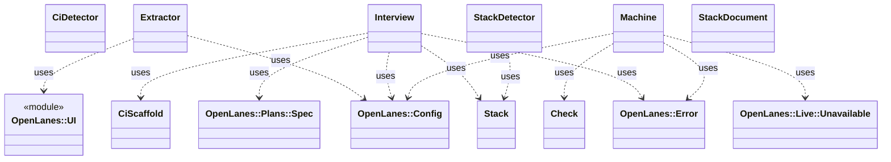

<!-- generated-by: bin/wiki-gen -->

# OpenLanes::Setup

_Gets a machine ready to run the factory (plan 035): the tools in the gem's `Brewfile`, then what brew cannot install._

**Up:** [Integrations](Integrations.md)

______________________________________________________________________

## What the namespace says about itself

> Gets a machine ready to run the factory (plan 035): the tools in the
> gem's `Brewfile`, then what brew cannot install. `openlanes setup` and
> `openlanes init` both come through here, so the two ask the same
> questions of the machine and never disagree about whether it is ready.
>
> It also holds what `openlanes init` settles about a project before any
> plan exists (plan 011): its CI, who merges, and its stack.

The doc comment on `OpenLanes::Setup` in [`lib/openlanes/setup.rb`](https://github.com/kigster/openlanes/blob/main/lib/openlanes/setup.rb).

## Class diagram

Generated by `openlanes uml self` (`just update-architecture`) into [`docs/architecture/openlanes-setup.md`](https://github.com/kigster/openlanes/blob/main/docs/architecture/openlanes-setup.md). Dotted arrows are `uses`; classes from other namespaces are shown where this one depends on them.

```mermaid
classDiagram
  class OpenLanes__Adapters__ProbeRunner["OpenLanes::Adapters::ProbeRunner"]
  class OpenLanes__Config["OpenLanes::Config"]
  class OpenLanes__Error["OpenLanes::Error"]
  class OpenLanes__Live__Unavailable["OpenLanes::Live::Unavailable"]
  class OpenLanes__Setup__Architecture["Architecture"]
  class OpenLanes__Setup__ArchitectureDecisions["ArchitectureDecisions"]
  class OpenLanes__Setup__ArchitectureScan["ArchitectureScan"]
  class OpenLanes__Setup__ArchitectureScan__Manifests["ArchitectureScan::Manifests"]
  class OpenLanes__Setup__Check["Check"]
  class OpenLanes__Setup__CiDetector["CiDetector"]
  class OpenLanes__Setup__CiScaffold["CiScaffold"]
  class OpenLanes__Setup__Extraction__CliAdapter["Extraction::CliAdapter"]
  class OpenLanes__Setup__Extraction__GeminiAdapter["Extraction::GeminiAdapter"]
  class OpenLanes__Setup__Extraction__Ollama["Extraction::Ollama"]
  class OpenLanes__Setup__Extraction__OllamaAdapter["Extraction::OllamaAdapter"]
  class OpenLanes__Setup__Extraction__Route["Extraction::Route"]
  class OpenLanes__Setup__Extraction__Routes["Extraction::Routes"]
  class OpenLanes__Setup__Extraction__XaiAdapter["Extraction::XaiAdapter"]
  class OpenLanes__Setup__Extractor["Extractor"]
  class OpenLanes__Setup__Interview["Interview"]
  class OpenLanes__Setup__Machine["Machine"]
  class OpenLanes__Setup__ProjectForm__Answers["ProjectForm::Answers"]
  class OpenLanes__Setup__ProjectForm__Driver["ProjectForm::Driver"]
  class OpenLanes__Setup__ProjectForm__Preselection["ProjectForm::Preselection"]
  class OpenLanes__Setup__ProjectForm__Renderer["ProjectForm::Renderer"]
  class OpenLanes__Setup__ProjectForm__Terminal["ProjectForm::Terminal"]
  class OpenLanes__Setup__ProjectForm__Validator["ProjectForm::Validator"]
  class OpenLanes__Setup__ProjectForm__WrappedNode["ProjectForm::WrappedNode"]
  class OpenLanes__Setup__Stack["Stack"]
  class OpenLanes__Setup__StackDetector["StackDetector"]
  class OpenLanes__Setup__StackDocument["StackDocument"]
  class OpenLanes__UI["OpenLanes::UI"]
  <<module>> OpenLanes__UI
  OpenLanes__Setup__ArchitectureDecisions ..> OpenLanes__Error : uses
  OpenLanes__Setup__ArchitectureDecisions ..> OpenLanes__Setup__Architecture : uses
  OpenLanes__Setup__ArchitectureScan ..> OpenLanes__Setup__Architecture : uses
  OpenLanes__Setup__ArchitectureScan ..> OpenLanes__Setup__ArchitectureScan__Manifests : uses
  OpenLanes__Setup__ArchitectureScan ..> OpenLanes__Setup__CiDetector : uses
  OpenLanes__Setup__ArchitectureScan ..> OpenLanes__Setup__StackDetector : uses
  OpenLanes__Setup__Extraction__Routes ..> OpenLanes__Adapters__ProbeRunner : uses
  OpenLanes__Setup__Extraction__Routes ..> OpenLanes__Setup__Extraction__CliAdapter : uses
  OpenLanes__Setup__Extraction__Routes ..> OpenLanes__Setup__Extraction__GeminiAdapter : uses
  OpenLanes__Setup__Extraction__Routes ..> OpenLanes__Setup__Extraction__Ollama : uses
  OpenLanes__Setup__Extraction__Routes ..> OpenLanes__Setup__Extraction__OllamaAdapter : uses
  OpenLanes__Setup__Extraction__Routes ..> OpenLanes__Setup__Extraction__Route : uses
  OpenLanes__Setup__Extraction__Routes ..> OpenLanes__Setup__Extraction__XaiAdapter : uses
  OpenLanes__Setup__Extractor ..> OpenLanes__Config : uses
  OpenLanes__Setup__Extractor ..> OpenLanes__Setup__Architecture : uses
  OpenLanes__Setup__Extractor ..> OpenLanes__UI : uses
  OpenLanes__Setup__Interview ..> OpenLanes__Config : uses
  OpenLanes__Setup__Interview ..> OpenLanes__Error : uses
  OpenLanes__Setup__Interview ..> OpenLanes__Setup__ArchitectureDecisions : uses
  OpenLanes__Setup__Interview ..> OpenLanes__Setup__ArchitectureScan : uses
  OpenLanes__Setup__Interview ..> OpenLanes__Setup__ProjectForm__Answers : uses
  OpenLanes__Setup__Interview ..> OpenLanes__Setup__ProjectForm__Driver : uses
  OpenLanes__Setup__Interview ..> OpenLanes__Setup__ProjectForm__Preselection : uses
  OpenLanes__Setup__Interview ..> OpenLanes__Setup__ProjectForm__Renderer : uses
  OpenLanes__Setup__Machine ..> OpenLanes__Config : uses
  OpenLanes__Setup__Machine ..> OpenLanes__Error : uses
  OpenLanes__Setup__Machine ..> OpenLanes__Live__Unavailable : uses
  OpenLanes__Setup__Machine ..> OpenLanes__Setup__Check : uses
  OpenLanes__Setup__ProjectForm__Answers ..> OpenLanes__Setup__Architecture : uses
  OpenLanes__Setup__ProjectForm__Answers ..> OpenLanes__Setup__ArchitectureDecisions : uses
  OpenLanes__Setup__ProjectForm__Preselection ..> OpenLanes__Setup__Architecture : uses
  OpenLanes__Setup__ProjectForm__Renderer ..> OpenLanes__Setup__ProjectForm__WrappedNode : uses
  OpenLanes__Setup__ProjectForm__Validator ..> OpenLanes__Setup__ProjectForm__Answers : uses
  OpenLanes__Setup__StackDetector ..> OpenLanes__Setup__Stack : uses
```

Before the 4.0 refactor

Frozen in [`docs/architecture/before/openlanes-setup.md`](https://github.com/kigster/openlanes/blob/main/docs/architecture/before/openlanes-setup.md), generated once from main at a80651d.

## Source files

- [`lib/openlanes/setup/architecture.rb`](https://github.com/kigster/openlanes/blob/main/lib/openlanes/setup/architecture.rb)
- [`lib/openlanes/setup/architecture_decisions.rb`](https://github.com/kigster/openlanes/blob/main/lib/openlanes/setup/architecture_decisions.rb)
- [`lib/openlanes/setup/architecture_scan.rb`](https://github.com/kigster/openlanes/blob/main/lib/openlanes/setup/architecture_scan.rb)
- [`lib/openlanes/setup/architecture_scan/manifests.rb`](https://github.com/kigster/openlanes/blob/main/lib/openlanes/setup/architecture_scan/manifests.rb)
- [`lib/openlanes/setup/architecture_scan/markers.rb`](https://github.com/kigster/openlanes/blob/main/lib/openlanes/setup/architecture_scan/markers.rb)
- [`lib/openlanes/setup/check.rb`](https://github.com/kigster/openlanes/blob/main/lib/openlanes/setup/check.rb)
- [`lib/openlanes/setup/ci_detector.rb`](https://github.com/kigster/openlanes/blob/main/lib/openlanes/setup/ci_detector.rb)
- [`lib/openlanes/setup/ci_scaffold.rb`](https://github.com/kigster/openlanes/blob/main/lib/openlanes/setup/ci_scaffold.rb)
- [`lib/openlanes/setup/extraction.rb`](https://github.com/kigster/openlanes/blob/main/lib/openlanes/setup/extraction.rb)
- [`lib/openlanes/setup/extraction/cli_adapter.rb`](https://github.com/kigster/openlanes/blob/main/lib/openlanes/setup/extraction/cli_adapter.rb)
- [`lib/openlanes/setup/extraction/gemini_adapter.rb`](https://github.com/kigster/openlanes/blob/main/lib/openlanes/setup/extraction/gemini_adapter.rb)
- [`lib/openlanes/setup/extraction/ollama.rb`](https://github.com/kigster/openlanes/blob/main/lib/openlanes/setup/extraction/ollama.rb)
- [`lib/openlanes/setup/extraction/ollama_adapter.rb`](https://github.com/kigster/openlanes/blob/main/lib/openlanes/setup/extraction/ollama_adapter.rb)
- [`lib/openlanes/setup/extraction/routes.rb`](https://github.com/kigster/openlanes/blob/main/lib/openlanes/setup/extraction/routes.rb)
- [`lib/openlanes/setup/extraction/xai_adapter.rb`](https://github.com/kigster/openlanes/blob/main/lib/openlanes/setup/extraction/xai_adapter.rb)
- [`lib/openlanes/setup/extractor.rb`](https://github.com/kigster/openlanes/blob/main/lib/openlanes/setup/extractor.rb)
- [`lib/openlanes/setup/interview.rb`](https://github.com/kigster/openlanes/blob/main/lib/openlanes/setup/interview.rb)
- [`lib/openlanes/setup/machine.rb`](https://github.com/kigster/openlanes/blob/main/lib/openlanes/setup/machine.rb)
- [`lib/openlanes/setup/project_form.rb`](https://github.com/kigster/openlanes/blob/main/lib/openlanes/setup/project_form.rb)
- [`lib/openlanes/setup/project_form/answers.rb`](https://github.com/kigster/openlanes/blob/main/lib/openlanes/setup/project_form/answers.rb)
- [`lib/openlanes/setup/project_form/driver.rb`](https://github.com/kigster/openlanes/blob/main/lib/openlanes/setup/project_form/driver.rb)
- [`lib/openlanes/setup/project_form/dsl.rb`](https://github.com/kigster/openlanes/blob/main/lib/openlanes/setup/project_form/dsl.rb)
- [`lib/openlanes/setup/project_form/preselection.rb`](https://github.com/kigster/openlanes/blob/main/lib/openlanes/setup/project_form/preselection.rb)
- [`lib/openlanes/setup/project_form/renderer.rb`](https://github.com/kigster/openlanes/blob/main/lib/openlanes/setup/project_form/renderer.rb)
- [`lib/openlanes/setup/project_form/terminal.rb`](https://github.com/kigster/openlanes/blob/main/lib/openlanes/setup/project_form/terminal.rb)
- [`lib/openlanes/setup/project_form/validator.rb`](https://github.com/kigster/openlanes/blob/main/lib/openlanes/setup/project_form/validator.rb)
- [`lib/openlanes/setup/project_form/wrapped_node.rb`](https://github.com/kigster/openlanes/blob/main/lib/openlanes/setup/project_form/wrapped_node.rb)
- [`lib/openlanes/setup/stack.rb`](https://github.com/kigster/openlanes/blob/main/lib/openlanes/setup/stack.rb)
- [`lib/openlanes/setup/stack_detector.rb`](https://github.com/kigster/openlanes/blob/main/lib/openlanes/setup/stack_detector.rb)
- [`lib/openlanes/setup/stack_document.rb`](https://github.com/kigster/openlanes/blob/main/lib/openlanes/setup/stack_document.rb)

______________________________________________________________________

## Sources

Generated by [`bin/wiki-gen`](https://github.com/kigster/openlanes/blob/main/bin/wiki-gen) v2.0.0 at the commit of 2026-11-07, from:

- [`lib/openlanes/setup.rb`](https://github.com/kigster/openlanes/blob/main/lib/openlanes/setup.rb)
- [`docs/architecture/openlanes-setup.md`](https://github.com/kigster/openlanes/blob/main/docs/architecture/openlanes-setup.md)
- [`docs/architecture/before/openlanes-setup.md`](https://github.com/kigster/openlanes/blob/main/docs/architecture/before/openlanes-setup.md)
