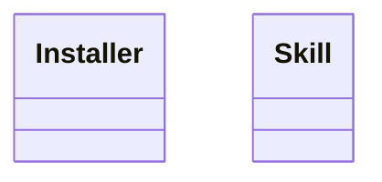

<!-- generated-by: bin/wiki-gen -->

# OpenLanes::Skills

_The agent skills that ship inside the gem, under `skills/`, and the copy that puts them where a coding agent looks for them._

**Up:** [Integrations](Integrations.md)

______________________________________________________________________

## What the namespace says about itself

> The agent skills that ship inside the gem, under `skills/`, and the copy
> that puts them where a coding agent looks for them.

The doc comment on `OpenLanes::Skills` in [`lib/openlanes/skills.rb`](https://github.com/kigster/openlanes/blob/main/lib/openlanes/skills.rb).

## Class diagram

Generated by `openlanes uml self` (`just update-architecture`) into [`docs/architecture/openlanes-skills.md`](https://github.com/kigster/openlanes/blob/main/docs/architecture/openlanes-skills.md). Dotted arrows are `uses`; classes from other namespaces are shown where this one depends on them.

Before the 4.0 refactor

Frozen in [`docs/architecture/before/openlanes-skills.md`](https://github.com/kigster/openlanes/blob/main/docs/architecture/before/openlanes-skills.md), generated once from main at a80651d.

## Source files

- [`lib/openlanes/skills/installer.rb`](https://github.com/kigster/openlanes/blob/main/lib/openlanes/skills/installer.rb)
- [`lib/openlanes/skills/skill.rb`](https://github.com/kigster/openlanes/blob/main/lib/openlanes/skills/skill.rb)

______________________________________________________________________

## Sources

Generated by [`bin/wiki-gen`](https://github.com/kigster/openlanes/blob/main/bin/wiki-gen) v2.0.0 at the commit of 2026-11-07, from:

- [`lib/openlanes/skills.rb`](https://github.com/kigster/openlanes/blob/main/lib/openlanes/skills.rb)
- [`docs/architecture/openlanes-skills.md`](https://github.com/kigster/openlanes/blob/main/docs/architecture/openlanes-skills.md)
- [`docs/architecture/before/openlanes-skills.md`](https://github.com/kigster/openlanes/blob/main/docs/architecture/before/openlanes-skills.md)
