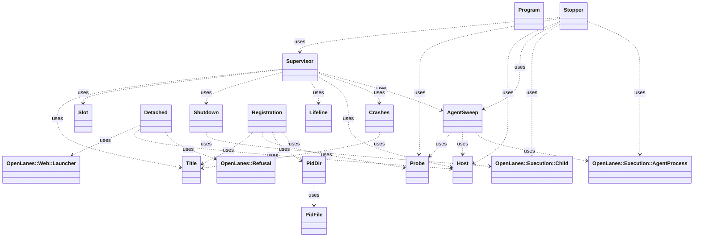

<!-- generated-by: bin/wiki-gen -->

# OpenLanes::Supervision

_The factory's processes (S1–S5 in docs/decisions/decisions-on-factory-start-stop.md): a supervisor that keeps the engine and the web up, the PID file and title each process gives itself, and the check…_

**Up:** [Agents and Execution](Agents-and-Execution.md)

______________________________________________________________________

## What the namespace says about itself

> The factory's processes (S1–S5 in docs/decisions/decisions-on-factory-start-stop.md):
> a supervisor that keeps the engine and the web up, the PID file and title
> each process gives itself, and the checks every reader makes before it
> trusts or signals one.
>
> registration = Supervision.registration(Supervision::ENGINE, root:)
> Supervision.stopper(root:).call(runs: true)
> Supervision.dir(root).entries

The doc comment on `OpenLanes::Supervision` in [`lib/openlanes/supervision.rb`](https://github.com/kigster/openlanes/blob/main/lib/openlanes/supervision.rb).

## Class diagram

Generated by `openlanes uml self` (`just update-architecture`) into [`docs/architecture/openlanes-supervision.md`](https://github.com/kigster/openlanes/blob/main/docs/architecture/openlanes-supervision.md). Dotted arrows are `uses`; classes from other namespaces are shown where this one depends on them.

## Source files

- [`lib/openlanes/supervision/agent_sweep.rb`](https://github.com/kigster/openlanes/blob/main/lib/openlanes/supervision/agent_sweep.rb)
- [`lib/openlanes/supervision/crashes.rb`](https://github.com/kigster/openlanes/blob/main/lib/openlanes/supervision/crashes.rb)
- [`lib/openlanes/supervision/detached.rb`](https://github.com/kigster/openlanes/blob/main/lib/openlanes/supervision/detached.rb)
- [`lib/openlanes/supervision/host.rb`](https://github.com/kigster/openlanes/blob/main/lib/openlanes/supervision/host.rb)
- [`lib/openlanes/supervision/lifeline.rb`](https://github.com/kigster/openlanes/blob/main/lib/openlanes/supervision/lifeline.rb)
- [`lib/openlanes/supervision/pid_dir.rb`](https://github.com/kigster/openlanes/blob/main/lib/openlanes/supervision/pid_dir.rb)
- [`lib/openlanes/supervision/pid_file.rb`](https://github.com/kigster/openlanes/blob/main/lib/openlanes/supervision/pid_file.rb)
- [`lib/openlanes/supervision/probe.rb`](https://github.com/kigster/openlanes/blob/main/lib/openlanes/supervision/probe.rb)
- [`lib/openlanes/supervision/program.rb`](https://github.com/kigster/openlanes/blob/main/lib/openlanes/supervision/program.rb)
- [`lib/openlanes/supervision/registration.rb`](https://github.com/kigster/openlanes/blob/main/lib/openlanes/supervision/registration.rb)
- [`lib/openlanes/supervision/shutdown.rb`](https://github.com/kigster/openlanes/blob/main/lib/openlanes/supervision/shutdown.rb)
- [`lib/openlanes/supervision/slot.rb`](https://github.com/kigster/openlanes/blob/main/lib/openlanes/supervision/slot.rb)
- [`lib/openlanes/supervision/stopper.rb`](https://github.com/kigster/openlanes/blob/main/lib/openlanes/supervision/stopper.rb)
- [`lib/openlanes/supervision/supervisor.rb`](https://github.com/kigster/openlanes/blob/main/lib/openlanes/supervision/supervisor.rb)
- [`lib/openlanes/supervision/title.rb`](https://github.com/kigster/openlanes/blob/main/lib/openlanes/supervision/title.rb)

______________________________________________________________________

## Sources

Generated by [`bin/wiki-gen`](https://github.com/kigster/openlanes/blob/main/bin/wiki-gen) v2.0.0 at the commit of 2026-11-07, from:

- [`lib/openlanes/supervision.rb`](https://github.com/kigster/openlanes/blob/main/lib/openlanes/supervision.rb)
- [`docs/architecture/openlanes-supervision.md`](https://github.com/kigster/openlanes/blob/main/docs/architecture/openlanes-supervision.md)
