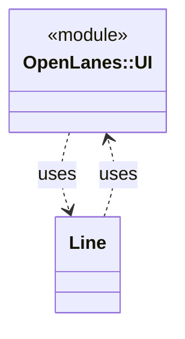

<!-- generated-by: bin/wiki-gen -->

# OpenLanes::UI

_Everything the user sees that is not the deliverable itself._

**Up:** [Developer Tooling](Developer-Tooling.md)

______________________________________________________________________

## What the namespace says about itself

> Everything the user sees that is not the deliverable itself.
>
> Include it and you get `info`, `warn`, `error` and `success` as instance
> methods, each drawing a dry-cli-ui box on **STDERR**. STDERR is deliberate:
> the documents and tables these commands produce own STDOUT, so every
> command composes in a pipe.
>
> @example
> class Thing
> include OpenLanes::UI
> def run = success("Linked 4 skills")
> end

The doc comment on `OpenLanes::UI` in [`lib/openlanes/support/ui.rb`](https://github.com/kigster/openlanes/blob/main/lib/openlanes/support/ui.rb).

## Class diagram

Generated by `openlanes uml self` (`just update-architecture`) into [`docs/architecture/openlanes-ui.md`](https://github.com/kigster/openlanes/blob/main/docs/architecture/openlanes-ui.md). Dotted arrows are `uses`; classes from other namespaces are shown where this one depends on them.

Before the 4.0 refactor

Frozen in [`docs/architecture/before/openlanes-ui.md`](https://github.com/kigster/openlanes/blob/main/docs/architecture/before/openlanes-ui.md), generated once from main at a80651d.

______________________________________________________________________

## Sources

Generated by [`bin/wiki-gen`](https://github.com/kigster/openlanes/blob/main/bin/wiki-gen) v2.0.0 at the commit of 2026-11-07, from:

- [`lib/openlanes/support/ui.rb`](https://github.com/kigster/openlanes/blob/main/lib/openlanes/support/ui.rb)
- [`docs/architecture/openlanes-ui.md`](https://github.com/kigster/openlanes/blob/main/docs/architecture/openlanes-ui.md)
- [`docs/architecture/before/openlanes-ui.md`](https://github.com/kigster/openlanes/blob/main/docs/architecture/before/openlanes-ui.md)
