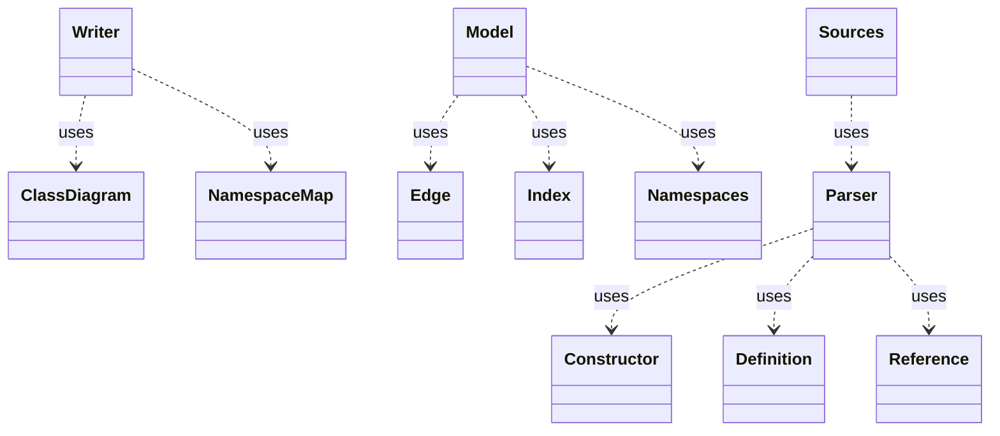

<!-- generated-by: bin/wiki-gen -->

# OpenLanes::Uml

_Class diagrams drawn from Ruby source read statically with Prism: the project being built, or OpenLanes itself._

**Up:** [Developer Tooling](Developer-Tooling.md)

______________________________________________________________________

## What the namespace says about itself

> Class diagrams drawn from Ruby source read statically with Prism: the
> project being built, or OpenLanes itself. Nothing is loaded or booted.

The doc comment on `OpenLanes::Uml` in [`lib/openlanes/uml.rb`](https://github.com/kigster/openlanes/blob/main/lib/openlanes/uml.rb).

## Class diagram

Generated by `openlanes uml self` (`just update-architecture`) into [`docs/architecture/openlanes-uml.md`](https://github.com/kigster/openlanes/blob/main/docs/architecture/openlanes-uml.md). Dotted arrows are `uses`; classes from other namespaces are shown where this one depends on them.

## Source files

- [`lib/openlanes/uml/class_diagram.rb`](https://github.com/kigster/openlanes/blob/main/lib/openlanes/uml/class_diagram.rb)
- [`lib/openlanes/uml/constructor.rb`](https://github.com/kigster/openlanes/blob/main/lib/openlanes/uml/constructor.rb)
- [`lib/openlanes/uml/definition.rb`](https://github.com/kigster/openlanes/blob/main/lib/openlanes/uml/definition.rb)
- [`lib/openlanes/uml/edge.rb`](https://github.com/kigster/openlanes/blob/main/lib/openlanes/uml/edge.rb)
- [`lib/openlanes/uml/index.rb`](https://github.com/kigster/openlanes/blob/main/lib/openlanes/uml/index.rb)
- [`lib/openlanes/uml/mermaid.rb`](https://github.com/kigster/openlanes/blob/main/lib/openlanes/uml/mermaid.rb)
- [`lib/openlanes/uml/model.rb`](https://github.com/kigster/openlanes/blob/main/lib/openlanes/uml/model.rb)
- [`lib/openlanes/uml/namespace_map.rb`](https://github.com/kigster/openlanes/blob/main/lib/openlanes/uml/namespace_map.rb)
- [`lib/openlanes/uml/namespaces.rb`](https://github.com/kigster/openlanes/blob/main/lib/openlanes/uml/namespaces.rb)
- [`lib/openlanes/uml/parser.rb`](https://github.com/kigster/openlanes/blob/main/lib/openlanes/uml/parser.rb)
- [`lib/openlanes/uml/reference.rb`](https://github.com/kigster/openlanes/blob/main/lib/openlanes/uml/reference.rb)
- [`lib/openlanes/uml/sources.rb`](https://github.com/kigster/openlanes/blob/main/lib/openlanes/uml/sources.rb)
- [`lib/openlanes/uml/writer.rb`](https://github.com/kigster/openlanes/blob/main/lib/openlanes/uml/writer.rb)

______________________________________________________________________

## Sources

Generated by [`bin/wiki-gen`](https://github.com/kigster/openlanes/blob/main/bin/wiki-gen) v2.0.0 at the commit of 2026-11-07, from:

- [`lib/openlanes/uml.rb`](https://github.com/kigster/openlanes/blob/main/lib/openlanes/uml.rb)
- [`docs/architecture/openlanes-uml.md`](https://github.com/kigster/openlanes/blob/main/docs/architecture/openlanes-uml.md)
