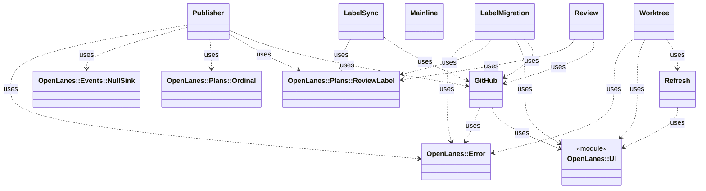

<!-- generated-by: bin/wiki-gen -->

# OpenLanes::Vcs

_Git and GitHub: a checkout per plan, pushing a branch, and reading pull requests._

**Up:** [Integrations](Integrations.md)

______________________________________________________________________

## What the namespace says about itself

> Git and GitHub: a checkout per plan, pushing a branch, and reading
> pull requests. Everything that leaves the machine leaves through here.

The doc comment on `OpenLanes::Vcs` in [`lib/openlanes/vcs.rb`](https://github.com/kigster/openlanes/blob/main/lib/openlanes/vcs.rb).

## Class diagram

Generated by `openlanes uml self` (`just update-architecture`) into [`docs/architecture/openlanes-vcs.md`](https://github.com/kigster/openlanes/blob/main/docs/architecture/openlanes-vcs.md). Dotted arrows are `uses`; classes from other namespaces are shown where this one depends on them.

Before the 4.0 refactor

Frozen in [`docs/architecture/before/openlanes-vcs.md`](https://github.com/kigster/openlanes/blob/main/docs/architecture/before/openlanes-vcs.md), generated once from main at a80651d.

## Source files

- [`lib/openlanes/vcs/ci_gate.rb`](https://github.com/kigster/openlanes/blob/main/lib/openlanes/vcs/ci_gate.rb)
- [`lib/openlanes/vcs/github.rb`](https://github.com/kigster/openlanes/blob/main/lib/openlanes/vcs/github.rb)
- [`lib/openlanes/vcs/label_migration.rb`](https://github.com/kigster/openlanes/blob/main/lib/openlanes/vcs/label_migration.rb)
- [`lib/openlanes/vcs/label_sync.rb`](https://github.com/kigster/openlanes/blob/main/lib/openlanes/vcs/label_sync.rb)
- [`lib/openlanes/vcs/mainline.rb`](https://github.com/kigster/openlanes/blob/main/lib/openlanes/vcs/mainline.rb)
- [`lib/openlanes/vcs/publisher.rb`](https://github.com/kigster/openlanes/blob/main/lib/openlanes/vcs/publisher.rb)
- [`lib/openlanes/vcs/refresh.rb`](https://github.com/kigster/openlanes/blob/main/lib/openlanes/vcs/refresh.rb)
- [`lib/openlanes/vcs/rename_date.rb`](https://github.com/kigster/openlanes/blob/main/lib/openlanes/vcs/rename_date.rb)
- [`lib/openlanes/vcs/review.rb`](https://github.com/kigster/openlanes/blob/main/lib/openlanes/vcs/review.rb)
- [`lib/openlanes/vcs/worktree.rb`](https://github.com/kigster/openlanes/blob/main/lib/openlanes/vcs/worktree.rb)

______________________________________________________________________

## Sources

Generated by [`bin/wiki-gen`](https://github.com/kigster/openlanes/blob/main/bin/wiki-gen) v2.0.0 at the commit of 2026-11-07, from:

- [`lib/openlanes/vcs.rb`](https://github.com/kigster/openlanes/blob/main/lib/openlanes/vcs.rb)
- [`docs/architecture/openlanes-vcs.md`](https://github.com/kigster/openlanes/blob/main/docs/architecture/openlanes-vcs.md)
- [`docs/architecture/before/openlanes-vcs.md`](https://github.com/kigster/openlanes/blob/main/docs/architecture/before/openlanes-vcs.md)
