<!-- generated-by: bin/wiki-gen -->

# OpenLanes::Web

_The control room's API server (plan 004, W3, W7): Sinatra on a threaded Puma, bound to 127.0.0.1._

**Up:** [Integrations](Integrations.md)

______________________________________________________________________

## What the namespace says about itself

> The control room's API server (plan 004, W3, W7): Sinatra on a threaded
> Puma, bound to 127.0.0.1. It holds no run state. Everything it shows is
> read from Redis through {Live}, and everything it is told goes back
> there as a command for the engine, so a restarted server loses nothing.
>
> context = Web.context(stores:, keys:, plans_dir:, url:)
> server = Web.server(app: Web.app(context), context:, port: 11000).start
> server.wait

The doc comment on `OpenLanes::Web` in [`lib/openlanes/web.rb`](https://github.com/kigster/openlanes/blob/main/lib/openlanes/web.rb).

## Class diagram

Generated by `openlanes uml self` (`just update-architecture`) into [`docs/architecture/openlanes-web.md`](https://github.com/kigster/openlanes/blob/main/docs/architecture/openlanes-web.md). Dotted arrows are `uses`; classes from other namespaces are shown where this one depends on them.

```mermaid
classDiagram
  class OpenLanes__Apps__Definition["OpenLanes::Apps::Definition"]
  class OpenLanes__Apps__Runner["OpenLanes::Apps::Runner"]
  class OpenLanes__Error["OpenLanes::Error"]
  class OpenLanes__Live__Chat["OpenLanes::Live::Chat"]
  class OpenLanes__Live__Chat__Invalid["OpenLanes::Live::Chat::Invalid"]
  class OpenLanes__Live__Chat__Settled["OpenLanes::Live::Chat::Settled"]
  class OpenLanes__Live__Command["OpenLanes::Live::Command"]
  class OpenLanes__Live__Command__Invalid["OpenLanes::Live::Command::Invalid"]
  class OpenLanes__Live__Commands["OpenLanes::Live::Commands"]
  class OpenLanes__Live__Copilot["OpenLanes::Live::Copilot"]
  class OpenLanes__Live__Copilot__Invalid["OpenLanes::Live::Copilot::Invalid"]
  class OpenLanes__Live__Copilot__Unanswered["OpenLanes::Live::Copilot::Unanswered"]
  class OpenLanes__Live__Keys["OpenLanes::Live::Keys"]
  class OpenLanes__Live__Node["OpenLanes::Live::Node"]
  class OpenLanes__Live__Reply["OpenLanes::Live::Reply"]
  class OpenLanes__Live__Unavailable["OpenLanes::Live::Unavailable"]
  class OpenLanes__Plans__Ordinal["OpenLanes::Plans::Ordinal"]
  class OpenLanes__UI["OpenLanes::UI"]
  <<module>> OpenLanes__UI
  class OpenLanes__Web__AdminAuth["AdminAuth"]
  class OpenLanes__Web__AdminAuth__Invalid["AdminAuth::Invalid"]
  class OpenLanes__Web__App["App"]
  class OpenLanes__Web__Context["Context"]
  class OpenLanes__Web__Demo["Demo"]
  class OpenLanes__Web__DemoBoard["DemoBoard"]
  class OpenLanes__Web__DemoBoard__Refusal["DemoBoard::Refusal"]
  class OpenLanes__Web__Events["Events"]
  class OpenLanes__Web__Launcher["Launcher"]
  class OpenLanes__Web__Listen["Listen"]
  class OpenLanes__Web__Listen__Invalid["Listen::Invalid"]
  class OpenLanes__Web__PlanFiles["PlanFiles"]
  class OpenLanes__Web__PlanFiles__FrontmatterChanged["PlanFiles::FrontmatterChanged"]
  class OpenLanes__Web__PlanFiles__NotFound["PlanFiles::NotFound"]
  class OpenLanes__Web__PlanFiles__ReadOnly["PlanFiles::ReadOnly"]
  class OpenLanes__Web__PlanFiles__Stale["PlanFiles::Stale"]
  class OpenLanes__Web__RequestLog["RequestLog"]
  class OpenLanes__Web__Server["Server"]
  class OpenLanes__Web__Stores["Stores"]
  OpenLanes__Web__AdminAuth ..> OpenLanes__Error : uses
  OpenLanes__Web__AdminAuth ..> OpenLanes__Web__AdminAuth__Invalid : uses
  OpenLanes__Web__AdminAuth__Invalid --|> OpenLanes__Error : inherits
  OpenLanes__Web__App ..> OpenLanes__Apps__Definition : uses
  OpenLanes__Web__App ..> OpenLanes__Apps__Runner : uses
  OpenLanes__Web__App ..> OpenLanes__Live__Chat__Invalid : uses
  OpenLanes__Web__App ..> OpenLanes__Live__Chat__Settled : uses
  OpenLanes__Web__App ..> OpenLanes__Live__Command : uses
  OpenLanes__Web__App ..> OpenLanes__Live__Command__Invalid : uses
  OpenLanes__Web__App ..> OpenLanes__Live__Copilot__Invalid : uses
  OpenLanes__Web__App ..> OpenLanes__Live__Copilot__Unanswered : uses
  OpenLanes__Web__App ..> OpenLanes__Live__Reply : uses
  OpenLanes__Web__App ..> OpenLanes__Live__Unavailable : uses
  OpenLanes__Web__App ..> OpenLanes__Plans__Ordinal : uses
  OpenLanes__Web__App ..> OpenLanes__Web__AdminAuth : uses
  OpenLanes__Web__App ..> OpenLanes__Web__Events : uses
  OpenLanes__Web__App ..> OpenLanes__Web__PlanFiles : uses
  OpenLanes__Web__App ..> OpenLanes__Web__PlanFiles__FrontmatterChanged : uses
  OpenLanes__Web__App ..> OpenLanes__Web__PlanFiles__NotFound : uses
  OpenLanes__Web__App ..> OpenLanes__Web__PlanFiles__ReadOnly : uses
  OpenLanes__Web__App ..> OpenLanes__Web__PlanFiles__Stale : uses
  OpenLanes__Web__Demo ..> OpenLanes__Live__Command : uses
  OpenLanes__Web__Demo ..> OpenLanes__Live__Command__Invalid : uses
  OpenLanes__Web__Demo ..> OpenLanes__Live__Commands : uses
  OpenLanes__Web__Demo ..> OpenLanes__Live__Copilot : uses
  OpenLanes__Web__Demo ..> OpenLanes__Live__Keys : uses
  OpenLanes__Web__Demo ..> OpenLanes__Live__Node : uses
  OpenLanes__Web__Demo ..> OpenLanes__Live__Reply : uses
  OpenLanes__Web__Demo ..> OpenLanes__Live__Unavailable : uses
  OpenLanes__Web__Demo ..> OpenLanes__UI : uses
  OpenLanes__Web__Demo ..> OpenLanes__Web__DemoBoard : uses
  OpenLanes__Web__Demo ..> OpenLanes__Web__DemoBoard__Refusal : uses
  OpenLanes__Web__DemoBoard ..> OpenLanes__Live__Commands : uses
  OpenLanes__Web__DemoBoard ..> OpenLanes__Plans__Ordinal : uses
  OpenLanes__Web__DemoBoard ..> OpenLanes__Web__DemoBoard__Refusal : uses
  OpenLanes__Web__Events ..> OpenLanes__Live__Chat : uses
  OpenLanes__Web__Events ..> OpenLanes__Live__Unavailable : uses
  OpenLanes__Web__Events ..> OpenLanes__UI : uses
  OpenLanes__Web__Launcher ..> OpenLanes__Web__AdminAuth : uses
  OpenLanes__Web__Launcher ..> OpenLanes__Web__Listen : uses
  OpenLanes__Web__Listen ..> OpenLanes__Error : uses
  OpenLanes__Web__Listen ..> OpenLanes__Web__Listen__Invalid : uses
  OpenLanes__Web__Listen__Invalid --|> OpenLanes__Error : inherits
  OpenLanes__Web__PlanFiles ..> OpenLanes__Error : uses
  OpenLanes__Web__PlanFiles ..> OpenLanes__Plans__Ordinal : uses
  OpenLanes__Web__PlanFiles ..> OpenLanes__Web__PlanFiles__FrontmatterChanged : uses
  OpenLanes__Web__PlanFiles ..> OpenLanes__Web__PlanFiles__NotFound : uses
  OpenLanes__Web__PlanFiles ..> OpenLanes__Web__PlanFiles__ReadOnly : uses
  OpenLanes__Web__PlanFiles ..> OpenLanes__Web__PlanFiles__Stale : uses
  OpenLanes__Web__PlanFiles__FrontmatterChanged --|> OpenLanes__Error : inherits
  OpenLanes__Web__PlanFiles__NotFound --|> OpenLanes__Error : inherits
  OpenLanes__Web__PlanFiles__ReadOnly --|> OpenLanes__Error : inherits
  OpenLanes__Web__PlanFiles__Stale --|> OpenLanes__Error : inherits
  OpenLanes__Web__Server ..> OpenLanes__Web__Listen : uses
```

Before the 4.0 refactor

Frozen in [`docs/architecture/before/openlanes-web.md`](https://github.com/kigster/openlanes/blob/main/docs/architecture/before/openlanes-web.md), generated once from main at a80651d.

```mermaid
classDiagram
  class OpenLanes__Apps__Definition["OpenLanes::Apps::Definition"]
  class OpenLanes__Apps__Runner["OpenLanes::Apps::Runner"]
  class OpenLanes__Error["OpenLanes::Error"]
  class OpenLanes__Live__Chat["OpenLanes::Live::Chat"]
  class OpenLanes__Live__Chat__Invalid["OpenLanes::Live::Chat::Invalid"]
  class OpenLanes__Live__Chat__Settled["OpenLanes::Live::Chat::Settled"]
  class OpenLanes__Live__Command["OpenLanes::Live::Command"]
  class OpenLanes__Live__Command__Invalid["OpenLanes::Live::Command::Invalid"]
  class OpenLanes__Live__Commands["OpenLanes::Live::Commands"]
  class OpenLanes__Live__Copilot["OpenLanes::Live::Copilot"]
  class OpenLanes__Live__Copilot__Invalid["OpenLanes::Live::Copilot::Invalid"]
  class OpenLanes__Live__Copilot__Unanswered["OpenLanes::Live::Copilot::Unanswered"]
  class OpenLanes__Live__Keys["OpenLanes::Live::Keys"]
  class OpenLanes__Live__Node["OpenLanes::Live::Node"]
  class OpenLanes__Live__Reply["OpenLanes::Live::Reply"]
  class OpenLanes__Live__Unavailable["OpenLanes::Live::Unavailable"]
  class OpenLanes__Plans__Ordinal["OpenLanes::Plans::Ordinal"]
  class OpenLanes__UI["OpenLanes::UI"]
  <<module>> OpenLanes__UI
  class OpenLanes__Web__AdminAuth["AdminAuth"]
  class OpenLanes__Web__AdminAuth__Invalid["AdminAuth::Invalid"]
  class OpenLanes__Web__App["App"]
  class OpenLanes__Web__Context["Context"]
  class OpenLanes__Web__Demo["Demo"]
  class OpenLanes__Web__DemoBoard["DemoBoard"]
  class OpenLanes__Web__DemoBoard__Refusal["DemoBoard::Refusal"]
  class OpenLanes__Web__Events["Events"]
  class OpenLanes__Web__Launcher["Launcher"]
  class OpenLanes__Web__Listen["Listen"]
  class OpenLanes__Web__Listen__Invalid["Listen::Invalid"]
  class OpenLanes__Web__PlanFiles["PlanFiles"]
  class OpenLanes__Web__PlanFiles__FrontmatterChanged["PlanFiles::FrontmatterChanged"]
  class OpenLanes__Web__PlanFiles__NotFound["PlanFiles::NotFound"]
  class OpenLanes__Web__PlanFiles__ReadOnly["PlanFiles::ReadOnly"]
  class OpenLanes__Web__PlanFiles__Stale["PlanFiles::Stale"]
  class OpenLanes__Web__RequestLog["RequestLog"]
  class OpenLanes__Web__Server["Server"]
  class OpenLanes__Web__Stores["Stores"]
  OpenLanes__Web__AdminAuth ..> OpenLanes__Error : uses
  OpenLanes__Web__AdminAuth ..> OpenLanes__Web__AdminAuth__Invalid : uses
  OpenLanes__Web__AdminAuth__Invalid --|> OpenLanes__Error : inherits
  OpenLanes__Web__App ..> OpenLanes__Apps__Definition : uses
  OpenLanes__Web__App ..> OpenLanes__Apps__Runner : uses
  OpenLanes__Web__App ..> OpenLanes__Live__Chat__Invalid : uses
  OpenLanes__Web__App ..> OpenLanes__Live__Chat__Settled : uses
  OpenLanes__Web__App ..> OpenLanes__Live__Command : uses
  OpenLanes__Web__App ..> OpenLanes__Live__Command__Invalid : uses
  OpenLanes__Web__App ..> OpenLanes__Live__Copilot__Invalid : uses
  OpenLanes__Web__App ..> OpenLanes__Live__Copilot__Unanswered : uses
  OpenLanes__Web__App ..> OpenLanes__Live__Reply : uses
  OpenLanes__Web__App ..> OpenLanes__Live__Unavailable : uses
  OpenLanes__Web__App ..> OpenLanes__Plans__Ordinal : uses
  OpenLanes__Web__App ..> OpenLanes__Web__AdminAuth : uses
  OpenLanes__Web__App ..> OpenLanes__Web__Events : uses
  OpenLanes__Web__App ..> OpenLanes__Web__PlanFiles : uses
  OpenLanes__Web__App ..> OpenLanes__Web__PlanFiles__FrontmatterChanged : uses
  OpenLanes__Web__App ..> OpenLanes__Web__PlanFiles__NotFound : uses
  OpenLanes__Web__App ..> OpenLanes__Web__PlanFiles__ReadOnly : uses
  OpenLanes__Web__App ..> OpenLanes__Web__PlanFiles__Stale : uses
  OpenLanes__Web__Demo ..> OpenLanes__Live__Command : uses
  OpenLanes__Web__Demo ..> OpenLanes__Live__Command__Invalid : uses
  OpenLanes__Web__Demo ..> OpenLanes__Live__Commands : uses
  OpenLanes__Web__Demo ..> OpenLanes__Live__Copilot : uses
  OpenLanes__Web__Demo ..> OpenLanes__Live__Keys : uses
  OpenLanes__Web__Demo ..> OpenLanes__Live__Node : uses
  OpenLanes__Web__Demo ..> OpenLanes__Live__Reply : uses
  OpenLanes__Web__Demo ..> OpenLanes__Live__Unavailable : uses
  OpenLanes__Web__Demo ..> OpenLanes__UI : uses
  OpenLanes__Web__Demo ..> OpenLanes__Web__DemoBoard : uses
  OpenLanes__Web__Demo ..> OpenLanes__Web__DemoBoard__Refusal : uses
  OpenLanes__Web__DemoBoard ..> OpenLanes__Live__Commands : uses
  OpenLanes__Web__DemoBoard ..> OpenLanes__Plans__Ordinal : uses
  OpenLanes__Web__DemoBoard ..> OpenLanes__Web__DemoBoard__Refusal : uses
  OpenLanes__Web__Events ..> OpenLanes__Live__Chat : uses
  OpenLanes__Web__Events ..> OpenLanes__Live__Unavailable : uses
  OpenLanes__Web__Events ..> OpenLanes__UI : uses
  OpenLanes__Web__Launcher ..> OpenLanes__Web__AdminAuth : uses
  OpenLanes__Web__Launcher ..> OpenLanes__Web__Listen : uses
  OpenLanes__Web__Listen ..> OpenLanes__Error : uses
  OpenLanes__Web__Listen ..> OpenLanes__Web__Listen__Invalid : uses
  OpenLanes__Web__Listen__Invalid --|> OpenLanes__Error : inherits
  OpenLanes__Web__PlanFiles ..> OpenLanes__Error : uses
  OpenLanes__Web__PlanFiles ..> OpenLanes__Plans__Ordinal : uses
  OpenLanes__Web__PlanFiles ..> OpenLanes__Web__PlanFiles__FrontmatterChanged : uses
  OpenLanes__Web__PlanFiles ..> OpenLanes__Web__PlanFiles__NotFound : uses
  OpenLanes__Web__PlanFiles ..> OpenLanes__Web__PlanFiles__ReadOnly : uses
  OpenLanes__Web__PlanFiles ..> OpenLanes__Web__PlanFiles__Stale : uses
  OpenLanes__Web__PlanFiles__FrontmatterChanged --|> OpenLanes__Error : inherits
  OpenLanes__Web__PlanFiles__NotFound --|> OpenLanes__Error : inherits
  OpenLanes__Web__PlanFiles__ReadOnly --|> OpenLanes__Error : inherits
  OpenLanes__Web__PlanFiles__Stale --|> OpenLanes__Error : inherits
  OpenLanes__Web__Server ..> OpenLanes__Web__Listen : uses
```

## Source files

- [`lib/openlanes/web/admin_auth.rb`](https://github.com/kigster/openlanes/blob/main/lib/openlanes/web/admin_auth.rb)
- [`lib/openlanes/web/app.rb`](https://github.com/kigster/openlanes/blob/main/lib/openlanes/web/app.rb)
- [`lib/openlanes/web/context.rb`](https://github.com/kigster/openlanes/blob/main/lib/openlanes/web/context.rb)
- [`lib/openlanes/web/demo.rb`](https://github.com/kigster/openlanes/blob/main/lib/openlanes/web/demo.rb)
- [`lib/openlanes/web/demo_board.rb`](https://github.com/kigster/openlanes/blob/main/lib/openlanes/web/demo_board.rb)
- [`lib/openlanes/web/events.rb`](https://github.com/kigster/openlanes/blob/main/lib/openlanes/web/events.rb)
- [`lib/openlanes/web/launcher.rb`](https://github.com/kigster/openlanes/blob/main/lib/openlanes/web/launcher.rb)
- [`lib/openlanes/web/listen.rb`](https://github.com/kigster/openlanes/blob/main/lib/openlanes/web/listen.rb)
- [`lib/openlanes/web/plan_files.rb`](https://github.com/kigster/openlanes/blob/main/lib/openlanes/web/plan_files.rb)
- [`lib/openlanes/web/request_log.rb`](https://github.com/kigster/openlanes/blob/main/lib/openlanes/web/request_log.rb)
- [`lib/openlanes/web/server.rb`](https://github.com/kigster/openlanes/blob/main/lib/openlanes/web/server.rb)
- [`lib/openlanes/web/stores.rb`](https://github.com/kigster/openlanes/blob/main/lib/openlanes/web/stores.rb)

______________________________________________________________________

## Sources

Generated by [`bin/wiki-gen`](https://github.com/kigster/openlanes/blob/main/bin/wiki-gen) v2.0.0 at the commit of 2026-11-07, from:

- [`lib/openlanes/web.rb`](https://github.com/kigster/openlanes/blob/main/lib/openlanes/web.rb)
- [`docs/architecture/openlanes-web.md`](https://github.com/kigster/openlanes/blob/main/docs/architecture/openlanes-web.md)
- [`docs/architecture/before/openlanes-web.md`](https://github.com/kigster/openlanes/blob/main/docs/architecture/before/openlanes-web.md)
