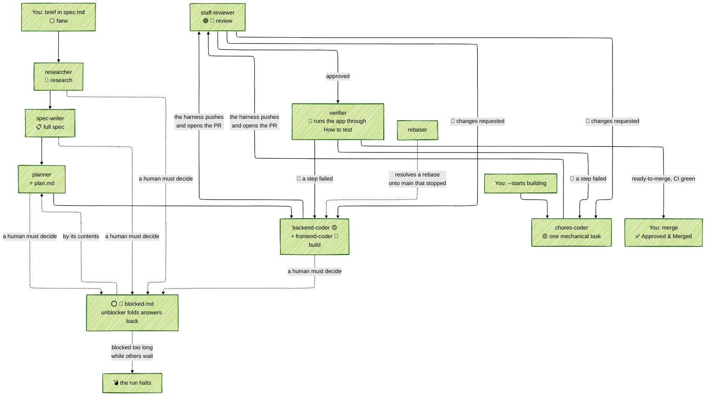

<!-- generated-by: bin/wiki-gen -->

# Overview

_What OpenLanes is, what it is built with, and what a run looks like._

______________________________________________________________________

   

> [!IMPORTANT]
> OpenLanes is under active development and may contain bugs. That said, its being written using itself, and a few other projects are using it too. If you'd like to try it, consider this an early alpha and please create issues for any problems you encounter. Thanks!
>
> OpenLanes is one of few factories that can autonomously execute and implement features and merge them autonomously as well. This is configurable, and if turned on a dedicated agent provides risk assessment of whether or not this plan is safe to merge without human oversight.

**OpenLanes®** is an open source CLI software factory written in Ruby (but can build products in any language), that runs inside your project repo. It can help create specifications for new features (from CLI or the Web UI), and it manages the various states of development of this feature, passing it from one specialized agent to the next.

In a very brief and simplified way, creating a new feature creates it's `.plans` folder and the `spec.md` file, which is then populated by an initial agent based on the title, the spec.md is then opened in your system editor to allow you to define additional details, then a researcher agent adds some amount of research (based on both your existing codebase and external web searches), the writer then polishes the spec, before it is passeed to another agent that determines any interdependencies between plans and records it.

Next phase is the planning phase, performed by a single agent who creates `plan.md`, with backend and front-end features split as there is a dedicated agent for each.

After the planner is finished, builders pick it up and when they are done in their worktree, the harness (ruby dispatcher) submits a pull request and invokes several agents to perform PR review. There are three types of reviewers who all use different models, and one specializes on security. The reviewers are able to create and attach the PR labels used in this process. They can reject the PR (and almost always do), which returns it to the builders who address the feedback and re-submit the PR. The number of times this may occur is defined by "rounds" and in most cases the builders fix the PR to reviewer satisfaction.

A currently planned but not yet implemented feature is once the PR has `review-approved` label, another agent determines the risk surface area and depending on what it finds attaches one of two labels: `auto-merge` or `human-should-merge` etc.

`.plans/001.00-<emoji>-plan-title/{spec.md,plan.md,....}`

Additional files are created in the plan's folder, and when the plan is finished it's moved into `.plans/archive` folder.

Lifted verbatim from [`README.md`](https://github.com/kigster/openlanes/blob/main/README.md).

## What it is

**OpenLanes®** is an open source software factory written in Ruby. Its agents run on Claude Code by default, through `claude -p`, which skips loading your own configuration, skills and plugins; `codex`, `pi`, `grok` and `gemini` can stand in per phase.

For each feature it creates a folder under `.plans`, and a series of specialized AI agents turn it into a finished feature. The harness opens the pull request, staff-reviewer reviews it, and verifier runs the app through the plan's How to test before you merge.

The state diagram looks something like this:

Agents may write code, tests and plan documents, but never commit, push or merge. The harness checks that, then publishes the branch and opens the pull request itself.

Lifted verbatim from [`README.md`](https://github.com/kigster/openlanes/blob/main/README.md).

## The Tech Stack

The harness and the Engine is written in Ruby, and uses deterministic state machine to move plans from one state to the next.

The engine & backend use redis (defined by `$REDIS_URL`) for coordination and resource locking, and AASM gem for state machine transitions.

The web control room uses - React 19 and TypeScript 5.8, built with Vite 6, Tailwind CSS 4 and Radix UI, TanStack Query fetches data; @microsoft/fetch-event-source receives the server's event stream.

CodeMirror 6 edits Markdown. marked and DOMPurify render it, and highlight.js colors code blocks.

Lifted verbatim from [`README.md`](https://github.com/kigster/openlanes/blob/main/README.md).

## What a run looks like

Above is the screenshot of the web component of open lanes. When you run `ol start` locally, this web UI automatcally opens and you can add your specifications via the UI, or you can execute `ol create` command on the CLI at the root of your project.

The software uses distributed locking using redis, so `$REDIS_URL` is the only thing you need to configure.

Each open control-room tab holds one Redis connection of its own, its subscription to board updates. On a shared or hosted Redis with a connection cap (`maxclients`, or a paid plan's limit), count one connection per open tab on top of the engine's own. A Redis user whose ACL forbids `SUBSCRIBE` still gets a working board: the page falls back to polling every 250 ms.

Once you boot the web UI, you may notice swim lanes (those are plans that existed already in the `.plans` folder, or you created via "Action -> New Idea" menu.)

One of the coolest parts of this, is if you have another laptop or a desktop, you can git clone your project there too, and start `openlanes` there as well. As long as `$REDIS_URL` is same as the first instance, and the github URL of the project matches, the two instances will cooperate and a single web UI will show remote nodes in a read-only mode.

Shortly we'll provide a video of this in action.

Lifted verbatim from [`README.md`](https://github.com/kigster/openlanes/blob/main/README.md).

## Further reading

- [`docs/STARTING-AN-APP.md`](Starting-an-App.md): from an empty directory or an example to `ol start`; [`docs/application-template.md`](https://github.com/kigster/openlanes/blob/main/docs/application-template.md) is the `APPLICATION.md` template.
- [`docs/USAGE.md`](https://github.com/kigster/openlanes/blob/main/docs/USAGE.md): settings, spec frontmatter, running and limits, handoffs, safety rails, GitHub and Linear, the factory integration test.
- [`docs/REVIEWING.md`](Reviewing-and-Merging.md): how to review a pull request, what each reviewer looks for, and every label, for reviewers inside openlanes or not.
- [`docs/WORKFLOW.md`](https://github.com/kigster/openlanes/blob/main/docs/WORKFLOW.md): states, transitions, numbering and plan files, generated by `openlanes docs`.
- [`docs/architecture/`](Namespace-Map.md): class diagrams of `lib/`, generated by `openlanes uml self`; `before/` is the frozen picture from before the 4.0 refactor.
- [`docs/decisions/`](https://github.com/kigster/openlanes/blob/main/docs/decisions): design decisions, including ones not built yet.
- [`docs/software-factory-proposal.md`](A-bounded-software-factory-for-OpenLanes.md): a proposed next architecture.

Related projects: [`agentilda-ai-setup`](https://github.com/kigster/agentilda-ai-setup) installs coding agents, skills and plugins from one `configuration.yml`, and ships the `/plan-*` slash commands that wrap this CLI; [`agent-lock`](https://github.com/kigster/agent-lock) coordinates agents writing in one checkout.

Lifted verbatim from [`README.md`](https://github.com/kigster/openlanes/blob/main/README.md).

______________________________________________________________________

## Sources

Generated by [`bin/wiki-gen`](https://github.com/kigster/openlanes/blob/main/bin/wiki-gen) v2.0.0 at the commit of 2026-11-07, from:

- [`README.md`](https://github.com/kigster/openlanes/blob/main/README.md)
