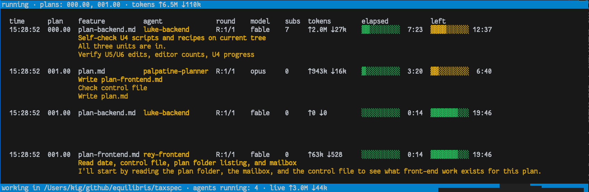

<!-- generated-by: bin/wiki-gen -->

# Running the Factory

_`openlanes start` and `openlanes run`: limits, logs, resuming sessions, and the safety rails._

**Up:** [Getting Started](Getting-Started.md)

______________________________________________________________________

## `openlanes start`: the factory with its control room

```bash
openlanes start                                # engine plus control room on http://127.0.0.1:11000
openlanes start --no-open --port 4848          # print the URL instead of opening it, on another port
openlanes start --rescan 10                    # look for new or hand-edited plans every 10 s while idle
openlanes start --plan 005                     # only plan 005, until stopped
openlanes start --background                   # the same, detached; prints the control room's URL
openlanes status                               # which factory processes are up, and the plans by state
openlanes stop                                 # stop the factory; --all stops every `openlanes run` too
```

`openlanes start` is the factory: the engine over the whole tree, with its control room, never stopping at a fixed point. When a plan blocks, it idles, puts the questions in **Needs You** on the page, takes your answer from there, folds it in and hands the plan back to its agent, with no restart. Plans created on the page, by `openlanes create` in another terminal, or edited by hand are picked up on the next rescan (every 5 s by default, or at once after anything you do on the page).

Every decision goes through the page: answers, hold, wrap up and stop on an agent, model changes, new plans. **Stop All Local** stops this machine's agents, then its engine and the page. The page also hosts `copilot`, a read-only copilot that talks about the run, drafts answers to blocked agents and proposes stops for you to confirm.

It never ends on its own, not even once every plan is finished, since the page can create the next one. Stop All Local, Ctrl-C or `SIGINT` ends it, and stops its agents. `SIGTERM` ends it too but leaves its agents running, for the next engine to take back. It takes `run`'s flags except `-n` and `--until`, plus `--plan` to narrow it, and needs Redis: without it, it refuses (exit 69) rather than going headless. `--no-web` leaves the page to an `openlanes web` run apart and keeps the engine up for it, as `mprocs.yaml` does under `just start`, with Vite's dev server in front of it so the page reloads as you edit it. Under mprocs the engine does not watch the `api` pane: if that pane dies, the engine waits on with no page until you restart the pane or end the engine with Ctrl-C.

`openlanes web` serves the page on its own; `openlanes web --demo` replays a sample run with no agents.

### Processes: the supervisor, `stop` and `status`

`openlanes start` is a small supervisor. It runs two children, each in a process group of its own: the engine (`openlanes engine --no-web`, the hidden command that does the work) and the control room (`openlanes web`). A child that crashes is restarted after 1, 2, 4 … up to 30 s; one that crashes three times inside five minutes is given up on, the rest stay up, and `openlanes status` says why. The engine ending of its own accord, on Stop All Local or a refusal, ends the factory with the engine's exit status. Each child watches a pipe from the supervisor, so a supervisor killed with `kill -9` takes no child with it to the grave: they see the pipe close and stop themselves.

Each process writes a PID file under `tmp/pids/` in the project (`$OPENLANES_PID_DIR` moves it): `supervisor.pid`, `engine.pid`, `web.pid`, `run-<pid>.pid` for every `openlanes run`, and `agent-<plan>-<agent>.pid` for every agent at work. A file names its process's pid and start time; a file whose process is gone, or whose pid now belongs to something else, is a crash's leftover. `ps` shows them by title: `openlanes-supervisor [project] up 2h, 1 restart`, `openlanes-engine [project] 2 of 4 agents busy`, `openlanes-web [project] http://127.0.0.1:11000`, `openlanes-run [project] 005,006`, `openlanes-agent [project] 005.00 backend-coder`, so `pgrep -fl openlanes-` lists every one.

- `openlanes stop` sends TERM to the supervisor, which pauses the system: INT to the engine, and `INTERRUPT` to every agent through its control file, so each leaves a resume note and the next start picks it up. Agents get one shared grace, 60 s or `$OPENLANES_SHUTDOWN_GRACE`; whichever is still running then is TERMed, then KILLed with its CLI's group. Running `stop` again skips the grace. An engine or a page whose supervisor is gone is stopped directly, an engine with INT. `--all` also stops every `openlanes run`, and any agent its engine left behind, with the same grace. Whatever else outlives its wait (about 10 s; the supervisor's covers the grace) is KILLed. A pid is signalled only after its start time and title match its file, and `-n` shows what it would stop.
- Each agent runs under an `openlanes-agent` process of its own, which owns the agent CLI, writes its output to a file the engine follows, and records how it ended. An engine that exits stops its agents on the way out.
- `openlanes status` prints each process, agents included (up, crashed or unreadable, how long it has run, and the URL) and then the plans by state. It reads only files and `ps`, so it needs no Redis.
- `openlanes start --background` starts the same factory detached from the terminal, with its output in `log/openlanes-start.log`. It returns once the page answers and prints its URL on STDOUT (exit 70 with the log's tail if it died first, 75 if it is still not up after 60 s). A second `start` in the same project is refused (exit 75) and names the URL of the one running.

It listens on `127.0.0.1:11000`. `-p` / `--port` moves the port. `-i` / `--ips` / `--bind 127.0.0.1,192.168.1.20` listens on the addresses given, and `-I` on every interface (the same as `--bind 0.0.0.0`), so other machines can open the page. `web` and `start` both take these flags. Anyone who reaches the page can stop agents, answer their questions and message them, so listening beyond loopback needs a login: `--admin-credentials USER:PASSWORD` (or `$OPENLANES_ADMIN_CREDENTIALS`), refused without one. Requests from other machines are then asked for it by HTTP Basic auth; requests from this machine are not. `start` hands the login to its server through its environment, never its command line, and the server warns whenever it listens beyond loopback, even under `--quiet`. Basic auth sends the password with every request, so off a trusted network put the page behind HTTPS. It still answers only Host headers naming loopback, an address it listens on, or this machine's name, which keeps DNS rebinding out.

## `openlanes run`: the plans named, headless, to a fixed point

`openlanes run` takes the plans to work as its argument, comma separated, and works only those, with no control room, until a round changes none of them. It is for scripts, CI and short dogfood runs; the whole tree is `start`'s.

Before any agent starts it claims every plan it was given, and holds them until it ends. If the factory or another run already holds one, the whole command is refused (exit 75), naming who holds it, and nothing is claimed. The factory, for its part, steps around a plan a run holds. Without Redis there are no claims to share, and the run goes on headless.

`--until STATE` stops each plan once it reaches that state or any later one on the spine, by key or emoji (`--until planned`, `--until 🟢`). Where a plan starts is its spec's `starts:`.

```bash
openlanes run 005 -n                           # dry run: who would take plan 005
openlanes run 005,006                          # both, one worktree per plan, in parallel
openlanes run 005,006 -j 1                     # one agent at a time
openlanes run 050 --until planned              # stop plan 050 once it is planned
openlanes run 005 --agent spec-writer --prompt "Rework the risks section first"
openlanes run 005 --skip staff-reviewer        # everyone but the reviewer; its plans wait
openlanes run 005 --model opus                 # one model for every agent
openlanes run 005 --user-config                # agents load your personal plugins and skills too
openlanes run 005 --timeout 600                # at most ten minutes per agent
openlanes run 005 --rounds 1                   # at most one round per agent per plan
openlanes run 005 --max-tokens 200000          # token budget per agent invocation
openlanes run 005 --isolation shared           # one checkout, one agent at a time, no git needed
```

- The loop stops when a full round changes no plan's state, or when every plan named is done, blocked, stopped by `--until`, or out of rounds.
- Agents start without your personal plugins, skills, hooks and MCP servers, which saves context and start-up time on every turn. `--user-config` lets them back in.
- `--agent` and `--skip` choose who builds, not who drains. Answered questions in `blocked.md` are folded back by the unblocker from the full agent registry, so they drain even under `--agent X` or `--skip unblocker`.




## Limits

| Limit  | Declared by the agent         | Flag           | Default         |
| :----- | :---------------------------- | :------------- | :-------------- |
| Clock  | `timeout:` in its frontmatter | `--timeout`    | 900 seconds     |
| Rounds | `rounds:` (at most 5)         | `--rounds`     | the agent's own |
| Tokens | none                          | `--max-tokens` | unmetered       |

Flags can only tighten what an agent declares, never loosen it. Each agent is told its clock and its token budget in its prompt. As its time runs out, the agent is warned at 10, 5 and 1 minute left, then asked to stop; if it is still running 60 seconds after that, it is killed. The token meter aborts an agent once it goes over its budget.

## Following a run, and stopping it

- `run` and `start` print one line per event on STDERR (an agent started or finished, a plan changed state, a command came from the page, the reason the engine idles). `--quiet` silences them. The same events also go to the log, which the terminal output does not replace.

## The log

The engine (`run`, `start`) and the control room's server (`web`, or the one `run` and `start` spawn) write one log through SemanticLogger: `log/development.log` under the project root, created when missing, appended to by both processes. Each line carries its process id and its writer, `engine` or `web`. The server logs every API request (method, path, status, duration in ms, and the page id when there is one); the event stream logs when it opens and when it closes, and static files and `/healthz` log at debug only.

```text
2026-10-15 20:25:44.277017 I [7415:592] engine -- idle: no plans yet; create one from the page or with openlanes create
2026-10-15 20:25:44.409615 I [7437:puma srv tp 001] (0.300ms) web -- GET /api/chat 422 -- {method: "GET", path: "/api/chat", status: 422, page: "tab-42"}
2026-10-15 20:25:47.514154 I [7437:puma srv tp 001] (3.078s) web -- GET /api/events stream closed -- {method: "GET", path: "/api/events", status: 200, page: "tab-42"}
```

| Flag                      | Default               | Meaning                                                                   |
| ------------------------- | --------------------- | ------------------------------------------------------------------------- |
| `-l`, `--log FILE`        | `log/development.log` | where to append; relative to the project root; `-` for STDOUT             |
| `-L`, `--log-level LEVEL` | `info`                | `debug`, `info`, `warn`, `error` or `fatal`; lower levels are not written |
| `--log-format FORMAT`     | `standard`            | `standard` (one line per entry) or `json` (one object per line)           |

`run`, `start` and `web` take all three, and `run`/`start` hand theirs to the server they spawn (through `OPENLANES_LOG`, `OPENLANES_LOG_LEVEL` and `OPENLANES_LOG_FORMAT`), so both processes always write the same file. A project can set them once in `.openlanes.yml` under `commands: run:` (or `start:`, `web:`) as `log:`, `log_level:` and `log_format:`. The server's raw STDOUT and STDERR (a crash before its logger is up) still go to a file under the system temp directory.

The log is never rotated or capped. For a long-running `start`, rotate it externally with `copytruncate` (logrotate, or `newsyslog` on macOS): both processes append with O_APPEND, so truncating in place is safe and neither needs a restart. `log/` is created in the project's own checkout, so add `/log/*` to the project's `.gitignore` if it is not there already. A URL's password is replaced by `***` in every line, whether it appears in the message or in a field.

- `unblock` and `create` show each agent as a spinner line on a terminal.
- Ctrl-C once asks each running agent to leave a `RESUME:` note in its plan's mailbox and sign `Interrupted`. Every agent reads its mail before it starts, so a later run picks up where this one stopped. A second Ctrl-C aborts immediately.

## Resuming an agent's session

An agent's next round resumes the session its last round ran in (`--resume <session id>`) when all of these hold: it is the same agent, the plan is in the same state that round left it in, and the round runs in the same checkout. Claude, grok and gemini resume (`-r <session id>` on both); codex and pi start every round fresh. A plan that moved to another state, or a session the CLI cannot find, also starts fresh. The log says which it chose and why: `resuming session …` or `fresh session: …`.

Every round's session id and checkout are kept in its entry under `stages` in `state.json`, written as soon as the agent's stream names the session. To talk to an agent yourself, in an interactive session that carries on from where it stopped:

```bash
openlanes state show --plan 003 | jq '.stages[-1] | {session, cwd}'
cd <cwd> && claude --resume <session>
```

`cd` first: claude keeps its sessions per directory, so an id recorded in a worktree is not found from the main checkout. Pick an earlier entry than `.stages[-1]` for another agent's session.

## Unblocking a plan

The loop never assigns a blocked plan (⭕ or 🛑). Write your answers into the plan's `blocked.md` under `## Answers`, dated and attributed, then:

```bash
openlanes unblock 003 -n         # what is 003 still waiting on?
openlanes unblock 003            # fold the answered questions into spec.md and plan.md
```

Partial answers are fine. The plan stays blocked until the last question is answered. Under `openlanes start`, answer in **Needs You** on the page instead.

## Running the app a plan builds: `openlanes project`

A project declares how to run its app under `app:` in `.openlanes.yml` (backend-coder writes it on a plan's first build):

```yaml
app:
  kind: web
  processes:                        # started in this order, each once the one before is ready
    - name: api
      start: bin/rails s -p $PORT_API  # a shell line, run in the checkout
      ready: /up                    # optional HTTP path that must answer 2xx or 3xx; without it a TCP connect will do
      restart_on: ["app/**/*.rb"]   # Dir.glob patterns; a change restarts this process only
    - name: web
      start: npx vite --port $PORT_WEB --strictPort
      ready: /
      preview: true                 # the one process the Preview tab shows
```

```bash
openlanes project start 012          # plan 012's app, in its worktree when it has one; Ctrl-C stops it
openlanes project status             # every port an app holds on this machine
openlanes project stop 012           # stop it from another terminal
```

- Each process gets the lowest free port from 11100, and every process sees every port as `PORT_<NAME>`. Ports come from one registry per machine (`~/.local/state/openlanes/ports.json`, or `$OPENLANES_PORTS_FILE`), so two worktrees never collide.
- A process that exits, or does not answer on its port within 30 s (`--ready-timeout`), fails the start and stops the rest. An app that moves to another port fails with the port it was given.
- The control room shows a **Preview** tab per running app, labelled with plan, branch and port: the app in a frame, or a button to open it in a window when its `X-Frame-Options` or `frame-ancestors` refuse framing. Its toolbar restarts the backend (every process but the previewed one) or stops the app.
- Without `app:` nothing changes: `project start` refuses and the page shows no Preview tab.

<sub>Lifted verbatim from [`docs/USAGE.md`](https://github.com/kigster/openlanes/blob/main/docs/USAGE.md).</sub>

## Safety rails

- **Isolation.** By default every plan gets its own git worktree and branch, `<user>/NNN.MM-slug`. `--isolation shared` runs one agent at a time in one checkout.
- **Agents cannot publish.** `git commit`, `git push`, `gh pr create`, `gh pr edit`, `gh pr merge`, `gh pr review`, `gh pr comment` and `gh release create` are withheld from every agent. An agent's `may:` frontmatter can lift some of these (the reviewer may `gh pr review` and `gh pr comment`), but never `git push` or `gh pr merge`. `WebFetch` and `WebSearch` are withheld unless the agent declares `network: true`.
- **Checked afterwards.** The harness verifies that `HEAD` did not move and that no remote-tracking ref was moved by a push (a `git fetch` is fine). A breach is reported as a failed attempt.
- **The harness publishes.** When a plan finishes, the harness commits the branch, pushes it and opens a pull request titled `[NNN.MM](X) Title`. `--no-git-push` leaves the work uncommitted in its worktree.
- **The plan travels with its pull request.** Before each commit, the publisher copies the plan folder from the main checkout into the worktree under its current name. The main checkout's folder stays the only one the tool reads or writes.
- **Nothing merges automatically.** An approval leaves the plan at 👀 until you merge.
- **Disk over claims.** A plan moves only when the files its new state requires exist. An agent that reports success but wrote nothing is recorded as interrupted.

<sub>Lifted verbatim from [`docs/USAGE.md`](https://github.com/kigster/openlanes/blob/main/docs/USAGE.md).</sub>

## GitHub and Linear

- **`resync dirs`** renames folders whose emoji their contents contradict. For example, a ⚪ with a `plan.md` becomes ⭐. Safe to run repeatedly.
- **`resync prs`** adds the `[NNN.MM]` prefix to pull request titles, working from the branch name first and the diff second. It reports anything ambiguous and never guesses. By default it adopts an orphan pull request as a retroactive plan; `--no-adopt` flags it instead. Needs `gh`.
- **`linear import TEAM -p PROJECT`** creates one Linear issue per plan and one child issue per work unit. It only goes one way: nothing edited in Linear comes back. `--format json` emits the arguments the Linear MCP tools take. `--update-unchanged` includes plans that have not changed since the last import. `linear projects TEAM` lists a team's projects and which plans they cover.

<sub>Lifted verbatim from [`docs/USAGE.md`](https://github.com/kigster/openlanes/blob/main/docs/USAGE.md).</sub>

## From Claude Code

The `/plan-create`, `/plan-run`, `/plan-status` and other `/plan-*` slash commands wrap this same binary and add checks, such as previewing the scope with `-n` before a run. They ship with [agentilda-ai-setup](https://github.com/kigster/agentilda-ai-setup). The bundled skills (`openlanes skills install`) teach any agent how to drive the factory.

<sub>Lifted verbatim from [`docs/USAGE.md`](https://github.com/kigster/openlanes/blob/main/docs/USAGE.md).</sub>

______________________________________________________________________

## Sources

Generated by [`bin/wiki-gen`](https://github.com/kigster/openlanes/blob/main/bin/wiki-gen) v2.0.0 at the commit of 2026-11-07, from:

- [`docs/USAGE.md`](https://github.com/kigster/openlanes/blob/main/docs/USAGE.md)
