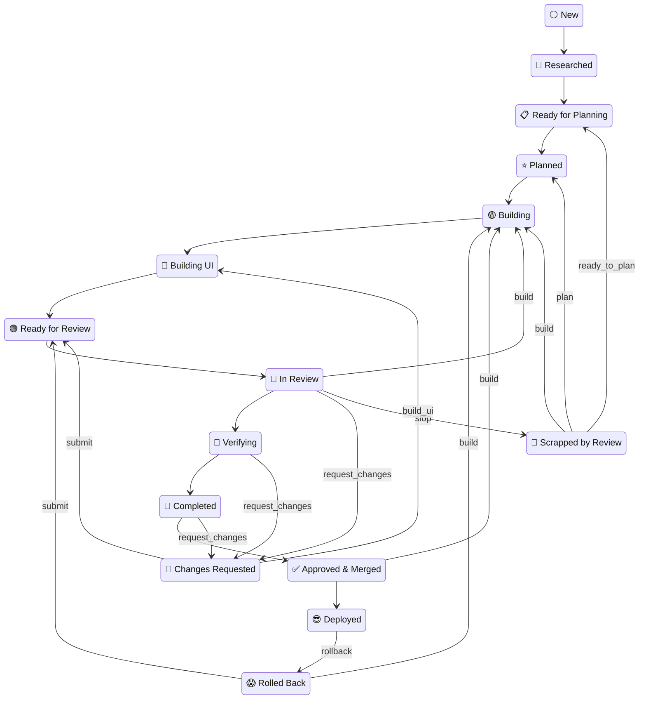
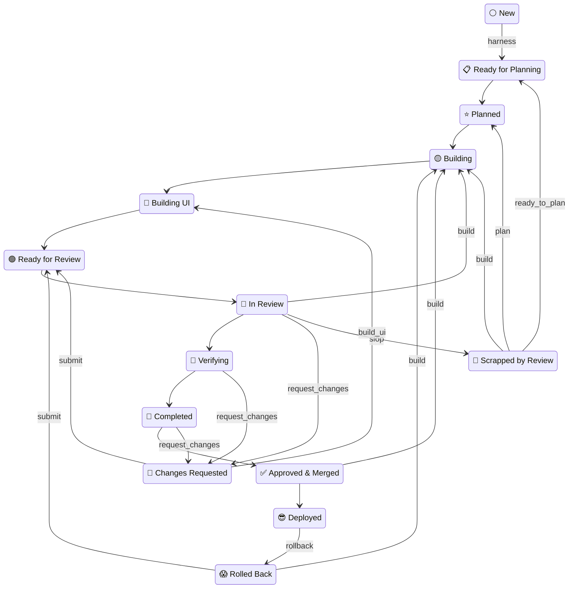
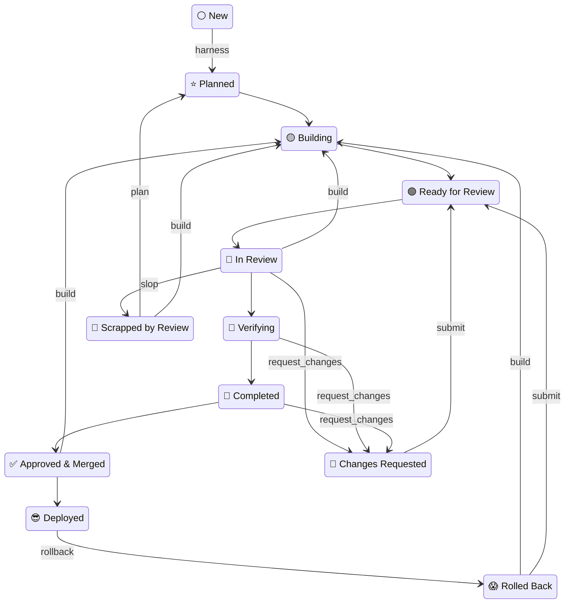

<!-- generated-by: bin/wiki-gen -->

# States and Transitions

_Every state a plan can be in, the files each one requires, and the legal moves between them._

**Up:** [Core Concepts](Core-Concepts.md)

______________________________________________________________________

OpenLanes knows 23 states. The folder name carries the state's emoji, so renaming the folder is the transition. Every row below is read from `STATUSES` and the `aasm` block at generation time.

|     | Key                  | Label              | Requires                                 | Moved by                                                 | Terminal | Meaning                                                                                                                     |
| --- | -------------------- | ------------------ | ---------------------------------------- | -------------------------------------------------------- | -------- | --------------------------------------------------------------------------------------------------------------------------- |
| ⚪  | `new`                | New                | `spec.md`                                | `researcher`                                             | —        | a specification exists; it has not been planned yet                                                                         |
| 🔎  | `researched`         | Researched         | `spec.md`                                | `spec-writer`                                            | —        | the topic has been researched; `spec.md` carries a `## Research` chapter                                                    |
| 📋  | `ready_for_planning` | Ready for Planning | `spec.md`, `plan.md`                     | `planner`                                                | —        | the specification is finished; `plan.md` exists and is still blank, waiting for the planner                                 |
| ⭐  | `planned`            | Planned            | `spec.md`, `plan.md`                     | `backend-coder`, `chores-coder`, `frontend-coder`        | —        | specified and planned; nobody has started building                                                                          |
| 🟡  | `building`           | Building           | `spec.md`, `plan.md`                     | `backend-coder`, `chores-coder`, `frontend-coder`        | —        | the back end is under way: data, domain and the API the interface will call                                                 |
| 🎨  | `building_ui`        | Building UI        | `spec.md`, `plan.md`                     | `frontend-coder`                                         | —        | the back end holds; the interface is being built against it                                                                 |
| 🟢  | `ready_for_review`   | Ready for Review   | `spec.md`, `plan.md`, `pull-requests.md` | `design-reviewer`, `security-reviewer`, `staff-reviewer` | —        | every pull request is green on CI and waiting for a reviewer                                                                |
| 👀  | `in_review`          | In Review          | `spec.md`, `plan.md`, `pull-requests.md` | `design-reviewer`, `security-reviewer`, `staff-reviewer` | —        | a reviewer has picked it up and has not ruled yet                                                                           |
| 🧪  | `verifying`          | Verifying          | `spec.md`, `plan.md`, `pull-requests.md` | `verifier`                                               | —        | the review approved it; verifier runs the app through How to test before anything merges                                    |
| 🏁  | `completed`          | Completed          | `spec.md`, `plan.md`, `pull-requests.md` | `deploy-assessor`                                        | —        | every pull request is `ready-to-merge`; deploy-assessor weighs each, and they merge one at a time                           |
| 🔴  | `rejected`           | Changes Requested  | `spec.md`, `plan.md`, `pull-requests.md` | `backend-coder`, `chores-coder`, `frontend-coder`        | —        | the review asked for fixes; resubmit once they are made                                                                     |
| ✅  | `approved`           | Approved & Merged  | `pull-requests.md`                       | _a human_                                                | —        | reviewed, approved, and every pull request merged                                                                           |
| 😎  | `deployed`           | Deployed           | `deployed.md`                            | _a human_                                                | —        | live in production; `deployed.md` names the release, date and SHA                                                           |
| 😱  | `rolled_back`        | Rolled Back        | `rollback.md`                            | _a human_                                                | —        | it shipped and was pulled; `rollback.md` names what broke                                                                   |
| 🚫  | `rewrite`            | Scrapped by Review | `rewrite.md`                             | _a human_                                                | —        | the review scrapped the work; the plan survives, the pull requests do not                                                   |
| ⭕  | `blocked`            | Technical Block    | `blocked.md`                             | `unblocker`                                              | —        | cannot proceed; `blocked.md` names what an engineer or the CTO must decide                                                  |
| 🛑  | `product_blocked`    | Product Block      | `blocked.md`                             | `unblocker`                                              | —        | cannot proceed; `blocked.md` names what a product manager must decide                                                       |
| 💣  | `bomb`               | Bomb               | `blocked.md`                             | `unblocker`                                              | —        | blocked too long while other plans depend on it; the run halts until a human answers                                        |
| 💤  | `deferred`           | Deferred           | `delayed.md`                             | _a human_                                                | —        | could proceed and chose not to yet; `delayed.md` must name the trigger                                                      |
| ⏪  | `retroactive`        | Retroactive        | —                                        | `spec-writer`                                            | —        | the feature is live, but has neither a specification nor a plan                                                             |
| 👎  | `abandoned`          | Abandoned          | —                                        | _a human_                                                | —        | work stopped with no decision to cancel it; it might be resumed. `abandoned-reason.md` says why                             |
| ❌  | `discarded`          | Discarded          | —                                        | _a human_                                                | —        | decided against and kept as a record; `discarded-reason.md` says why                                                        |
| 🚮  | `trashed`            | Trashed            | —                                        | _a human_                                                | yes      | removed from the workspace: done elsewhere, never happening, or conflicting. `trashed-reason.md` says why. A terminal state |

Read from [`lib/openlanes/plans/status.rb`](https://github.com/kigster/openlanes/blob/main/lib/openlanes/plans/status.rb), [`lib/openlanes/plans/state_machine.rb`](https://github.com/kigster/openlanes/blob/main/lib/openlanes/plans/state_machine.rb) and the `handles:` frontmatter in `agents/*.md`.

## Lifecycle diagrams

______________________________________________________________________

> [!IMPORTANT]
> **This file is auto generated.** Please do not edit this file manually.

______________________________________________________________________

> [!NOTE]
> To regenerate it, run `ol docs --output <file>`; without `--output`
> it prints to STDOUT (and you can use `-o` as a short flag).
>
> A common place to keep this file is in your `.plans/README.md` file.
>
> If you are contributing to the gem, and especially after changing the state
> machine, please run `just update-workflow` to update this document.

______________________________________________________________________

Every project keeps its specs and plans in a `.plans/` directory at its root.
This directory, like many other configuration parameters, can be set to a different location
by an environment variable, for instance `.plans` can be set by `$PLANS_DIR`. However, in the
case of OpenLanes, we strongly suggest that you keep your plans folder committed into your
version control system, especially if more than one person is working on the project.

Each medium-to-large feature gets one folder, and the folder's **name includes its
state**: the number identifies it forever, the emoji says what phase it is in,
and the slug says what it is, acting as a kebab-case title of the feature.

A feature takes one of three paths, chosen by `starts:` in its `spec.md`
(`research`, `planning`, `building`; the default is the project's `.openlanes.yml`).

| Starts       | Path                                                                                                                                                                                               | The harness writes   |
| :----------- | :------------------------------------------------------------------------------------------------------------------------------------------------------------------------------------------------- | :------------------- |
| **research** | ⚪ New → 🔎 Researched → 📋 Ready for Planning → ⭐ Planned → 🟡 Building → 🎨 Building UI → 🟢 Ready for Review → 👀 In Review → 🧪 Verifying → 🏁 Completed → ✅ Approved & Merged → 😎 Deployed | —                    |
| **planning** | ⚪ New → 📋 Ready for Planning → ⭐ Planned → 🟡 Building → 🎨 Building UI → 🟢 Ready for Review → 👀 In Review → 🧪 Verifying → 🏁 Completed → ✅ Approved & Merged → 😎 Deployed                 | a blank `plan.md`    |
| **building** | ⚪ New → ⭐ Planned → 🟡 Building → 🟢 Ready for Review → 👀 In Review → 🧪 Verifying → 🏁 Completed → ✅ Approved & Merged → 😎 Deployed                                                          | a one-unit `plan.md` |

`research` walks the spine from ⚪ New to 😎 Deployed. `planning` and
`building` are created at ⚪ New and moved to 📋 Ready for Planning and ⭐ Planned,
and the harness writes the file in the last column so that state's invariant
holds. A state further along is left off a path when no agent serving it
handles the state and one that does advances past it.

The arrows that leave a path are how a plan comes back. 🔴 Changes Requested is
where a review, a verification or a finished plan asks for changes, and the
next arrow puts it back with the builders. A looser review can send
👀 In Review straight back to 🟡 Building. 🚫 Scrapped by Review sends
the work back to be planned again. 😱 Rolled Back returns a bad release
to the build. A block, a deferral or a discard can leave from almost anywhere;
those edges are in the machine diagram below.

#### Starts at `research`

##### The Happy Path

  
<h5>Expand to see this flow complete with failure states</h5>

### Starts at `planning`

#### The Happy Path

  
<h5>Expand to see this flow complete with failure states</h5>

#### Starts at `building`

##### The Happy Path

  
<h5>Expand to see this flow complete with failure states</h5>

Those files are not paperwork. They are what the tool checks: a folder may not
claim a state whose file is missing, and `openlanes resync dirs` renames
any folder whose emoji its contents do not support. The file each state
requires is in the table below.

Lifted verbatim from the output of `openlanes docs`, generated from [`lib/openlanes/plans/status.rb`](https://github.com/kigster/openlanes/blob/main/lib/openlanes/plans/status.rb) and [`lib/openlanes/plans/state_machine.rb`](https://github.com/kigster/openlanes/blob/main/lib/openlanes/plans/state_machine.rb).

## The states

| Symbol | Meaning                | Key                  | Files required                           | Description                                                                                                                 |
| :----: | :--------------------- | :------------------- | :--------------------------------------- | :-------------------------------------------------------------------------------------------------------------------------- |
|   ⚪   | **New**                | `new`                | `spec.md`                                | a specification exists; it has not been planned yet                                                                         |
|   🔎   | **Researched**         | `researched`         | `spec.md`                                | the topic has been researched; `spec.md` carries a `## Research` chapter                                                    |
|   📋   | **Ready for Planning** | `ready_for_planning` | `spec.md`, `plan.md`                     | the specification is finished; `plan.md` exists and is still blank, waiting for the planner                                 |
|   ⭐   | **Planned**            | `planned`            | `spec.md`, `plan.md`                     | specified and planned; nobody has started building                                                                          |
|   🟡   | **Building**           | `building`           | `spec.md`, `plan.md`                     | the back end is under way: data, domain and the API the interface will call                                                 |
|   🎨   | **Building UI**        | `building_ui`        | `spec.md`, `plan.md`                     | the back end holds; the interface is being built against it                                                                 |
|   🟢   | **Ready for Review**   | `ready_for_review`   | `spec.md`, `plan.md`, `pull-requests.md` | every pull request is green on CI and waiting for a reviewer                                                                |
|   👀   | **In Review**          | `in_review`          | `spec.md`, `plan.md`, `pull-requests.md` | a reviewer has picked it up and has not ruled yet                                                                           |
|   🧪   | **Verifying**          | `verifying`          | `spec.md`, `plan.md`, `pull-requests.md` | the review approved it; verifier runs the app through How to test before anything merges                                    |
|   🏁   | **Completed**          | `completed`          | `spec.md`, `plan.md`, `pull-requests.md` | every pull request is `ready-to-merge`; deploy-assessor weighs each, and they merge one at a time                           |
|   🔴   | **Changes Requested**  | `rejected`           | `spec.md`, `plan.md`, `pull-requests.md` | the review asked for fixes; resubmit once they are made                                                                     |
|   ✅   | **Approved & Merged**  | `approved`           | `pull-requests.md`                       | reviewed, approved, and every pull request merged                                                                           |
|   😎   | **Deployed**           | `deployed`           | `deployed.md`                            | live in production; `deployed.md` names the release, date and SHA                                                           |
|   😱   | **Rolled Back**        | `rolled_back`        | `rollback.md`                            | it shipped and was pulled; `rollback.md` names what broke                                                                   |
|   🚫   | **Scrapped by Review** | `rewrite`            | `rewrite.md`                             | the review scrapped the work; the plan survives, the pull requests do not                                                   |
|   ⭕   | **Technical Block**    | `blocked`            | `blocked.md`                             | cannot proceed; `blocked.md` names what an engineer or the CTO must decide                                                  |
|   🛑   | **Product Block**      | `product_blocked`    | `blocked.md`                             | cannot proceed; `blocked.md` names what a product manager must decide                                                       |
|   💣   | **Bomb**               | `bomb`               | `blocked.md`                             | blocked too long while other plans depend on it; the run halts until a human answers                                        |
|   💤   | **Deferred**           | `deferred`           | `delayed.md`                             | could proceed and chose not to yet; `delayed.md` must name the trigger                                                      |
|   ⏪   | **Retroactive**        | `retroactive`        | —                                        | the feature is live, but has neither a specification nor a plan                                                             |
|   👎   | **Abandoned**          | `abandoned`          | —                                        | work stopped with no decision to cancel it; it might be resumed. `abandoned-reason.md` says why                             |
|   ❌   | **Discarded**          | `discarded`          | —                                        | decided against and kept as a record; `discarded-reason.md` says why                                                        |
|   🚮   | **Trashed**            | `trashed`            | —                                        | removed from the workspace: done elsewhere, never happening, or conflicting. `trashed-reason.md` says why. A terminal state |

"Files required" is a **minimum**, not an exact match: a ⚪ folder that
has grown a `plan.md` still satisfies ⚪, and is ⭐ anyway. That is
why `resync dirs` moves a folder to the furthest state its contents justify
rather than only fixing outright lies.

Some states share their requirements on purpose, and are told apart only by the
folder name. ⭕ Technical Block and 🛑 Product Block both mean "a human must
decide before this can move"; *which* human is recorded nowhere but the emoji.
⭐ 🟡 🎨 🟢 👀 🧪 🏁 🔴 all mean "the work exists and pull requests are open"; whether
anyone has started reviewing is written down nowhere either.

So nothing re-derives one of them from a folder's contents — otherwise every
⭕ would silently become 🛑 the first time anything resynced. A folder
falling back into that group from outside lands on its weakest member,
⭐ Planned, because that is all its contents can prove.

🟣 Merged is deliberately **not** a folder state. It describes a pull request, and a folder that claimed it would be claiming a pull request's condition as its own.

Lifted verbatim from the output of `openlanes docs`, generated from [`lib/openlanes/plans/status.rb`](https://github.com/kigster/openlanes/blob/main/lib/openlanes/plans/status.rb) and [`lib/openlanes/plans/state_machine.rb`](https://github.com/kigster/openlanes/blob/main/lib/openlanes/plans/state_machine.rb).

## Transitions

| From                  | May become                          | `promote` goes to     |
| :-------------------- | :---------------------------------- | :-------------------- |
| ⚪ New                | 🔎 📋 ⭐ ⭕ 🛑 💤 👎 ❌ 🚮          | 🔎 Researched         |
| 🔎 Researched         | 📋 ⭐ ⭕ 🛑 💤 👎 ❌ 🚮             | 📋 Ready for Planning |
| 📋 Ready for Planning | ⭐ ⭕ 🛑 💤 👎 ❌ 🚮                | ⭐ Planned            |
| ⭐ Planned            | 🟡 ⭕ 🛑 💤 👎 ❌ 🚮                | 🟡 Building           |
| 🟡 Building           | 🎨 🟢 ⭕ 🛑 💤 👎 ❌ 🚮             | 🎨 Building UI        |
| 🎨 Building UI        | 🟢 ⭕ 🛑 💤 👎 ❌ 🚮                | 🟢 Ready for Review   |
| 🟢 Ready for Review   | 👀 👎 ❌ 🚮                         | 👀 In Review          |
| 👀 In Review          | 🟡 🧪 ✅ 🔴 🚫 👎 ❌ 🚮             | 🧪 Verifying          |
| 🧪 Verifying          | 🏁 ✅ 🔴 👎 ❌ 🚮                   | 🏁 Completed          |
| 🏁 Completed          | ✅ 🔴 👎 ❌ 🚮                      | ✅ Approved & Merged  |
| 🔴 Changes Requested  | 🎨 🟢 ⭕ 🛑 💤 👎 ❌ 🚮             | 🎨 Building UI        |
| ✅ Approved & Merged  | 🟡 😎 👎 ❌ 🚮                      | 😎 Deployed           |
| 😎 Deployed           | 😱 👎 ❌ 🚮                         | —                     |
| 😱 Rolled Back        | 🟡 🟢 👎 ❌ 🚮                      | 🟢 Ready for Review   |
| 🚫 Scrapped by Review | 📋 ⭐ 🟡 👎 ❌ 🚮                   | ⭐ Planned            |
| ⭕ Technical Block    | ⚪ 🔎 📋 ⭐ 🟡 💣 💤 👎 ❌ 🚮       | —                     |
| 🛑 Product Block      | ⚪ 🔎 📋 ⭐ 🟡 💣 💤 👎 ❌ 🚮       | —                     |
| 💣 Bomb               | ⚪ 🔎 📋 ⭐ 🟡 ⭕ 🛑 👎 ❌ 🚮       | —                     |
| 💤 Deferred           | ⚪ 🔎 📋 ⭐ 🟡 👎 ❌ 🚮             | —                     |
| ⏪ Retroactive        | ⚪ 🔎 📋 ⭐ 🟡 ✅ ⭕ 🛑 💤 👎 ❌ 🚮 | ⭐ Planned            |
| 👎 Abandoned          | ❌ 🚮                               | —                     |
| ❌ Discarded          | 🚮                                  | —                     |
| 🚮 Trashed            | _terminal_                          | —                     |

A bare promote walks the **spine** — spec → plan → build. Everything off it
(blocking, deferring, rejecting) has to be named explicitly. That is the whole
reason there is a machine here rather than a rename: a transition is refused
when the destination's requirements are not already met, and that refusal is
information — it means the phase has not actually happened yet.

```mermaid
---
config:
  layout: dagre
  theme: redux-color
---
stateDiagram-v2
    direction TB
    new : ⚪ New
    researched : 🔎 Researched
    ready_for_planning : 📋 Ready for Planning
    planned : ⭐ Planned
    building : 🟡 Building
    building_ui : 🎨 Building UI
    ready_for_review : 🟢 Ready for Review
    in_review : 👀 In Review
    verifying : 🧪 Verifying
    completed : 🏁 Completed
    rejected : 🔴 Changes Requested
    approved : ✅ Approved & Merged
    deployed : 😎 Deployed
    rolled_back : 😱 Rolled Back
    rewrite : 🚫 Scrapped by Review
    blocked : ⭕ Technical Block
    product_blocked : 🛑 Product Block
    bomb : 💣 Bomb
    deferred : 💤 Deferred
    retroactive : ⏪ Retroactive
    abandoned : 👎 Abandoned
    discarded : ❌ Discarded
    trashed : 🚮 Trashed

    retroactive --> new
    blocked --> new
    product_blocked --> new
    bomb --> new
    deferred --> new
    new --> researched
    retroactive --> researched
    blocked --> researched
    product_blocked --> researched
    bomb --> researched
    deferred --> researched
    researched --> ready_for_planning
    new --> ready_for_planning
    retroactive --> ready_for_planning
    rewrite --> ready_for_planning
    blocked --> ready_for_planning
    product_blocked --> ready_for_planning
    bomb --> ready_for_planning
    deferred --> ready_for_planning
    ready_for_planning --> planned
    researched --> planned
    new --> planned
    retroactive --> planned
    rewrite --> planned
    blocked --> planned
    product_blocked --> planned
    bomb --> planned
    deferred --> planned
    planned --> building
    rewrite --> building
    approved --> building
    rolled_back --> building
    retroactive --> building
    blocked --> building
    product_blocked --> building
    bomb --> building
    deferred --> building
    in_review --> building
    building --> building_ui
    rejected --> building_ui
    building --> ready_for_review
    building_ui --> ready_for_review
    rejected --> ready_for_review
    rolled_back --> ready_for_review
    ready_for_review --> in_review
    in_review --> verifying
    verifying --> completed
    in_review --> approved
    verifying --> approved
    completed --> approved
    retroactive --> approved
    in_review --> rejected
    verifying --> rejected
    completed --> rejected
    in_review --> rewrite
    approved --> deployed
    deployed --> rolled_back
    new --> blocked
    researched --> blocked
    retroactive --> blocked
    ready_for_planning --> blocked
    planned --> blocked
    building --> blocked
    building_ui --> blocked
    rejected --> blocked
    bomb --> blocked
    new --> product_blocked
    researched --> product_blocked
    retroactive --> product_blocked
    ready_for_planning --> product_blocked
    planned --> product_blocked
    building --> product_blocked
    building_ui --> product_blocked
    rejected --> product_blocked
    bomb --> product_blocked
    blocked --> bomb
    product_blocked --> bomb
    new --> deferred
    researched --> deferred
    retroactive --> deferred
    ready_for_planning --> deferred
    planned --> deferred
    building --> deferred
    building_ui --> deferred
    rejected --> deferred
    blocked --> deferred
    product_blocked --> deferred
    new --> abandoned
    researched --> abandoned
    ready_for_planning --> abandoned
    planned --> abandoned
    building --> abandoned
    building_ui --> abandoned
    ready_for_review --> abandoned
    in_review --> abandoned
    verifying --> abandoned
    completed --> abandoned
    rejected --> abandoned
    approved --> abandoned
    deployed --> abandoned
    rolled_back --> abandoned
    rewrite --> abandoned
    blocked --> abandoned
    product_blocked --> abandoned
    bomb --> abandoned
    deferred --> abandoned
    retroactive --> abandoned
    new --> discarded
    researched --> discarded
    ready_for_planning --> discarded
    planned --> discarded
    building --> discarded
    building_ui --> discarded
    ready_for_review --> discarded
    in_review --> discarded
    verifying --> discarded
    completed --> discarded
    rejected --> discarded
    approved --> discarded
    deployed --> discarded
    rolled_back --> discarded
    rewrite --> discarded
    blocked --> discarded
    product_blocked --> discarded
    bomb --> discarded
    deferred --> discarded
    retroactive --> discarded
    abandoned --> discarded
    new --> trashed
    researched --> trashed
    ready_for_planning --> trashed
    planned --> trashed
    building --> trashed
    building_ui --> trashed
    ready_for_review --> trashed
    in_review --> trashed
    verifying --> trashed
    completed --> trashed
    rejected --> trashed
    approved --> trashed
    deployed --> trashed
    rolled_back --> trashed
    rewrite --> trashed
    blocked --> trashed
    product_blocked --> trashed
    bomb --> trashed
    deferred --> trashed
    retroactive --> trashed
    abandoned --> trashed
    discarded --> trashed
```

Mermaid source for the diagram above 

Lifted verbatim from the output of `openlanes docs`, generated from [`lib/openlanes/plans/status.rb`](https://github.com/kigster/openlanes/blob/main/lib/openlanes/plans/status.rb) and [`lib/openlanes/plans/state_machine.rb`](https://github.com/kigster/openlanes/blob/main/lib/openlanes/plans/state_machine.rb).

______________________________________________________________________

## Sources

Generated by [`bin/wiki-gen`](https://github.com/kigster/openlanes/blob/main/bin/wiki-gen) v2.0.0 at the commit of 2026-11-07, from:

- [`lib/openlanes/plans/status.rb`](https://github.com/kigster/openlanes/blob/main/lib/openlanes/plans/status.rb)
- [`lib/openlanes/plans/state_machine.rb`](https://github.com/kigster/openlanes/blob/main/lib/openlanes/plans/state_machine.rb)
- [`lib/openlanes/plans/ordinal.rb`](https://github.com/kigster/openlanes/blob/main/lib/openlanes/plans/ordinal.rb)
- [`lib/openlanes/presentation/documentation.rb`](https://github.com/kigster/openlanes/blob/main/lib/openlanes/presentation/documentation.rb)
